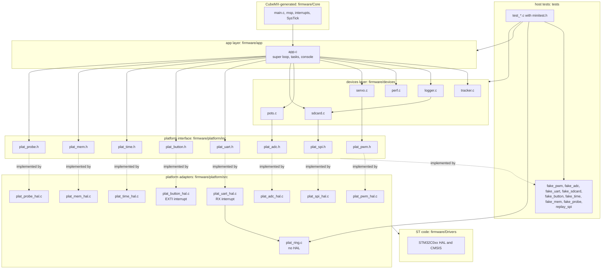

# Architecture

Heliostat controller: NUCLEO-C031C6 / STM32C031C6, simulated in Wokwi. This document describes the layers of
the firmware, the rule between them, how the rule is checked, how the firmware runs (the super loop and the
interrupts, section 3), how the host tests reach the code and the versions of the tools. Pins and bus parameters are
in [pinout.md](pinout.md); the logic-analyzer evidence of LR2 is in [captures/analysis.md](captures/analysis.md). The
tasks and their deadlines are in [tasks.md](tasks.md); how the timing is measured is in
[instrumentation.md](instrumentation.md); where the loop reaches its limits is in [limitations.md](limitations.md).

## 1. Component diagram



Solid arrows are build-time dependencies (an `#include` and calls). Dotted arrows mean "implemented by".
Only the platform adapters and the CubeMX-generated `Core/` include ST headers. The same interface headers are
implemented by the adapters on the board and by the fakes on the host, so the driver and application code is the same
in both builds. `tracker.c` and `perf.c` need no platform interface at all (they are plain arithmetic on values the
application passes in), `logger.c` reaches the card only through `sdcard.h`, and the receive ring `plat_ring.c` holds no
HAL call, so the host builds it unchanged (`test_ring.c`). The interrupt handlers `USART2_IRQHandler` and
`EXTI4_15_IRQHandler` live in their adapters; `SysTick_Handler` is the CubeMX one in `Core/Src/stm32c0xx_it.c`.

## 2. Layers and dependency rules

| Layer | Directory | May include | Must not include |
|---|---|---|---|
| platform interface | `firmware/platform/inc` | headers of `platform/inc` | vendor headers (`stm32*`, `core_cm*`, `cmsis*`, `arm_*`) |
| platform adapters | `firmware/platform/src` | HAL through `main.h`, `platform/inc` | any header of `devices/inc` or `app/inc` |
| devices | `firmware/devices` | `devices/inc`, `platform/inc` | vendor headers |
| app | `firmware/app` | `app/inc`, `devices/inc`, `platform/inc` | vendor headers |

`scripts/check_deps.sh` reads every `#include` of the four layer directories (34 files at the time of writing),
prints each violation and exits with status 1. It is the first half of `make check` and runs in CI on every push and
pull request. A deliberate violation (a device including an ST header) makes it fail; this was checked and is
documented in the report.

## 3. Components

### 3.1 Modules

| Component | Files | Responsibility | Depends on | Tests |
|---|---|---|---|---|
| app | `app/src/app.c`, `app/inc/app.h` | the super loop `app_poll`, the tasks (sense and track, log flush, stow button, console), the boot self-test with five checks (format in [selftest-format.md](selftest-format.md)), the line console (line limit 48 characters), the statistics and the `STAT` and `EVT` lines | tracker, logger, perf, servo, pots, sdcard, `plat_*.h` | `test_app.c`: 140 tests, 639 checks |
| tracker | `devices/src/tracker.c` | the tracking decision: the error of each axis from the four raw values, a dead zone (default 100), a step of 1 degree per run, the end stops 0..180, the night park after 20 dark runs, the stow state, the zero position | none | `test_tracker.c`: 29 tests, 183 checks |
| logger | `devices/src/logger.c` | 32-byte log records, a 512-byte block buffer, the flush rule (block full or 10 s old), the retry after a failed write, the read-back of record `n` with its checksum; blocks 8192..12287 of the card | sdcard | `test_logger.c`: 18 tests, 356 checks |
| perf | `devices/src/perf.c` | the statistics (count, min, max, sum), a 32-bit millisecond clock built from differences of the cycle counter, so it keeps counting through the wrap of that counter every 357.9 s; conversion of cycles to microseconds | none | `test_perf.c`: 17 tests, 52 checks |
| servo | `devices/src/servo.c` | angle 0..180 degrees to a pulse of 1000..2000 us | `plat_pwm.h` | `test_servo.c`: 7 tests, 33 checks |
| pots | `devices/src/pots.c` | four raw ADC values to millivolts and percent | `plat_adc.h` | `test_pots.c`: 8 tests, 41 checks |
| sdcard | `devices/src/sdcard.c` | SPI-mode initialisation (CMD0, CMD8, ACMD41, CMD58), single-block read (CMD17) and write (CMD24), boot signature check | `plat_spi.h` | `test_sdcard.c`: 34 tests, 171 checks; `test_sd_replay.c`: 5 tests, 45 checks |
| platform interfaces | `platform/inc/plat_*.h` | the contract between the logic and the board; one status type `plat_status_t` (OK, ARG, TIMEOUT, BUS) | none | through the fakes |
| ADC adapter | `plat_adc_hal.c` | one conversion per call (the sequencer is reconfigured for one channel); PB3 high during the call, the timing marker on logic analyzer channel D7 | HAL | not host-testable |
| PWM adapter | `plat_pwm_hal.c` | TIM3 prescaler and period set at run time from the PCLK1 frequency (1 us tick, 20 ms period), pulse width in us | HAL | not host-testable |
| SPI adapter | `plat_spi_hal.c` | SPI1 mode 0, 375 kHz or 6 MHz, chip select on PB9, transfers in chunks of 32 bytes | HAL | not host-testable |
| UART adapter | `plat_uart_hal.c` | USART2 transmit by polling, receive by interrupt into a 256-byte ring, a read with a timeout, the counters of the ring (bytes, dropped, highest fill, errors) | HAL, ring | ring: `test_ring.c`; the rest not host-testable |
| ring | `plat_ring.c`, `plat_ring.h` | single-producer single-consumer byte ring of 256 bytes without HAL calls | none | `test_ring.c`: 8 tests, 870 checks |
| button adapter | `plat_button_hal.c` | PB5 as a falling-edge interrupt (EXTI line 5): the handler counts the edges and keeps the time of the first one; `plat_button_take` hands both to the loop and clears them | HAL | through `fake_button` |
| time adapter | `plat_time_hal.c` | the 32-bit cycle counter built from the SysTick tick count, the SysTick down-counter and its pending flag (the Cortex-M0+ has no DWT); the read costs 88 cycles | HAL | the arithmetic `plat_time_compose` in `test_perf.c` |
| memory adapter | `plat_mem_hal.c` | paints the unused stack with a pattern at start and reports the highest used depth and the heap use | HAL, linker symbols | through `fake_mem` |
| probe adapter | `plat_probe_hal.c`, `probe_pins.h` | the service pins PB4 (T2), PB7 (event) and PB6 (loop busy) for the logic analyzer | HAL | through `fake_probe` |
| Core | `firmware/Core` (CubeMX) | clock, peripheral initialisation, interrupt vectors, SysTick; hand-written code only inside USER CODE blocks | HAL, app | none |

The tests count 2390 checks in 266 tests at the time of writing (9 programs, `make test`). Coverage is measured for the
devices and app layers only (see section 6): 99.21 % of the lines (1130 of 1139) and 97.99 % of the branches; the
adapters are excluded because they cannot run on the host. A longer host run, `tests/soak.sh`, replays two hours of
virtual time of the nominal scenario against the real `app.c` (result in [metrics/soak.txt](metrics/soak.txt)).

### 3.2 The super loop

`main()` in `Core/Src/main.c` initialises the HAL and the peripherals, prints the banner, runs `app_init`,
`app_selftest` and `app_start`, and then calls `app_poll(&app)` forever. Nothing else runs outside the interrupts.
`app_poll` is four calls in a fixed order, and every call returns at once if it has nothing to do:

```text
while (1) {
    button_poll();     E1   the stow request: act on the edge stamped by the EXTI interrupt
    track_poll();      T1-T3, T5   when the 50 ms grid says so: sense, track, park; then flush the log if due
    load_poll();       only while the `load` command is active (measurement aid)
    console_poll();    T4   wait up to 5 ms for one byte; at a line end run the command
}
```

| Task | Function | Run when | Deadline ([tasks.md](tasks.md)) |
|---|---|---|---|
| T1 sense | `track_task` (`pots_read_all`) | start of every T2 run | finished within 5 ms of its start |
| T2 track | `track_due`, `track_task`, `tracker_update`, `apply_servos` | every 50 ms on an absolute grid (the next time is `track_next`, advanced by one period, so a late run does not shift the grid; skipped periods are counted in `missed`) | servo pulse updated within 25 ms of the nominal release |
| T3 park | inside `tracker_update` | 20 dark runs in a row, about 1 s | park command at most 1.1 s after the light goes out |
| T4 console | `console_poll`, `run_line` | one byte per pass | no byte lost; reply within 100 ms of the line end |
| T5 log | `log_poll`, `logger_flush` | after a T2 run that moved a servo, when a block is full or 10 s old; the write blocks the loop for about 13 ms | a block written within 10 s of its first record |
| T6 self-test | `app_selftest` | once after reset | main loop running within 1 s |
| E1 stow | `button_poll`, `tracker_stow` | after a falling edge on PB5; a second edge inside 200 ms is ignored | servo write within 10 ms of the edge |

The worst reaction to an event is the time since the loop last returned to `button_poll`: the longest stretch of the
loop that does not return to it, plus one pass of the checks. The stretches are the 5 ms wait for a byte in
`console_poll`, a T2 run, a block write to the card (about 13.5 ms) and the polled transmission of a reply
(93.9 us per byte). Limitations 1 and 2 of [limitations.md](limitations.md) are this sum, measured.

### 3.3 Interrupts and shared data

| Interrupt | Priority | Handler | What it does | Shared with the loop |
|---|---|---|---|---|
| EXTI4_15 (button PB5) | 0 (highest) | `EXTI4_15_IRQHandler` in `plat_button_hal.c` | counts the edges, keeps the cycle count of the first edge | `edge_count`, `edge_first`; the loop reads and clears both inside a critical section (`plat_button_take`) |
| USART2 (receive) | 1 | `USART2_IRQHandler` in `plat_uart_hal.c` | moves the received byte into the 256-byte ring, counts bytes, drops and receive errors | the ring: the handler writes, the loop reads; the counters are read by `stats` |
| SysTick | 3 (lowest) | `SysTick_Handler` (CubeMX) | increments the millisecond tick `uwTick` | the time adapter reads the tick, the down-counter and the pending flag until two reads agree |

The button interrupt has the highest priority, so it can interrupt the receive handler and the time stamp of the edge is never delayed by it. The
receive handler is short (about 143 cycles on average), so a byte can wait for the loop for at most the longest
blocking stretch, and the ring (256 bytes, 22.2 ms of full-speed input) absorbs it. When the stretch is longer than the
ring holds, bytes are lost: limitation 4. The transmit side has no interrupt; `plat_uart_write` waits for each byte.

### 3.4 Memory

The linker report of the final build is in [metrics/memory.txt](metrics/memory.txt): flash 31708 B of 32768 B (96.77 %),
RAM 3832 B of 12288 B (31.18 %), heap 0 B in every scenario (the application, device and platform code never calls
`malloc`). The linker script reserves 1024 B of stack and 512 B of heap. The stack is measured by painting the unused
stack with a pattern at start: 940 B used at most, against a static worst case of 1016 B for the deepest call chain,
which leaves 8 B to the reserve (limitation 8). The memory adapter reports the measured depth and the heap use in the
`STAT mem` line.

## 4. Where pins and handles live

The peripheral handles (`hadc1`, `hspi1`, `htim3`, `huart2`) are created by CubeMX in `Core/` and used only by the
adapters through `extern`. The pins that CubeMX does not configure for a peripheral are named at the top of the
adapter that owns them: the chip select PB9 (`CS_PORT`, `CS_PIN`) in `plat_spi_hal.c`, the ADC marker PB3 in
`plat_adc_hal.c`, the button PB5 in `plat_button_hal.c` and the three service pins PB4, PB6 and PB7 in `probe_pins.h`
(configured by `plat_probe_init`). The alternate-function pins are configured by CubeMX in `stm32c0xx_hal_msp.c`. The table in
[pinout.md](pinout.md) is the single index of all of them. The knowledge is therefore in one layer, not in one file:
each adapter owns the handle and the pin of its own peripheral, so an adapter can be read, replaced or faked on its
own, and `devices/` and `app/` contain no pin or handle at all (enforced by the rule in section 2).

## 5. CubeMX regeneration

- Generated and replaced on every regeneration: `firmware/Makefile`, the `Core/` files outside USER CODE blocks,
  the startup file and the linker script. Their source is `firmware.ioc`.
- Written by hand: `platform/`, `devices/`, `app/`, `firmware/build.mk` and five USER CODE blocks of
  `Core/Src/main.c` (the includes of `plat_uart.h`, `plat_mem.h` and `app.h`, the static `app_t`, `plat_mem_init` as the
  first statement, the banner with `app_init`, `app_selftest` and `app_start`, and `app_poll` in the main loop). The
  SysTick priority 3 is the CubeMX value `TICK_INT_PRIORITY` in `stm32c0xx_hal_conf.h`; the priorities of the button
  and the receive interrupt are set by their adapters.
- `firmware/build.mk` includes the generated `Makefile` unchanged and appends the layer sources, include paths and
  objects. A new source file in a layer directory needs no change in it. The layers are compiled with
  `-Wall -Wextra -Werror`; the vendor code keeps its own flags.
- Values that the `.ioc` holds as placeholders (TIM3 prescaler 0 and period 65535) are overwritten in
  `plat_pwm_init()`, so a regeneration does not change the behaviour.
- Known issue of the generated code: `MX_GPIO_Init()` writes the level low to PB9 before it makes the pin an
  output, so the chip select is low from the start of the program until `plat_spi_init()` drives it high
  (section 8.2 of [captures/analysis.md](captures/analysis.md)). The fix is the CubeMX setting "GPIO output level:
  High" for PB9.

## 6. Build, tests, coverage, captures

| Command | What it does |
|---|---|
| `make build` | builds the Docker image from `docker/Dockerfile` and compiles the firmware in it (`make -C firmware -f build.mk all`) |
| `make flash` | runs the firmware in Wokwi and waits for the self-test line `SELFTEST END total=5 passed=5 failed=0` |
| `make check` | `make check-deps` and `make test` |
| `make test` | `tests/run.sh`: every program of the `TESTS` table is compiled with `-std=c11 -Wall -Wextra -Werror` against its fakes and run |
| `make coverage` | `tests/coverage.sh`: the same programs built with `--coverage`, line and branch coverage of the devices and app layers with gcov; fails below 90 % of lines |
| `make capture NAME=boot` | records one logic-analyzer capture (`scripts/capture.sh`, scenarios in `scenarios/`) |
| `scripts/decode_captures.sh` | decodes all captures and cross-checks them against sigrok-cli |
| `tests/soak.sh` | two hours of virtual time of the nominal scenario against the real `app.c` and the fakes |
| `tools/lr3_run.sh`, `tools/lr3_capture.sh` | run one LR3 scenario in Wokwi and report it, or record it with the logic analyzer ([instrumentation.md](instrumentation.md)) |
| `tools/lr3_regen.sh` | rebuilds every offline report in `docs/metrics/` from the committed logs and captures |

Test doubles are hand-written and share the interface of the adapter they replace:

| Fake | Replaces | What it can do |
|---|---|---|
| `fake_pwm` | `plat_pwm` | records the calls, fails on request |
| `fake_adc` | `plat_adc` | returns set raw values, fails on a chosen channel |
| `fake_uart` | `plat_uart` | collects the output, feeds input bytes and receive errors, returns the ring counters the test sets |
| `fake_button` | `plat_button` | delivers a press with a chosen time of the first edge, fails on request |
| `fake_time` | `plat_time` | a cycle counter that the test sets, or advances by a step at every read; the clock frequency can be set |
| `fake_mem` | `plat_mem` | returns the stack and heap figures the test sets, fails on request |
| `fake_probe` | `plat_probe` | records the pin changes in order |
| `fake_sdcard` | `plat_spi` | simulates an SD card in SPI mode: card version, capacity class, busy polls, wrong echo, error tokens, failing transfers |
| `replay_spi` | `plat_spi` | replays the bytes recorded by the logic analyzer (`tests/vectors/*.inc`, generated from `docs/captures/*.vcd` by `scripts/vcd_tool.py vectors`) and compares everything the driver sends with what the firmware sent |

The tests use a small macro header (`tests/minitest.h`) instead of Unity and CMock. What this gives up: there is no
mock generator, no automatic check of the order of calls beyond what each fake records itself, and no test
discovery: a test must be listed in its `RUN` list and a program in the `TESTS` table of `tests/run.sh`.

## 7. CI

`.github/workflows/lab2.yml` (the file keeps its LR2 name) runs on every push and every pull request. Job `host-tests`: `make check`, then
`make coverage` and the annotated sources as an artifact. Job `firmware`: `make build` in the Docker toolchain image,
a failure on any compiler warning, the memory use line, and the `.elf`, `.hex` and `.bin` as an artifact.

## 8. Tool versions

Read from the development machine and the repository on 2026-10-16 (LR2); not read again for LR3, in which the
toolchain did not change. The LR3 timing tools are Python scripts in `tools/` that use only the standard library.

| Tool | Version | Where it was read |
|---|---|---|
| Docker base image | `ubuntu:22.04` | `docker/Dockerfile` |
| ARM toolchain in the image | `gcc-arm-none-eabi` package 15:10.3-2021.07-4, GCC 10.3.1 20210621 | `.comment` section of `firmware.elf` |
| STM32CubeMX | 6.18.1 (database DB.6.0.181) | `firmware/firmware.ioc` |
| Firmware package | STM32Cube FW_C0 V1.4.1 (CMSIS device 1.4.1) | `firmware/firmware.ioc`, `stm32c0xx.h` |
| Host compiler for the tests | gcc 11.4.0 (Ubuntu 22.04); the CI job uses the gcc of the `ubuntu-latest` runner | `gcc --version` |
| Coverage | gcov 11.4.0 | `gcov --version` |
| Docker | 29.1.3 | `docker --version` |
| Wokwi CLI | 0.27.1 (ffde06bde1ae), simulation API 1.0.0-20261015-gabc7e34c | `wokwi-cli --version`, first lines of a run |
| Capture decoding | Python 3.10.12, sigrok-cli 0.7.2 | `python3 --version`, `sigrok-cli --version` |
| CI actions | `actions/checkout@v4`, `actions/upload-artifact@v4` | `.github/workflows/lab2.yml` |
