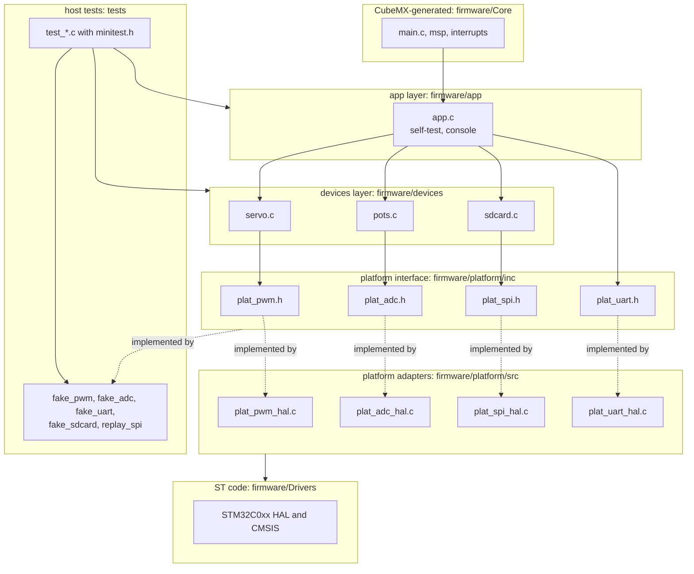

# Architecture

Heliostat controller: NUCLEO-C031C6 / STM32C031C6, simulated in Wokwi. This document describes the layers of
the firmware, the rule between them, how the rule is checked, how the host tests reach the code and the versions of
the tools. Pins and bus parameters are in [pinout.md](pinout.md); the logic-analyzer evidence is in
[captures/analysis.md](captures/analysis.md).

## 1. Component diagram

Solid arrows are build-time dependencies (an `#include` and calls). Dotted arrows mean "implemented by".
Only the platform adapters and the CubeMX-generated `Core/` include ST headers. The same interface headers are
implemented by the adapters on the board and by the fakes on the host, so the driver code is the same in both builds.

## 2. Layers and dependency rules

| Layer | Directory | May include | Must not include |
|---|---|---|---|
| platform interface | `firmware/platform/inc` | headers of `platform/inc` | vendor headers (`stm32*`, `core_cm*`, `cmsis*`, `arm_*`) |
| platform adapters | `firmware/platform/src` | HAL through `main.h`, `platform/inc` | any header of `devices/inc` or `app/inc` |
| devices | `firmware/devices` | `devices/inc`, `platform/inc` | vendor headers |
| app | `firmware/app` | `app/inc`, `devices/inc`, `platform/inc` | vendor headers |

`scripts/check_deps.sh` reads every `#include` of the four layer directories (17 files at the time of writing),
prints each violation and exits with status 1. It is the first half of `make check` and runs in CI on every push and
pull request. A deliberate violation (a device including an ST header) makes it fail; this was checked and is
documented in the report.

## 3. Components

| Component | Files | Responsibility | Depends on | Tests |
|---|---|---|---|---|
| app | `app/src/app.c`, `app/inc/app.h` | boot self-test with five checks (format in [selftest-format.md](selftest-format.md)); line console with `help`, `selftest`, `adc`, `servo`, `sd init`, `sd read`; line length limit of 48 characters | servo, pots, sdcard, `plat_uart.h` | `test_app.c`: 33 tests, 108 checks |
| servo | `devices/src/servo.c` | angle 0..180 degrees to a pulse of 1000..2000 us | `plat_pwm.h` | `test_servo.c`: 7 tests, 33 checks |
| pots | `devices/src/pots.c` | four raw ADC values to millivolts and percent | `plat_adc.h` | `test_pots.c`: 8 tests, 41 checks |
| sdcard | `devices/src/sdcard.c` | SPI-mode initialisation (CMD0, CMD8, ACMD41, CMD58), single-block read (CMD17), boot signature check | `plat_spi.h` | `test_sdcard.c`: 23 tests, 116 checks; `test_sd_replay.c`: 5 tests, 45 checks |
| platform interfaces | `platform/inc/plat_*.h` | the contract between the logic and the board; one status type `plat_status_t` (OK, ARG, TIMEOUT, BUS) | none | through the fakes |
| ADC adapter | `plat_adc_hal.c` | one conversion per call (the sequencer is reconfigured for one channel); PB3 high during the call, the timing marker on logic analyzer channel D7 | HAL | not host-testable |
| PWM adapter | `plat_pwm_hal.c` | TIM3 prescaler and period set at run time from the PCLK1 frequency (1 us tick, 20 ms period), pulse width in us | HAL | not host-testable |
| SPI adapter | `plat_spi_hal.c` | SPI1 mode 0, 375 kHz or 6 MHz, chip select on PB9, transfers in chunks of 32 bytes | HAL | not host-testable |
| UART adapter | `plat_uart_hal.c` | USART2 write and read with a timeout | HAL | not host-testable |
| Core | `firmware/Core` (CubeMX) | clock, peripheral initialisation, interrupt vectors; hand-written code only inside USER CODE blocks | HAL, app | none |

The tests count 343 checks in 76 tests at the time of writing. Coverage is measured for the devices and app layers
only (see section 6); the adapters are excluded because they cannot run on the host.

## 4. Where pins and handles live

The peripheral handles (`hadc1`, `hspi1`, `htim3`, `huart2`) are created by CubeMX in `Core/` and used only by the
adapters through `extern`. The two pins that CubeMX does not configure for a peripheral are named at the top of the
adapter that owns them: the chip select PB9 (`CS_PORT`, `CS_PIN`) in `plat_spi_hal.c` and the ADC marker PB3 in
`plat_adc_hal.c`. The alternate-function pins are configured by CubeMX in `stm32c0xx_hal_msp.c`. The table in
[pinout.md](pinout.md) is the single index of all of them. The knowledge is therefore in one layer, not in one file:
each adapter owns the handle and the pin of its own peripheral, so an adapter can be read, replaced or faked on its
own, and `devices/` and `app/` contain no pin or handle at all (enforced by the rule in section 2).

## 5. CubeMX regeneration

- Generated and replaced on every regeneration: `firmware/Makefile`, the `Core/` files outside USER CODE blocks,
  the startup file and the linker script. Their source is `firmware.ioc`.
- Written by hand: `platform/`, `devices/`, `app/`, `firmware/build.mk` and four USER CODE blocks of
  `Core/Src/main.c` (the includes of `plat_uart.h` and `app.h`, the static `app_t`, the banner with `app_init` and
  `app_selftest`, and `app_poll` in the main loop).
- `firmware/build.mk` includes the generated `Makefile` unchanged and appends the layer sources, include paths and
  objects. A new source file in a layer directory needs no change in it. The layers are compiled with
  `-Wall -Wextra -Werror`; the vendor code keeps its own flags.
- Values that the `.ioc` holds as placeholders (TIM3 prescaler 0 and period 65535) are overwritten in
  `plat_pwm_init()`, so a regeneration does not change the behaviour.
- Known issue of the generated code: `MX_GPIO_Init()` writes the level low to PB9 before it makes the pin an
  output, so the chip select is low from the start of the program until `plat_spi_init()` drives it high
  (section 8.2 of [captures/analysis.md](captures/analysis.md)). The fix is the CubeMX setting "GPIO output level:
  High" for PB9.

## 6. Build, tests, coverage, captures

| Command | What it does |
|---|---|
| `make build` | builds the Docker image from `docker/Dockerfile` and compiles the firmware in it (`make -C firmware -f build.mk all`) |
| `make flash` | runs the firmware in Wokwi and waits for the self-test line `SELFTEST END total=5 passed=5 failed=0` |
| `make check` | `make check-deps` and `make test` |
| `make test` | `tests/run.sh`: every program of the `TESTS` table is compiled with `-std=c11 -Wall -Wextra -Werror` against its fakes and run |
| `make coverage` | `tests/coverage.sh`: the same programs built with `--coverage`, line and branch coverage of the devices and app layers with gcov; fails below 90 % of lines |
| `make capture NAME=boot` | records one logic-analyzer capture (`scripts/capture.sh`, scenarios in `scenarios/`) |
| `scripts/decode_captures.sh` | decodes all captures and cross-checks them against sigrok-cli |

Test doubles are hand-written and share the interface of the adapter they replace:

| Fake | Replaces | What it can do |
|---|---|---|
| `fake_pwm` | `plat_pwm` | records the calls, fails on request |
| `fake_adc` | `plat_adc` | returns set raw values, fails on a chosen channel |
| `fake_uart` | `plat_uart` | collects the output, feeds input bytes |
| `fake_sdcard` | `plat_spi` | simulates an SD card in SPI mode: card version, capacity class, busy polls, wrong echo, error tokens, failing transfers |
| `replay_spi` | `plat_spi` | replays the bytes recorded by the logic analyzer (`tests/vectors/*.inc`, generated from `docs/captures/*.vcd` by `scripts/vcd_tool.py vectors`) and compares everything the driver sends with what the firmware sent |

The tests use a small macro header (`tests/minitest.h`) instead of Unity and CMock. What this gives up: there is no
mock generator, no automatic check of the order of calls beyond what each fake records itself, and no test
discovery: a test must be listed in its `RUN` list and a program in the `TESTS` table of `tests/run.sh`.

## 7. CI

`.github/workflows/lab2.yml` runs on every push and every pull request. Job `host-tests`: `make check`, then
`make coverage` and the annotated sources as an artifact. Job `firmware`: `make build` in the Docker toolchain image,
a failure on any compiler warning, the memory use line, and the `.elf`, `.hex` and `.bin` as an artifact.

## 8. Tool versions

Read from the development machine and the repository on 2026-10-16.

| Tool | Version | Where it was read |
|---|---|---|
| Docker base image | `ubuntu:22.04` | `docker/Dockerfile` |
| ARM toolchain in the image | `gcc-arm-none-eabi` package 15:10.3-2021.07-4, GCC 10.3.1 20210621 | `.comment` section of `firmware.elf` |
| STM32CubeMX | 6.18.1 (database DB.6.0.181) | `firmware/firmware.ioc` |
| Firmware package | STM32Cube FW_C0 V1.4.1 (CMSIS device 1.4.1) | `firmware/firmware.ioc`, `stm32c0xx.h` |
| Host compiler for the tests | gcc 11.4.0 (Ubuntu 22.04); the CI job uses the gcc of the `ubuntu-latest` runner | `gcc --version` |
| Coverage | gcov 11.4.0 | `gcov --version` |
| Docker | 29.1.3 | `docker --version` |
| Wokwi CLI | 0.27.1 (ffde06bde1ae), simulation API 1.0.0-20261015-gabc7e34c | `wokwi-cli --version`, first lines of a run |
| Capture decoding | Python 3.10.12, sigrok-cli 0.7.2 | `python3 --version`, `sigrok-cli --version` |
| CI actions | `actions/checkout@v4`, `actions/upload-artifact@v4` | `.github/workflows/lab2.yml` |
