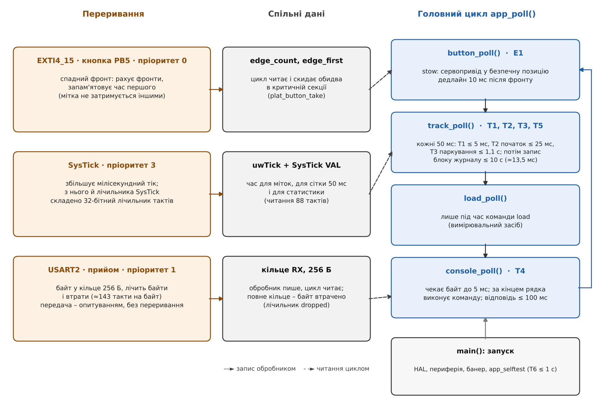
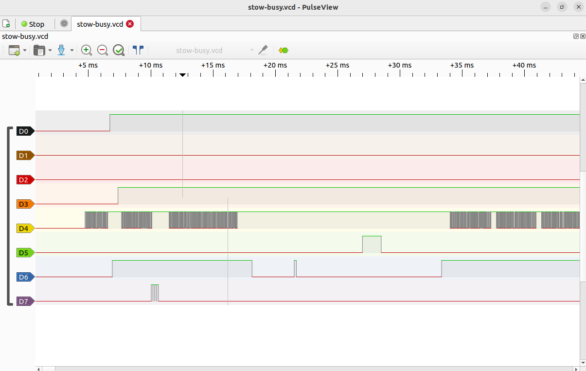

Національний технічний університет України
«Київський політехнічний інститут імені Ігоря Сікорського»

Факультет інформатики та обчислювальної техніки
Кафедра обчислювальної техніки

**Лабораторна робота №3**
з дисципліни «Системне програмування»
на тему «Реалізація вимог продукту на bare metal (super loop): вимірювання швидкодії та пам'яті, пошук меж підходу»

Виконав:
студент групи ІО-31
Бобруйко Олексій Євгенович

Перевірив:
Гордієнко Нікіта Юрійович

Київ – 2026

---

## 1. Мета лабораторної роботи

Метою роботи є запуск продукту – геліостата (чотири потенціометри як замінник датчиків освітленості, два сервоприводи, мікро-SD картка, USART2, кнопка негайного паркування) – як цілого в одній прошивці без операційної системи, у вигляді суперциклу (super loop), та визначення меж цього підходу вимірюваннями: часу виконання кожної задачі, періоду циклу, джитера періодичної задачі, затримки реакції на подію, завантаження процесора, пам'яті flash і RAM та глибини стека. Підсумком роботи є реєстр обмежень суперциклу з доказами й базова лінія для ЛР4, де ті самі сценарії буде повторено на FreeRTOS. Роботу виконано у формі B (симулятор Wokwi): усі часи в звіті – це часи симулятора з ядром 12 МГц, на реальній платі продукт не вимірювався.

На початковому етапі склалося уявлення, згідно з яким межею суперциклу є завантаження процесора: що більше задач, то менший запас у 50-мілісекундному періоді. Виміряне завантаження виявилося малим – 1,6% у S1, 3,4% у S2 і 5,9% у S3. Проте реакція на кнопку в S3 сягала 18,511 мс проти 10 мс (10 із 27 натискань, які припали на запис блоку на SD-картку, не вклалися), а для 20 команд, надісланих підряд, відповіді на рядки 9–20 були готові пізніше ніж за 100 мс. У процесі виконання встановлено, що межу задає не середня зайнятість, а довжина найдовшої ділянки, на якій цикл не повертається до перевірки події: найгірша реакція дорівнює B+H. Другий висновок стосується самих вимірювань: втрата байтів команди (проблеми 2 і 3) та подвійне прийняття одного натискання (проблема 4) були дефектами реалізації, які виявили саме вимірювання, а не функціональні перевірки; їх усунуто, а решту ефектів внесено до реєстру обмежень.

## 2. Розподіл обов'язків

Роботу виконано індивідуально; за кожну з п'яти ролей розділу 9 методичних вказівок відповідальним є автор звіту. Оскільки роботу виконано у формі B, роль «Тестування на обладнанні» охоплює стенд у Wokwi (`scenarios/lr3.diagram.json`), виконання сценаріїв у симуляторі, логічний аналізатор та «фізичні» відмови, змодельовані зміною схеми (в `nosd-log.diagram.json` відрізано дріт MISO картки). Артефакти та коміти кожної ролі наведено в таблиці.

| № | Роль | Відповідальний | Ключові артефакти | Коміти |
|---|---|---|---|---|
| 1 | Розробка super loop | Бобруйко О. Є. | `firmware/app/src/app.c` (цикл, задачі, консоль), `firmware/devices/{tracker,logger,perf}.c`, адаптери кнопки, часу, прийому USART2 з кільцем, `docs/architecture.md` | [36d9587](https://github.com/IO31-Bobruiko-Oleksii/systems-programming-2026/commit/36d9587bc58463160790901310a09ff06768ab05), [f824f58](https://github.com/IO31-Bobruiko-Oleksii/systems-programming-2026/commit/f824f58f6d4c553e4d653a8aa5dd5fa54c0fbdff), [3b269fd](https://github.com/IO31-Bobruiko-Oleksii/systems-programming-2026/commit/3b269fd20a29b5d612537930930af9215de75564), [57e432c](https://github.com/IO31-Bobruiko-Oleksii/systems-programming-2026/commit/57e432cb471b0b6d725137654dd89021b78c2c26), [bd158be](https://github.com/IO31-Bobruiko-Oleksii/systems-programming-2026/commit/bd158bed05caa5d5a01ee0c80181e542c64862f7), [42f6691](https://github.com/IO31-Bobruiko-Oleksii/systems-programming-2026/commit/42f6691d4adc17c36bd4576c86caa98d56b2a85e), [19b0119](https://github.com/IO31-Bobruiko-Oleksii/systems-programming-2026/commit/19b01197329524cbe5d999b0d84f841f4755cd7b) |
| 2 | Метрики | Бобруйко О. Є. | команди `stats`, `load`, `time`; лічильник циклів; службові виводи PB4, PB6, PB7; `tools/lr3_*.py`, `scripts/lr3_memory.sh`; `docs/instrumentation.md` | [6445998](https://github.com/IO31-Bobruiko-Oleksii/systems-programming-2026/commit/6445998dd74a38a3a9dcbe15f4d57605b6253781), [61b7536](https://github.com/IO31-Bobruiko-Oleksii/systems-programming-2026/commit/61b7536e231de5478ebe2be655ce52ab9ad07092), [9476bf8](https://github.com/IO31-Bobruiko-Oleksii/systems-programming-2026/commit/9476bf890859b3bb4488e1e6339140d50ba3fb5a), [a5b6b65](https://github.com/IO31-Bobruiko-Oleksii/systems-programming-2026/commit/a5b6b65e116c14b86d63d9f215a2a1dc41398043), [33fd5d0](https://github.com/IO31-Bobruiko-Oleksii/systems-programming-2026/commit/33fd5d09e7b99af5f95daeb8ecbf721cc491664c), [1fa9b34](https://github.com/IO31-Bobruiko-Oleksii/systems-programming-2026/commit/1fa9b34a5e5b9438eb27ef1ba0c0ba3e611102cf), [3ceaf59](https://github.com/IO31-Bobruiko-Oleksii/systems-programming-2026/commit/3ceaf5969ab165743e58ad6bcf5ee597abaaa9cc) |
| 3 | Тестування | Бобруйко О. Є. | `docs/tasks.md`, `scenarios/`, `tools/lr3_gen.py`, `lr3_run.sh`, `lr3_stats.py`, `docs/metrics/`, `tests/soak.c`, `scenarios/calibrate.yaml` | [5000c46](https://github.com/IO31-Bobruiko-Oleksii/systems-programming-2026/commit/5000c468d0564d3d6870e57d7a2e0dc3697a0994), [c018189](https://github.com/IO31-Bobruiko-Oleksii/systems-programming-2026/commit/c018189ba9782b6729117626eca6460643a53105), [9ede332](https://github.com/IO31-Bobruiko-Oleksii/systems-programming-2026/commit/9ede332a6284e4137521ebc6a516745b132bfe1e), [cf18a0b](https://github.com/IO31-Bobruiko-Oleksii/systems-programming-2026/commit/cf18a0bb471ef88820c1284f0850374dd4977bc0), [e20edba](https://github.com/IO31-Bobruiko-Oleksii/systems-programming-2026/commit/e20edbaee3585ebb42bd7205e2d97bddef01bd32), [a980afb](https://github.com/IO31-Bobruiko-Oleksii/systems-programming-2026/commit/a980afb6fb400e301a6c7181e0fb2b02d7207a53), [6a430cc](https://github.com/IO31-Bobruiko-Oleksii/systems-programming-2026/commit/6a430cc9c68bcd83d98c47c9524cb72e65b7f223), [0143bc4](https://github.com/IO31-Bobruiko-Oleksii/systems-programming-2026/commit/0143bc493971b85b1854826796f5157e1290769c), [de56635](https://github.com/IO31-Bobruiko-Oleksii/systems-programming-2026/commit/de566352abb10f3470771787bba6d98c0ba631b3), [e455fd3](https://github.com/IO31-Bobruiko-Oleksii/systems-programming-2026/commit/e455fd3a0e46eac6bcd6c7cb6882cb5077ff6cf1) |
| 4 | Тестування на обладнанні (Wokwi) | Бобруйко О. Є. | `scenarios/*.diagram.json`, записи аналізатора `docs/captures/lr3/*.vcd`, журнали прогонів | [61b7536](https://github.com/IO31-Bobruiko-Oleksii/systems-programming-2026/commit/61b7536e231de5478ebe2be655ce52ab9ad07092), [12bb9b0](https://github.com/IO31-Bobruiko-Oleksii/systems-programming-2026/commit/12bb9b023d44de186b3b58f0adb387f0fc13b9d8), [d358a36](https://github.com/IO31-Bobruiko-Oleksii/systems-programming-2026/commit/d358a36a604539c73080df6d95f0bda3f61ab9f7), [ef01528](https://github.com/IO31-Bobruiko-Oleksii/systems-programming-2026/commit/ef015284fd6c03b9948742b2c6e96470604beed2), [a980afb](https://github.com/IO31-Bobruiko-Oleksii/systems-programming-2026/commit/a980afb6fb400e301a6c7181e0fb2b02d7207a53), [a6f02cc](https://github.com/IO31-Bobruiko-Oleksii/systems-programming-2026/commit/a6f02cc232c449aa2833749ad7af31a585ca7152) |
| 5 | Звіт | Бобруйко О. Є. | `docs/limitations.md`, `docs/baseline-lab4.md`, `docs/PRD.md`, `docs/pinout.md`, `README.md`, `docs/lab3-report.md`, відеозвіт | [b066795](https://github.com/IO31-Bobruiko-Oleksii/systems-programming-2026/commit/b06679596ede909cc59a155467ed990e43bc5f8b), [e455fd3](https://github.com/IO31-Bobruiko-Oleksii/systems-programming-2026/commit/e455fd3a0e46eac6bcd6c7cb6882cb5077ff6cf1), [bc22e41](https://github.com/IO31-Bobruiko-Oleksii/systems-programming-2026/commit/bc22e41059e14ad4e4d17765c0d3afac65435b23), [9d0f892](https://github.com/IO31-Bobruiko-Oleksii/systems-programming-2026/commit/9d0f892718fff3f9757ae9d0f6f8fcc560be8c1a), [07a5529](https://github.com/IO31-Bobruiko-Oleksii/systems-programming-2026/commit/07a5529322982a4bdc5cabff8ea6da2ffa90befb), [d94526a](https://github.com/IO31-Bobruiko-Oleksii/systems-programming-2026/commit/d94526ad380783b3651045f1612a418d1e8549bc) |

Результат здається pull request-ом `lab3` -> `main` з тегом `lab3` на фінальному коміті. Репозиторій: [https://github.com/IO31-Bobruiko-Oleksii/systems-programming-2026](https://github.com/IO31-Bobruiko-Oleksii/systems-programming-2026)

## 3. Опис прошивки

Уся прикладна логіка працює в одній прошивці без операційної системи. Шари та правило залежностей з ЛР2 збережено (`docs/architecture.md`): `firmware/app` – суперцикл, задачі й консоль; `firmware/devices` – драйвери й логіка (`tracker`, `logger`, `perf`, `servo`, `pots`, `sdcard`); `firmware/platform` – інтерфейси `plat_*.h` та їх реалізації над HAL. Нова логіка (стеження, журнал, статистика) залежить лише від інтерфейсів платформи, тому виконується на хості в тестах без плати: 266 тестів, 2390 перевірок, перевірка залежностей охоплює 34 файли, покриття рядків шарів `devices` і `app` – 99,21% (gcc 13.2).

### 3.1. Структура головного циклу

Функція `main()` ініціалізує HAL і периферію, друкує банер, викликає `app_init`, `app_selftest` і `app_start`, після чого нескінченно викликає `app_poll()`. Поза перериваннями більше нічого не виконується. `app_poll` – це чотири виклики у фіксованому порядку, і кожен одразу повертає керування, якщо йому нічого робити:

```c
while (1) {
    button_poll();
    track_poll();
    load_poll();
    console_poll();
}
```



*Рис. 1: структура прошивки: три переривання, дані, спільні з циклом, і чотири виклики головного циклу з дедлайнами задач*

Задача T2 запускається на абсолютній сітці: наступний час `track_next` збільшується на період, тож запізнілий запуск не зсуває сітку, а пропущені періоди лічаться в `missed`. У спокої кожен прохід триває 6 мс: `console_poll` чекає байт до 5 мс, і прохід завершується на межі тіка SysTick. Саме тому запізнення початку T2 у S1 має дискретні рівні близько 1,9, 3,9 і 5,9 мс (50 мс за модулем 6 мс), а не нуль.

Цикл ніколи не перериває прохід, тому задача може початися лише між двома проходами. Для події, яку обробляє `button_poll`, найгірша затримка реакції дорівнює

*реакція(max) = B + H,*

де B – найдовша ділянка, на якій цикл не повертається до `button_poll`, а H – час самого обробника (0,10–0,12 мс: імпульс EVENT має ширину 101,9 мкс у `stow-busy` та 102,2 і 119,0 мкс у `stow`). Той самий B обмежує, наскільки пізно може початися T2. Значення B, взяті з вимірювань:

| Джерело B | Довжина | Де виміряно |
|---|---|---|
| прохід у спокої (очікування байта 5 мс і вирівнювання на тік) | 6,0 мс | `stats-s1-idle.txt`: максимум проходу 6007 мкс |
| команда консолі з відповіддю, типова | 11,8 мс (S2), 19,9 мс (S3) | `stats-s2-nominal.txt`, `stats-s3-worst.txt` |
| команда `sd write` (запис 13,4 мс, відповідь 3,6 мс, розбір) | близько 21 мс | `stats-s3-worst.txt`, таблиця «натискання під час sd write» |
| відповідь на `stats` | 82,7 мс (збірка A) | `analyzer-stats.txt`: прохід без запуску T2 |
| команда `time` (діагностика, 40000 читань лічильника) | 342 мс | `stats-e1-idle.txt`, вікно W2 |

Перевірка за даними: у спокої B = 6,0 мс дає 6,1 мс, виміряний максимум – 6,113 мс (n = 40); у S3 за B = 21 мс і найранішого натискання через 3 мс після рядка команди очікується 18 мс, виміряно 18,0–18,5 мс.

### 3.2. Задачі, періоди й дедлайни

PRD не містить часових вимог, тому кожну вимогу перетворено на задачу з тригером, періодом і дедлайном (`docs/tasks.md`). Числа – інженерні припущення з обґрунтуванням у тому самому файлі; вимірювання оцінюються за **максимумом**, а не за середнім.

| Задача | Що робить | Запуск/період | Дедлайн |
|---|---|---|---|
| T1 | опитування 4 каналів світла (FR-01) | за часом, 50 мс | завершення не пізніше 5 мс від початку |
| T2 | стеження: різниці протилежних пар, мертва зона, оновлення сервоприводів (FR-02…FR-04) | після T1, 50 мс на абсолютній сітці | ширина імпульсу оновлена не пізніше 25 мс після номінального випуску |
| T3 | паркування: 20 «темних» запусків поспіль – безпечна позиція (FR-06) | усередині T2 | команда паркування не пізніше 1,1 с після зникнення світла |
| T4 | консоль: прийом і виконання рядка команди (FR-07) | байт UART, один на 86,8 мкс | жодного втраченого байта; відповідь не пізніше 100 мс після кінця рядка |
| T5 | журнал: запис події, блоки по 512 байтів з блоку 8192 (FR-05) | рух сервоприводу, паркування, прийняте натискання; не частіше ніж раз на 50 мс | блок записано не пізніше 10 с після першого запису; запис блокує цикл близько 13 мс |
| T6 | самоперевірка ADC, PWM, SPI, UART (FR-08) | один раз після скидання | головний цикл працює не пізніше 1 с після скидання |
| E1 | негайне паркування кнопкою (розширення FR-06) | спадний фронт на PB5; між запитами не менше 200 мс | ширина імпульсу оновлена не пізніше 10 мс після фронту; імпульс на виході змінився не пізніше 30 мс |

Кнопки в PRD немає: її додано, щоб у системі була зовнішня подія з реальним дедлайном (аналог вітрової тривоги, що вимагає негайно паркувати панель). 50 мс обрано тому, що фоторезистор реагує за 20–45 мс (`docs/hardware-components.md`), а сервопривід рухається повільніше; 25 мс – половина періоду, друга половина лишається консолі, журналу й вимірювальному коду. 20 «темних» запусків (1,1 с) гарантують, що хмара коротша за 1 с не паркує панель. 10 мс для E1 – половина кадру ШІМ 20 мс, тож програмна частина ніколи не домінує; 30 мс додає один кадр, бо нова ширина потрапляє до сервоприводу найраніше з наступним кадром.

### 3.3. Переривання і для чого вони потрібні

| Переривання | Пріоритет | Що робить обробник | Для чого і що спільне з циклом |
|---|---|---|---|
| EXTI4_15 (кнопка PB5) | 0 (найвищий) | лічить фронти й запам'ятовує мітку часу першого | затримка реакції рахується від фронту, тож мітку не можна брати в циклі, який може бути заблокований; Wokwi імітує брязкіт контактів (52–146 фронтів на натискання), а обробник лише лічить фронти, тож брязкіт не навантажує цикл. Цикл зчитує й скидає `edge_count`, `edge_first` в критичній секції (`plat_button_take`) |
| USART2 (прийом) | 1 | кладе байт у кільце 256 Б, лічить байти, втрати й помилки (близько 143 тактів на байт) | один байт регістра USART живе 86,7 мкс: при опитуванні втрата байтів починається, щойно прохід циклу довший за цей час (проблема 2). Кільце вміщає 22,2 мс безперервного входу. Обробник пише, цикл читає; передача лишилася опитуванням без переривання |
| SysTick | 3 (найнижчий) | збільшує мілісекундний тік | на Cortex-M0+ немає DWT, тому 32-бітний лічильник тактів складено з тіка, поточного значення SysTick і прапорця очікування (читання коштує 88 тактів, період переповнення 357,9 с) |

Обробник кнопки має найвищий пріоритет, тому може перервати обробник прийому, і мітка фронту ніколи не затримується ним. Обробник прийому короткий: при безперервному вході на швидкості лінії він забирає 13,8% часу процесора. Спільних даних між перериваннями й циклом три набори (фронти кнопки, кільце прийому й тік часу), і кожен має власний спосіб захисту: критична секція, кільце з одним записувачем і одним читачем, повторне читання до збігу двох значень. Чому такий захист доводиться придумувати вручну, показує обмеження 5 реєстру та проблема 4.

## 4. Статус вимог PRD

Статус кожної вимоги – один із трьох: **виконана** (критерій успіху виконано у всіх вимірюваних сценаріях), **виконана з обмеженням** (вимога реалізована, але в описаних умовах критерій не виконується або перевірка неповна; обмеження пов'язане з реєстром) і **недосяжна** (вимогу не можна виконати в цьому середовищі). Недосяжних вимог немає. Вердикт «виконана» ставиться лише тоді, коли максимум у найгіршому сценарії не перевищує вимоги. Повна таблиця з процедурами перевірки – у `docs/PRD.md`, розділ D.

| Вимога | Статус | Сценарій і результат | Обмеження | Файли доказів |
|---|---|---|---|---|
| FR-01 | виконана | `adc.yaml`: положення потенціометрів 256/512/768/1023 з 1023 дають `raw=1025,2050,3074,4095`; T1 (4 канали) не більше 738 мкс проти 5 мс у S3 | – | `adc.yaml`, `test_pots.c`, `stats-s3-worst.txt` |
| FR-02 | виконана | `test_tracker.c` (183 перевірки): яскравіше праворуч піднімає азимут, ліворуч опускає, вгорі піднімає нахил, внизу опускає; `track.yaml`: панель доходить до `az=180 tilt=0` за 90 запусків по 1°, `missed=0` | – | `test_tracker.c`, `track.yaml` |
| FR-03 | виконана | `servo.yaml`: 0° – 1000 мкс, 180° – 2000 мкс, 45° – 1250 мкс; T2: запізнення початку не більше 20,956 мс проти 25 мс, тіло задачі не більше 1,151 мс, пропущених запусків 0 в S1, S2, S3 | 2 (запас 4,0 мс) | `servo.yaml`, `stats-s3-worst.txt` |
| FR-04 | виконана | `calibrate.yaml`: помилка осі 61 при мертвій зоні 100 – положення `az=90 tilt=90` через 1 с; та сама освітленість при `deadband 0` – обидві осі доходять до 180 | – | `calibrate.yaml`, `test_tracker.c` |
| FR-05 | виконана з обмеженням | запис 32 байти (номер, час, 4 сирі значення, азимут, нахил, прапорці, сума), блоки по 512 байтів з блоку 8192; у S2 і S3 зчитано 3 записи – 3 з 3 із правильною сумою, на хості 65536 з 65536. **Обмеження:** журнал не циркулярний (заповнюється за 6533 с = 108,9 хв), сума проста, не CRC, без картки запис мовчки зупиняється (відкинуто 144 з 160 подій); запис блоку блокує цикл на 13,8 мс | 6, 1 | `log.yaml`, `stats-nosd-log.txt`, `soak.txt`, `test_logger.c` |
| FR-06 | виконана з обмеженням | `park.yaml`, 16 циклів: через 0,92 с панель ще не запаркована, через 1,03 с запаркована на безпечній позиції (16 з 16), запас до 1,1 с не менше 70 мс; хмара 0,9 с не паркує (16 з 16). **Обмеження стосується розширення – кнопки E1 (дедлайн 10 мс):** у спокої найгірше 6,113 мс (40 з 40), у S3 під час запису на SD 18,511 мс, 10 із 27 натискань понад 10 мс | 1 | `park.yaml`, `stats-park.txt`, `stats-e1-idle.txt`, `stats-s3-worst.txt` |
| FR-07 | виконана з обмеженням | `calibrate.yaml`: `deadband 0`/`100` і `zero 80 100` підтверджуються й діють (нова позиція парковки 80,100), `deadband 5000` і `zero 200 90` відхиляються з `reason=range`; виконання команди не більше 19,928 мс проти 100 мс (S3), у S1–S3 жодного втраченого байта. **Обмеження:** пачка з 20 рядків – відповіді на рядки 9–20 пізніше 100 мс (остання о 225,87 мс), безперервний потік втрачає 53…657 з 1440 байтів | 3, 4 | `calibrate.yaml`, `analyzer-burst.txt`, `analyzer-flood.txt` |
| FR-08 | виконана | п'ять перевірок (`adc`, `spi`, `sd`, `servo1`, `servo2`; перевірка UART – сам факт друку звіту): `SELFTEST END total=5 passed=5 failed=0`; перший прохід циклу через 54,7 мс після скидання (T6: 1 с); без картки звіт показує `passed=4 failed=1` | – | `boot.yaml`, `nosd.yaml`, `startup.txt` |

Стовпець «Обмеження» містить номери записів реєстру. Під навантаженням S3 парковку T3 не вимірювано: T2 у S3 не пропустив жодного запуску, тож 20-й «темний» зразок лишається на своїй сітці і команда паркування надходить не пізніше близько 1,021 с (оцінка з розкладу T2, не вимірювання).

## 5. Вимірювання

Розділ описує методику, сценарії та їх результати. Усі числа взято з файлів `docs/metrics/*.txt` і журналів `docs/captures/lr3/*`, їх можна перерахувати без симулятора командою `tools/lr3_regen.sh`; повний опис кожного сценарію та кроків відтворення – у `docs/baseline-lab4.md`, розділ 4.

### 5.1. Методика

Кожну метрику, де це можливо, отримано двома незалежними способами. **Перший – лічильник циклів у прошивці.** На Cortex-M0+ немає DWT, тому 32-бітний лічильник тактів складено з тіка SysTick, поточного значення SysTick і прапорця очікування з повторним читанням до збігу; 12 тактів на мікросекунду, читання коштує 88 тактів (7,3 мкс), період переповнення 357,9 с, різниці беззнакових значень правильні для інтервалів коротших за період. Результати друкуються командою `stats` рядками `STAT`, подіями `EVT` і відповідями `CMD`; мітки часу беруться з лічильника в прошивці, а не з часу надходження рядка на хості. **Другий спосіб – логічний аналізатор Wokwi** (`wokwi-logic-analyzer`, 8 каналів, буфер 1000000 відліків, сітка 25 нс) із трьома службовими виводами прошивки:

| Канал | Вивід | Сигнал | Хто керує |
|---|---|---|---|
| D0 | PB6 | цикл зайнятий: низький, поки цикл чекає байт, високий у решті проходу | адаптер UART, два записи в регістр на прохід |
| D1 | PB4 | T2: високий від початку `track_due` до мітки, що завершує статистику `track` | `app.c` |
| D2 | PB7 | EVENT: високий, поки працює обробник stow | `app.c` |
| D3 | PB5 | кнопка (у `burst.diagram.json` – PA3, лінія прийому) | кнопка |
| D4 | PA2 | UART TX | USART2 |
| D5 | PC6 | ШІМ сервоприводу 1 | TIM3 |
| D6 | PB9 | вибір SD-картки (CS) | `plat_spi` |
| D7 | PB3 | маркер АЦП, високий під час одного перетворення | `plat_adc` |

Вартість вимірювання записано поруч із результатом. Робота кожного проходу циклу поза очікуванням байта – 28,06 мкс у середньому (максимум 33,6 мкс) разом із двома записами службового виводу; запас до часу байта 86,7 мкс становить 53 мкс. Службові виводи додають близько 1 мкс до проходу (PB6) і близько 4 мкс на 50 мс до T2 (PB4).

Правила порівняння: з вимогою PRD – за максимумом; між сценаріями – різниця S3 − S1; з розрахунком – із поясненням розбіжності понад 10–20%; між двома способами – для кількох метрик. Повторюваність: для подій не менше 30 повторів (E1: 30 у S3 і 40 у `e1-idle`), для періодичних задач тисячі запусків (S1 – 5000, S2 – 2582, S3 – 946). Визначення метрик: `late` – на скільки пізніше номінального випуску на сітці 50 мс почалася T2; `period` – час між двома стартами T2; `missed` – пропущені випуски; `cmd` – від кінця рядка команди до кінця відповіді; E1 – від спадного фронту на виводі (мітка в перериванні) до оновлення сервоприводу.

### 5.2. Збірки і сценарії

Методичні вказівки вимагають, щоб усі сценарії виконувались на одній збірці з git-хешем у банері. Банер цієї прошивки хешу не містить, а прошивка змінювалась під час вимірювань, тому збірку кожного результату відновлено за комітом, у якому записано захоплення (`git log -- firmware`). Прошивка змінювалась лише в чотирьох комітах:

| Збірка | Останній коміт прошивки | Що додано | Результати |
|---|---|---|---|
| A | [a5b6b65](https://github.com/IO31-Bobruiko-Oleksii/systems-programming-2026/commit/a5b6b65e116c14b86d63d9f215a2a1dc41398043) | вимірювальний код і службові виводи | `stats`, `stow`, `stow-busy` |
| B | [9ede332](https://github.com/IO31-Bobruiko-Oleksii/systems-programming-2026/commit/9ede332a6284e4137521ebc6a516745b132bfe1e) | команда `load`, перезапуск сітки T2 у `load` | `load`, `sweep-ms`, `sweep-uart-poll` |
| C | [42f6691](https://github.com/IO31-Bobruiko-Oleksii/systems-programming-2026/commit/42f6691d4adc17c36bd4576c86caa98d56b2a85e) | прийом USART2 у кільце 256 Б, на перериванні | `sweep-uart`, `flood`, S1, S2, S3 |
| D | [19b0119](https://github.com/IO31-Bobruiko-Oleksii/systems-programming-2026/commit/19b01197329524cbe5d999b0d84f841f4755cd7b) | блокування кнопки зберігає мітку часу переривання | `e1-idle`, `burst`, `nosd-log`, `park`, старт, пам'ять |

D – прошивка на вершині гілки. Збірки A і B не мають приймального кільця, тому їх проходи не містять обробника прийому (близько 13 мкс на байт) і відповідь `stats` на 7 мс коротша (немає рядка `STAT rx`): прохід цієї відповіді, 82,7 мс на збірці A, на D очікується близько 90 мс (максимум команди тієї самої відповіді на C – 86,9 мс). Тому числа A і B позначено літерою збірки, а перезапуск їх на збірці D залишено необов'язковим кроком (`docs/baseline-lab4.md`). Різниця C і D стосується лише підрахунку другого натискання всередині блокування 200 мс, а не часу задач.

| Сценарій | Що відбувається | Тривалість (симулятор/реальний) | Збірка |
|---|---|---|---|
| S1 (спокій) | потенціометри сталі, команд і натискань немає; одне вікно 250 с, 5000 запусків T2 | 256 с/близько 5 хв | C |
| S2 (номінальний) | кожні 4 с потенціометр 2 проходить 0,9 – 0,5 – 0,1 – 0,5 і надходить пачка з 4 команд консолі (прибл. 1 команда на секунду); журнал увімкнено; 4 натискання кнопки з `resume`; вікно 129 с, 2582 запуски | 129 с/3,9 хв | C |
| S3 (найгірший) | 9 тактів по 4 с; у кожному `sd write 16000` окремо, або натискання у випадковий момент, або пачка 20 рядків `track`; далі в кожному такті по 2–3 натискання під час `sd write` через 3…27 мс; разом 30 натискань (27 під час запису); вікно 47,3 с, 946 запусків | 47 с/3,9 хв | C |
| e1-idle | 40 натискань у спокої з випадковим випередженням 1…99 мс (зерно 2026); друге вікно – три виклики `time` (по 0,34 с) | 18,5 с/2,4 хв | D |
| stow, stow-busy | одне натискання в спокої і під час запису блоку на SD (запис аналізатора) | 6,5 і 6,2 с | A |
| stats | одна команда `stats`, 60 запусків T2 (запис аналізатора) | 3,2 с | A |
| burst | один рядок `track`, потім 20 рядків одним записом; на аналізаторі лінії прийому й передачі | 1,4 с | D |
| flood | вісім вікон `load`: шість по 30 рядків x 48 байтів за додаткового очікування 0, 8, 17, 34, 68, 100 мкс на прохід; відповідь `stats`; `sd write` | 6,3 с | C |
| sweep-uart, sweep-ms | 11 вікон з додатковим очікуванням на прохід і чотирма рядками; 7 вікон по 1…30 мс на прохід з трьома натисканнями | 4,7 с; 9,3 с | C; B |
| nosd-log | картку відключено (дріт MISO), трекер рухається, `log on`; потім три `sd write` | 18 с | D |
| park | 16 циклів: світло на каналі зникає, `track` через 920 і 1030 мс; потім хмара 900 мс | 39,5 с | D |
| soak (хост) | 2 год віртуального часу, справжній `app.c` на фальшивих драйверах і фальшивому часі | менше 1 с | D |

### 5.3. Результати S1, S2, S3

Джерела: `docs/metrics/stats-s1-idle.txt`, `stats-s2-nominal.txt`, `stats-s3-worst.txt` (збірка C). Тире означає «у цьому сценарії не вимірювалось».

| Метрика | Вимога PRD | S1 спокій | S2 номінальний | S3 найгірший | S3 − S1 |
|---|---|---|---|---|---|
| вікно | – | 250,0 с | 129,1 с | 47,3 с | – |
| запусків T2/пропущено | пропущено 0 | 5000/0 | 2582/0 | 946/0 | – |
| T2, запізнення початку, max | 25 000 мкс | 5 861 мкс | 10 536 мкс | 20 956 мкс | +15 095 мкс |
| T2, запізнення початку, середнє | – | 3 858 мкс | 3 293 мкс | 3 481 мкс | −377 мкс |
| T2, період, max | – | 54 005 мкс | 59 678 мкс | 66 569 мкс | +12 564 мкс |
| T1, опитування, max | 5 000 мкс | 602 мкс | 738 мкс | 738 мкс | +136 мкс |
| T2, тіло, max | – | 833 мкс | 1 151 мкс | 1 151 мкс | +318 мкс |
| прохід циклу, середнє | – | 5 999 мкс | 5 970 мкс | 5 566 мкс | −433 мкс |
| прохід циклу, max | – | 6 007 мкс | 20 005 мкс | 24 624 мкс | +18 617 мкс |
| T4, команд | – | 1 | 133 | 136 | – |
| T4, команда, max | 100 000 мкс | 2 332 мкс | 11 834 мкс | 19 928 мкс | +17 596 мкс |
| T5, записів блоку/max | – | 0/– | 80/13 496 мкс | 28/13 847 мкс | – |
| E1, натискань | не менше 30 | 0 | 5 (надіслано 4) | 30 | – |
| E1 stow, max | 10 000 мкс | – | 5 610 мкс (виконано) | **18 511 мкс (не виконано)** | – |
| завантаження CPU | – | 1,6% | 3,4% | 5,9% | +4,3% |
| байтів прийнято/втрачено | втрачено 0 | 6/0 | 699/0 | 1067/0 | – |
| кільце прийому, max (з 256) | – | 1 | 55 | 114 | +113 |
| стек/heap | – | 916 Б/0 | 924 Б/0 | 940 Б/0 | +24 Б |
| журнал, зчитано з перевіркою суми | – | – | 3 з 3 | 3 з 3 | – |

Вердикти: T1, початок T2, виконання команд T4 і приймальний буфер задовольняють вимоги в усіх трьох сценаріях; **E1 не виконано в S3**. Із 27 натискань під час `sd write` 10 тривали понад 10 мс, а 3 випадкових – не більше 5,0 мс. У S2 прийнято 5 натискань за 4 надісланих: блокування кнопки зберігало мітку часу переривання, що відставала на один тік (виправлено на збірці D, проблема 4); S3 виконувався до виправлення і показує 30 з 30. Різниця S3 − S1 кількісно показує ціну навантаження: запізнення початку T2 зростає на 15,1 мс, максимум проходу – на 18,6 мс, а середні значення майже не змінюються (−0,4 мс). Це й є ознака межі, що задається не навантаженням: завантаження CPU в S3 лише 5,9%.

### 5.4. Затримка реакції на подію (E1)

| Прогін | Збірка | n | min | середнє | медіана | p90 | max/вердикт |
|---|---|---|---|---|---|---|---|
| e1-idle, випадкові випередження | D | 40 (40 прийнято) | 0,338 мс | 2,942 мс | 2,685 мс | 5,510 мс | 6,113 мс, виконано, запас 3,9 мс |
| S3, усі натискання | C | 30 | 0,576 мс | 7,766 мс | 5,439 мс | 16,403 мс | 18,511 мс, не виконано, 10 понад |
| S3, під час `sd write` | C | 27 | 0,576 мс | 8,171 мс | 5,831 мс | 16,403 мс | 18,511 мс, 10 понад |
| S3, випадкові моменти | C | 3 | 3,664 мс | 4,122 мс | 3,685 мс | 5,017 мс | 5,017 мс, виконано |
| S2, після групи команд | C | 5 | 0,270 мс | 1,356 мс | 0,292 мс | 5,610 мс | 5,610 мс (синхронізовано з циклом, не розподіл у спокої) |

Затримка залежить від того, коли натискання припало на довгу операцію. Натискання через *d* мс після відправлення рядка `sd write` чекає закінчення команди, близько 21 мс − *d*; після прибл. 21 мс лишається лише фаза проходу в спокої (0,6…5,6 мс). Таблиця – усі 27 натискань S3 під час запису:

| d, мс | Затримка реакції, мс | d, мс | Затримка реакції, мс |
|---|---|---|---|
| 3 | 18,511; 18,279; 17,987 | 17 | 3,775; 3,786 |
| 5 | 16,202; 16,403 | 19 | 1,722; 1,720 |
| 7 | 13,919; 13,510 | 21 | 3,582; 4,989 |
| 9 | 11,881; 9,599 | 23 | 3,649; 3,957 |
| 11 | 10,071; 10,023 | 25 | 0,576; 1,607 |
| 13 | 8,116; 7,746 | 27 | 5,321; 5,558 |
| 15 | 5,831; 2,302 |  |  |

**Анотований запис логічного аналізатора.** Рисунок 2 – одне натискання, яке припало на запис блоку на SD-картку (збірка A, `docs/captures/lr3/stow-busy.vcd`, звіт `docs/metrics/analyzer-stow-busy.txt`). Нуль часової осі – перший спадний фронт на PB5 (6075,617 мс від початку запису). Щільні короткі проходи D0 за 1,9–0,7 мс до фронту – це прийом рядка команди `sd write 16000`; далі цикл займається (D0 високий) на 24,80 мс, фронт припадає на 0,71 мс від початку цієї ділянки; вибір картки (D6) низький з 1,2 до 14,6 мс – це запис блоку (13,4 мс); з 15,4 мс до 19,0 мс іде відповідь `CMD sd-write OK`. Лише на 18,93 мс цикл повертається до `button_poll`: імпульс EVENT (D2) триває 101,9 мкс, прошивка вимірює `lat_us=19020`, а аналізатор – 19 031 мкс до кінця імпульсу (різниця +11,0 мкс). Реакція 19,0 мс проти 10 мс – дедлайн не виконано. Після обробника цикл ще друкує рядок `EVT stow` (19,9–23,3 мс), тож ділянка зайнятості закінчується о 24,1 мс. Кадр ШІМ, що почався о 11,4 мс, ще має стару ширину (2000 мкс); нова ширина 1500 мкс з'являється лише в наступному кадрі, через 31,37 мс після фронту: це на 1,4 мс пізніше 30 мс, тож другий дедлайн E1 також не виконано. Кадр ШІМ додає 12,3 мс до кінця обробника; у спокійному записі `stow` ця добавка 8,7 мс. Сама кнопка за ці 2 мс дала 86 спадних фронтів (брязкіт контактів у Wokwi), прийнято одне натискання.



*Рис. 2: запис stow-busy.vcd: натискання кнопки під час запису блоку на SD-картку. Реакція 19,0 мс (дедлайн 10 мс), новий імпульс ШІМ через 31,37 мс (дедлайн 30 мс); обробник stow починається через 18,93 мс і закінчується через 19,03 мс після фронту*

### 5.5. Порівняння двох способів вимірювання

Для кількох метрик виміряно і лічильником у прошивці, і логічним аналізатором (запис `stats.vcd`, одна команда `stats`, 60 запусків T2, збірка A; рядок для `stow` – із `analyzer-stow-busy.txt`):

| Метрика | Лічильник у прошивці | Логічний аналізатор | Різниця | Причина різниці |
|---|---|---|---|---|
| T2, тривалість, max | 850 мкс | 844,7 мкс | −5,3 мкс | імпульс PB4 починається після мітки часу, що відкриває вимірювання `track`, і закінчується одним викликом після мітки, що його завершує |
| T2, від початку до початку, max | 54 005 мкс | 54 000,5 мкс | −4,5 мкс | те саме на краях вікна |
| T1, опитування, max | 602 мкс | 581,5 мкс | −20,6 мкс | аналізатор бачить від початку першого до кінця четвертого перетворення, прошивка міряє весь виклик, разом із паузами між перетвореннями |
| T2, джитер початку | 4 007 мкс | 4 228 мкс | +221 мкс | годинник прошивки іде швидше за модельований на 74…96 ppm: 3 с × 74 ppm = 221 мкс |
| прохід циклу, період, max | 6 005 мкс | 6 004,2 мкс | −0,8 мкс | – |
| кількість проходів | 505 | 505 | 0 | – |
| затримка `stow` | 19 020 мкс | 19 031 мкс | +11,0 мкс | аналізатор рахує від фронту на виводі до кінця імпульсу, прошивка – від мітки в перериванні до кінця обробника (вхід у переривання лежить між ними); у записі `stow` ще +12,7 і +16,8 мкс |
| завантаження CPU | 1,7% | 1,68% (лише T2); 2,31% (PB6) | +0,61% | Прошивка рахує код задач (T2, команди, запис журналу) і не міряє роботу кожного проходу; PB6 її бачить: 505 проходів × 28 мкс = 14 мс за 3 с прибл. 0,5% |

Висновок порівняння: способи узгоджуються – тривалості розходяться на 0,01–3,4%, джитер на 5,5% (221 мкс), – а розбіжності пояснюються різними точками відліку й різними означеннями (що вважати роботою). Єдина розбіжність, яка не є методичною, – 74…96 ppm швидший годинник прошивки відносно модельованого часу; вона не впливає на інтервали менші за 1 мс і дає 0,01% на інтервалах у секунди.

### 5.6. Порівняння з розрахунком

| Величина | Розрахунок | Виміряно | Пояснення розбіжності |
|---|---|---|---|
| час одного байта UART | 86,7 мкс (10 біт при 115 385 біт/с) | 93,9 мкс | +8,3%: передавач з опитуванням у симуляторі залишає паузу між байтами (причину не підтверджено); тому блокування передачею довше за розрахунок на 8…9% |
| відповідь на один рядок у пачці з 20 | 8,667 + 0,75 + 2,33 = 11,75 мс | 11,736 мс | 0,1%: 8,667 мс на дроті, 0,75 мс пауз між байтами, 2,33 мс на читання 6 байтів, розбір і формування відповіді |
| E1 у S3 (натискання через 3 мс після рядка `sd write`) | B + H = 21 − 3 + 0,12 прибл. 18,1 мс | 18,0…18,5 мс | до 0,4 мс (2%), у межах точності оцінки B |
| E1 у спокої | 6,0 + 0,1 = 6,1 мс | 6,113 мс | 0,2% |
| прохід із відповіддю на `stats` | 666 символів × 86,7 мкс = 57,7 мс плюс форматування | 82,743 мс | різниця близько 25 мс – форматування (`snprintf` без апаратного ділення на Cortex-M0+); за виміряним часом байта передача 62,5 мс, форматування близько 20 мс |
| паркування T3 | 20 запусків × 50 мс = 1,0 с плюс прохід | не запарковано через 0,92 с (18–19 «темних» зразків), запарковано через 1,03 с | 16 з 16 циклів, запас до 1,1 с не менше 70 мс |
| запис блоку 512 байтів на SD | 512 × 8 біт/6 МГц = 0,68 мс | 13,4…13,8 мс | у 20 разів більше, але це не тактування: час іде між викликами передачі, як у ЛР2, розділ 6.3, де читання блоку тривало 10,492 мс; запис на 3 мс довший за читання, причину цієї добавки окремо не виміряно |
| кадр ШІМ | 20 мс (ЛР2: 20 000,000 мкс) | нова ширина через 12,3 мс після кінця обробника (stow-busy), 8,7 мс (stow) | нова ширина з'являється з наступним кадром, тож кінцева затримка E1 не може бути меншою за залишок кадру |

### 5.7. Сценарії розділу 6.2 методичних вказівок

| № | Сценарій | Результат | Джерело |
|---|---|---|---|
| 1 | довга операція і періодична задача | S3: запізнення початку T2 до 20,956 мс проти 5,861 мс у S1, пропусків 0. `time` (342 мс): 18 запусків T2 пропущено за три виклики, запізнення до 318,1 мс, CPU 99,8%. Відповідь на `stats` у вікні: 1 запуск пропущено, запізнення 55,291 мс | `stats-s3-worst.txt`, `stats-e1-idle.txt`, `analyzer-flood.txt` |
| 2 | подія під час довгої операції | 30 натискань у S3: max 18,511 мс, 10 із 27 понад 10 мс; за аналізатором 31,37 мс до нового імпульсу | `stats-s3-worst.txt`, `analyzer-stow-busy.txt` |
| 3 | потік команд | 1440 байтів за 125 мс на швидкості лінії: втрачено 53, 134, 238, 415, 575, 657 за додаткового очікування 0, 8, 17, 34, 68, 100 мкс на прохід; під час відповіді `stats` – 224 з 486; під час `sd write` – 0 з 255. Відповідь на один рядок 12,094 мс; у пачці з 20 кожна наступна на 11,736 мс пізніше, 9-а закінчується о 101,9 мс (перша запізніла), запізнілих 12 з 20, остання – о 225,87 мс | `analyzer-flood.txt`, `analyzer-burst.txt` |
| 4 | відмова пристрою | картки немає: журнал зберіг 16 записів, відкинув 144, 12 помилок запису; `sd write` завершується відмовою за 7,868 мс (ініціалізація близько 4 мс); T2: 240 запусків, 0 пропусків, запізнення до 5,894 мс. Завислий пристрій – лише розрахунок (0,1…4,9 с) | `stats-nosd-log.txt`, обмеження 6 |
| 5 | точка зламу | UART без кільця (B): перший втрачений байт за додаткового очікування 17 мкс на прохід, 100 зі 192 втрачено за 100 мкс. З кільцем (C): 192 зі 192 в усіх 11 вікнах, обробник 143 такти. Мілісекунди на прохід (B): E1 ламається за +6 мс (11,5 мс), T2 – за +20 мс (запізнення 27,2 мс). Потік: кільце ламається за 1440 байтів за 125 мс | `analyzer-sweep-uart-poll.txt`, `analyzer-sweep-uart.txt`, `analyzer-sweep-ms.txt`, `analyzer-flood.txt` |
| 6 | тривала робота | у симуляторі неможливо (сесія 5 хв). Хост, 2 год, навантаження S2: 144040 запусків T2, 0 пропусків, 20 переходів лічильника, жодної мітки часу назад; журнал заповнився за 6533 с (108,9 хв), далі відкинуто 6748 записів, 225 натискань усі прийняті, зчитано 65536 записів, 0 хибних сум; heap 0 | `soak.txt` |
| 7 | старт і перезапуск | скидання – перший байт банера 4,8 мс; самоперевірка завершена о 48,9 мс; цикл працює з 54,7 мс (T6: 1 с); перший запуск T2 о 102,7 мс. Перезапуск не перевірявся. | `startup.txt` |
| 8 | зникнення живлення під час запису | не виконано: у симуляторі живлення обірвати не можна. Запис журналу має контрольну суму: 3 з 3 зчитано правильно в S2 і S3, 65536 з 65536 на хості | `soak.txt` |

### 5.8. Що симулятор не показав і межі достовірності

- Усі часи – часи симулятора. Годинник прошивки йде на 74…96 ppm швидше за модельований, передавач UART залишає паузу між байтами (93,9 проти 86,7 мкс), кнопка за замовчуванням дає брязкіт контактів, а прапорець переповнення USART симулятор не встановлює: до появи кільця прошивка не бачила власних втрат байтів (`rx_errors` лишався 0 при 100 втрачених зі 192). Форма обмежень (реакція дорівнює найдовшій блокувальній ділянці) від цього не залежить, абсолютні числа на платі можуть відрізнятися.
- Обсяг вибірок нижчий за рекомендований: сесія Wokwi CLI обмежена 5 хв реального часу, а кожен крок сценарію коштує близько 0,7 с, тому S3 має 946 запусків T2 (рекомендовано тисячі), 27 натискань під час запису (рекомендовано 30–50, разом із 3 випадковими – 30) і 16 циклів паркування. Для S1 і S2 вибірка достатня (5000 і 2582).
- У банері немає git-хешу, тому збірки A–D відновлено за комітами; після цього прогони підписуються хешем і сумою `firmware.elf`, а захоплення з брудного дерева `firmware/` не додаються до комітів.
- Не виконано: прогін понад годину та перехід лічильника через 358 с (замість цього двогодинний прогін справжнього `app.c` на хості), перезапуск прошивки, втрата живлення під час запису, повторне вставлення картки, T3 під навантаженням S3 (лише оцінка).
- Службові виводи PB4, PB6 і PB7 не звірено зі схемою плати MB1717; вони потрібні лише для аналізатора й не належать продукту.

### 5.9. Відтворення

```bash
make build
tests/run.sh
tools/lr3_run.sh s3-worst 600000
tools/lr3_capture.sh stow-busy event
tools/lr3_regen.sh
scripts/lr3_memory.sh
```

Токен симулятора передається змінною `WOKWI_CLI_TOKEN` і не зберігається в репозиторії. Повна таблиця сценаріїв із командами, правила їх повторення в ЛР4 та перелік відомих прогалин – `docs/baseline-lab4.md`.

## 6. Використання пам'яті

Дані – з `docs/metrics/memory.txt`, який будує `scripts/lr3_memory.sh` (збірка D із `-Og -fstack-usage`, arm-none-eabi-gcc 10.3.1, newlib-nano). Статичний обсяг RAM збігається з тим, що друкує сама прошивка в симуляторі (`STAT mem static=2296`), тож аналізується саме та збірка, що працювала.

### 6.1. Вивід компонувальника

```text
Memory region         Used Size  Region Size  %age Used
             RAM:        3832 B        12 KB     31.18%
           FLASH:       31708 B        32 KB     96.77%
```

| Секція | Розмір, Б | Пам'ять | Зміст |
|---|---|---|---|
| `.isr_vector` | 192 | flash | таблиця векторів |
| `.text` | 27 628 | flash | код |
| `.rodata` | 3 764 | flash | рядкові й інші сталі |
| `.ARM, .init_array, .fini_array` | 16 | flash | службові |
| `.data` | 112 | RAM (початкові значення у flash) | ініціалізовані змінні |
| `.bss` | 2 184 | RAM | змінні, занулені під час запуску |
| `._user_heap_stack` | 1 536 | RAM | резерв компонувальника: heap 512 Б і стек 1024 Б |

Статична частина RAM (`.data` + `.bss`) – 2296 Б, разом із резервом 3832 Б (31,18%). Показання `size` для `.bss` – 3720 Б, бо воно містить і резерв (2184 + 1536); це пояснює різницю зі `static`.

### 6.2. Найбільші споживачі

| Група | flash, Б | RAM, Б | Найбільше |
|---|---|---|---|
| власний код проєкту | 12 355 | 2 136 | `app.o` 6031 Б, `sdcard.o` 1284, `logger.o` 902, `main.o` 796, `tracker.o` 574, `plat_uart_hal.o` 552, `perf.o` 420 |
| HAL і стартовий код | 10 589 | 13 | – |
| libc_nano | 4 212 | 112 | `vfprintf_i` 1096, `svfprintf` 1064, `snprintf` 256, `vsnprintf` 220 (сімейство printf – 2636 Б) |
| рядкові сталі | 3 333 | 0 | об'єднаний пул |
| libgcc | 936 | 0 | `_udivmoddi4` 416 (64-бітне ділення), `_udivsi3` 276 (немає апаратного ділення) |
| інше | 256 | 32 | – |
| разом за таблицею | 31 681 | 2 293 | компонувальник дає 31 712 (різниця 31 Б – вирівнювання) |

Найбільші символи в RAM: `app` – 1416 Б (62% статичної частини), `rx_ring` – 268 Б (256 Б кільця й індекси), `huart2` – 148 Б, `hspi1` і `hadc1` – по 100 Б, `impure_data` – 96 Б, `htim3` – 76 Б.

### 6.3. Стек: статична оцінка і вимір

**Статично** (`-fstack-usage` із перевіркою кадрів за машинним кодом: збігаються 209 із 210 функцій; `say` – 192 Б за кодом проти 176 Б від компілятора, бо variadic-пролог зберігає r0–r3, а `-fstack-usage` їх не враховує). Найглибший ланцюг викликів – команда `stats`:

| Ланцюг від `main` (кадри, Б) | Сума, Б |
|---|---|
| `main` 8, `app_poll` 8, `console_poll` 16, `run_line` 16, `app_execute` 88, `cmd_stats` 16, `print_stats` 8, `print_loop` 32, `print_stat` 104, `say` 192, `vsniprintf` 120, `_svfiprintf_r` 152, `__ssputs_r` 32, `_realloc_r` 24, `_malloc_r` 24, `_sbrk_r` 16, `_sbrk` 8 | 864 |
| вкладені переривання: SysTick (пріоритет 3) 32 + 8, USART2 (1) 32 + 28, EXTI4_15 (0) 32 + 20 | 152 |
| **найгірший випадок** | **1016** |

Резерв стека в скрипті компонувальника – 1024 Б, тож статичний запас становить лише 8 Б. **Виміряно** фарбуванням стека (`STAT mem stack_used`, шаблон `0xA5A5A5A5`): 916 Б у S1, 924 Б у S2, 940 Б у S3 (найглибший шлях у всіх трьох – друк `stats`). Статична оцінка перевищує виміряне на 76 Б (відношення 1,08): переривання ніколи не вкладаються в точці найбільшої глибини. Фарбування не бачить стека до `main` і дає найвищу позначку від скидання, а не поточну; тому запас у 84 Б за виміром (1024 − 940) розглядається як оцінка зверху, а 8 Б статичного запасу – як межа, за якою додавання будь-якої функції в найглибший ланцюг переповнює стек (обмеження 8).

### 6.4. Heap

Heap у продукті не використовується: `heap_used` = 0 Б у кожному прогоні, де `stats` друкувала `STAT mem` (S1, S2, S3, e1-idle, nosd-log). У образі є `_malloc_r` і `_sbrk`, статично досяжні через `vsnprintf` -> `__ssputs_r` -> `realloc`, але newlib-nano викликає розподільник лише тоді, коли сам виділив буфер (`asprintf`); `say()` передає буфер фіксованих 160 Б, тому виклику немає. Доказ – нуль у `STAT mem` у кожному прогоні, а не лише аналіз коду.

### 6.5. Запас

| Ресурс | Вільно | Наслідок для ЛР4 |
|---|---|---|
| flash | 1060 Б з 32768 (3,23%) | дефіцитний ресурс: ядро за зовнішньою оцінкою 5…10 КБ без вивільнення не вміститься; шляхи – `-Os`, відмова від сімейства printf (2636 Б), 64-бітного ділення |
| RAM | 8456 Б з 12288 (68,8%) не використовується збіркою | не обмеження: ядро (236 Б) і стеки задач вміщаються |
| стек | 8 Б за статичною оцінкою, 84 Б за виміром | кожна задача отримає власний стек: сума, а не максимум; `stack_used` у ЛР4 – по задачах |

## 7. Реєстр обмежень суперциклу

Повний реєстр – `docs/limitations.md`: для кожного обмеження наведено симптом, докази з посиланнями на файли, причину в архітектурі, обхід без ОС, що дала б ОС і чого вона коштувала б, та гіпотезу для ЛР4. Нижче – короткий звід. Усі числа – час симулятора, оцінка за максимумом; літера в дужках – збірка, якщо це A або B.

| № | Обмеження | Найгірше виміряне | Гіпотеза для ЛР4 (метрика: було -> очікується) |
|---|---|---|---|
| 1 | реакція на подію чекає найдовшої блокувальної ділянки | S3: 18,5 мс проти 10 мс, 10 із 27 натискань під час запису запізнилися | E1, max у S3: 18,5 мс -> не більше 1 мс; у спокої 6,1 мс -> не більше 1 мс |
| 2 | джитер запуску періодичної задачі визначається найдовшою ділянкою інших задач | запізнення початку T2 5,9/10,5/21,0 мс (S1/S2/S3) проти 25 мс | T2, запізнення, max: не більше 2 мс у всіх сценаріях; пропущених запусків у вікні `stats` 1 -> 0 |
| 3 | відповіді консолі й довгі команди блокують цикл (передача опитуванням) | відповідь на 9-й рядок пачки закінчується о 101,9 мс; прохід `stats` 82,7 мс (A); `time` 342 мс | рядків пачки вчасно: 8 -> близько 10 (межа дроту); запізнення T2 під час `stats` 55,3 мс -> не більше 2 мс |
| 4 | вхід втрачається, коли цикл заблоковано довше, ніж вміщає кільце 256 Б | 53…657 з 1440 байтів у потоці; 224 з 486 під час відповіді `stats` | втрат 0 у вікнах потоку, не більше близько 30 у вікні `stats` |
| 5 | кожні дані, спільні з перериванням, потребують ручного захисту | S2: 4 натискання враховано як 5 (виправлено, [19b0119](https://github.com/IO31-Bobruiko-Oleksii/systems-programming-2026/commit/19b01197329524cbe5d999b0d84f841f4755cd7b)) | 0 аномалій у не менше ніж 100 натисканнях; виміряно час від переривання до задачі |
| 6 | несправний пристрій блокує цикл і відмовляє мовчки | картки немає: 90% подій журналу відкинуто, цикл блокується на 4 мс раз на секунду; завислий пристрій 0,1…4,9 с (розрахунок) | без картки T2 і E1 не залежать від відмови (не більше 2 мс) |
| 7 | додавання задачі змінює час усіх наявних | E1 ламається за +6 мс на прохід, T2 – за +20 мс (B) | межі не досягаються до +30 мс, якщо нова робота має найнижчий пріоритет |
| 8 | flash майже заповнена, один стек розрахований на найглибший шлях будь-якої задачі | flash 96,77% (вільно 1060 Б); стек 1016 Б із 1024 Б | ядро 5…10 КБ доведеться вивільняти; RAM 31% -> близько 40…55% (оцінка) |

**Найважливіше – обмеження 1.** Це єдине, де вимога продукту (E1, аналог тривоги) порушується в ситуації, що виникає в нормальній роботі: журнал пише блок 13,5 мс щоразу, коли готово 16 записів (80 разів у S2), а також при кожній команді `sd write`. Порушення становить 8,5 мс у S3, і вкластися в дедлайн можна лише або перенісши роботу в переривання, або порізавши кожну довгу ділянку. Механізм ОС, що це розв'язує, – планувальник з витісненням із задачею, яку повідомляє переривання. Нові ризики: спільний стан трекера й сервоприводів між задачами E1 і T2 (м'ютекс або черга, інверсія пріоритетів), критичні секції Cortex-M0+ маскують усі переривання (немає BASEPRI), стек нової задачі.

**Що суперцикл робить краще** (це має виконуватись і в ЛР4):

- визначений розклад: S1 – 5000 запусків T2, 0 пропущених, запізнення не більше 5,861 мс, період не більше 54,005 мс; хост – 144040 запусків, 0 пропущених;
- пам'ять: heap 0 Б, один стек, RAM 31,18%, 8456 Б не використано;
- старт: перший прохід циклу 54,7 мс, перший запуск T2 – 102,7 мс;
- поясненість: кожна велика затримка – сума відомих ділянок (11,736 мс на відповідь = 8,667 + 0,75 + 2,33; E1 близько 21 мс − d);
- немає помилок між задачами: жодного м'ютекса, черги, інверсії чи взаємоблокування, єдина паралельність – три переривання з фіксованими пріоритетами;
- низькі накладні витрати: завантаження CPU у S1 – 1,6%, жодних перемикань контексту.

Базову лінію для ЛР4 зафіксовано в `docs/baseline-lab4.md`: сценарії з командами й зерном генератора, остаточні метрики з літерою збірки, 16 гіпотез (H1a…H8b), відповідність елементів вимірювального коду очікуваним аналогам у FreeRTOS і контрольний список повторення. Усе, окрім архітектури прошивки, у ЛР4 лишається без змін.

## 8. Журнал проблем

Нижче – дефекти, знайдені під час роботи (помилка в коді, сценарії або засобі вимірювання, а не межа архітектури; межі – у розділі 7).

#### Проблема 1: кнопка в Wokwi дає десятки фронтів на одне натискання, і сценарії зависають

- **Симптом:** Перші прогони `stow.yaml` і `stow-busy.yaml` завершилися тайм-аутом, хоча прошивка працювала правильно: `CMD button OK edges=307 accepted=1 ignored=306` (stow) і `edges=136 accepted=1 ignored=135` (stow-busy), а сценарій чекав `edges=2`.
- **Root cause:** `wokwi-pushbutton` за замовчуванням імітує брязкіт контактів: кожне натискання й відпускання – пачка з десятків спадних фронтів приблизно за 1 мс, причому число випадкове (від 52 до 146 на натискання в різних прогонах). Обробник EXTI лічить кожен фронт, перший приймається, решту поглинає блокування 200 мс; сценарій же чекав точного числа фронтів.
- **Фікс:** Сценарії чекають `accepted=N ignored=` і не перевіряють число фронтів; у звітах воно наводиться як діапазон. Після виправлення обидва проходять (stow: `edges=328 accepted=2 ignored=326`; stow-busy: `edges=52 accepted=1`). Зафіксовано в коміті: [https://github.com/IO31-Bobruiko-Oleksii/systems-programming-2026/commit/57e432cb471b0b6d725137654dd89021b78c2c26](https://github.com/IO31-Bobruiko-Oleksii/systems-programming-2026/commit/57e432cb471b0b6d725137654dd89021b78c2c26).

#### Проблема 2: байти команди втрачаються, а прошивка цього не бачить

- **Симптом:** У першому прогоні `track.yaml` команда `track`, надіслана точно в мить випуску T2, прийшла як `t`: `CMD t FAIL reason=unknown`, сценарій завершився тайм-аутом. Пізніше `sweep-uart-poll` (збірка B) показав, що перший байт втрачається вже за додаткового очікування 17 мкс на прохід, а за 100 мкс втрачається 100 зі 192 байтів; при цьому `rx_errors` лишався 0.
- **Root cause:** Приймач опитувався: цикл читає один байт за прохід, а регістр USART однобайтовий (86,7 мкс на байт). Усе, що тримає цикл довше (T2 – 0,85 мс, запис блоку – 13,4 мс, відповідь консолі), призводить до перезапису байта. Симулятор не встановлює прапорець переповнення ORE, тому прошивка власної втрати не бачить, і єдиним доказом є різниця «надіслано – прийнято».
- **Фікс:** Прийом USART2 переведено на переривання з кільцем 256 Б (`plat_ring.c`, обробник близько 143 тактів на байт; 8 тестів кільця, 870 перевірок). У `sweep-uart` прийнято 192 зі 192 байтів в усіх 11 вікнах. Залишок – обмеження 4: потік 1440 байтів за 125 мс усе ще втрачає 53…657. До появи кільця команди в сценаріях ставили поза інтервалом 0…7 мс після випуску T2. Зафіксовано в коміті: [https://github.com/IO31-Bobruiko-Oleksii/systems-programming-2026/commit/42f6691d4adc17c36bd4576c86caa98d56b2a85e](https://github.com/IO31-Bobruiko-Oleksii/systems-programming-2026/commit/42f6691d4adc17c36bd4576c86caa98d56b2a85e).

#### Проблема 3: регресія довжини проходу – п'ятий байт команди втрачається в спокої

- **Симптом:** Після додавання журналу подій (T5) у спокійному циклі двічі втрачався п'ятий байт рядка: `log on` приходило як `log n` (`CMD log FAIL reason=usage`), `track` – як `trac`; той самий сценарій до цього проходив.
- **Root cause:** Коміт із журналом додав у кожен прохід `track_poll` оновлення мілісекундного годинника з трьома програмними діленнями (на Cortex-M0+ немає апаратного ділення). Прохід разом із цим оновленням став довшим за час байта 86,7 мкс, і п'ятий байт перезаписувався. Початкова оцінка вартості оновлення – близько 20 мкс за трьома діленнями – виявилася заниженою: за картиною втрат у `sweep-uart-poll` вона становить близько 45 мкс (опосередковано, напряму не виміряно).
- **Фікс:** Оновлення годинника перенесено в гілку «настав час T2»; у решті проходів лишається лише читання лічильника. Тепер робота проходу 28,06 мкс (максимум 33,6 мкс), запас до часу байта 53 мкс. Зафіксовано: введення дефекту – [https://github.com/IO31-Bobruiko-Oleksii/systems-programming-2026/commit/bd158bed05caa5d5a01ee0c80181e542c64862f7](https://github.com/IO31-Bobruiko-Oleksii/systems-programming-2026/commit/bd158bed05caa5d5a01ee0c80181e542c64862f7), виправлення – [https://github.com/IO31-Bobruiko-Oleksii/systems-programming-2026/commit/6445998dd74a38a3a9dcbe15f4d57605b6253781](https://github.com/IO31-Bobruiko-Oleksii/systems-programming-2026/commit/6445998dd74a38a3a9dcbe15f4d57605b6253781).

#### Проблема 4: одне натискання приймається двічі

- **Симптом:** У S2 надіслано 4 натискання, а прийнято 5: два рядки `EVT stow` – `t_us=44458727 lat_us=270` і `t_us=44458003 lat_us=5610`; друга мітка на 724 мкс раніша за першу, хоча другий фронт надійшов пізніше.
- **Root cause:** Мітку першого фронту обробник EXTI (пріоритет 0) бере з лічильника, складеного з тіка SysTick (пріоритет 3); коли тік ще не оброблено, мітка відстає приблизно на один тік (механізм ймовірний, не доведений). Різниця `first − button_last` у беззнаковій арифметиці стала величезним числом, і блокування 200 мс було оминуте. Частота – близько 1 з 35 подій; у S3 (30 натискань) дублікатів не було.
- **Фікс:** Додано допуск `APP_STAMP_SLACK_MS = 2`: `since = first − last + slack; since < lockout + slack`. Знакове порівняння відхилено: воно ігнорувало б кожне натискання пізніше 179 с після попереднього. Нові хостові тести (мітка на 1 і 2 мс раніша лишається в блокуванні; натискання через 200 с приймається; блокування через переповнення лічильника): старий код не проходить 6 перевірок першого з них. Прогін `e1-idle`: 40 із 40. Відомий залишок: натискання через 357,9…358,1 с після попереднього (2^32 тактів) ігнорується. Зафіксовано в коміті: [https://github.com/IO31-Bobruiko-Oleksii/systems-programming-2026/commit/19b01197329524cbe5d999b0d84f841f4755cd7b](https://github.com/IO31-Bobruiko-Oleksii/systems-programming-2026/commit/19b01197329524cbe5d999b0d84f841f4755cd7b).

#### Проблема 5: звіт аналізатора не знаходить рядків EVT

- **Симптом:** Звіт аналізатора показував `EVT lines: 1` і різницю «аналізатор – прошивка» +2740,7 мкс для натискання, хоча в журналі було два рядки EVT, а різниці мали бути в межах десятків мікросекунд.
- **Root cause:** Wokwi CLI у файлі серійного журналу відкидає перевід рядка після останнього символу, на якому спрацював крок `wait-serial`: `failed=0CMD stats-reset OKSTAT name=loop`. На дроті (D4) рядки цілі. Скрипт розбирав журнал за рядками, тому склеєні `EVT` не знаходились і натискання зіставлялися хибно.
- **Фікс:** Перед розбором перед кожним маркером `STAT `, `EVT `, `CMD ` вставляється перевід рядка; час CPU обмежується вікном вимірювання. Різниці стали +11,0 мкс (stow-busy), +12,7 і +16,8 мкс (stow). Зафіксовано в коміті: [https://github.com/IO31-Bobruiko-Oleksii/systems-programming-2026/commit/a5b6b65e116c14b86d63d9f215a2a1dc41398043](https://github.com/IO31-Bobruiko-Oleksii/systems-programming-2026/commit/a5b6b65e116c14b86d63d9f215a2a1dc41398043).

#### Проблема 6: сценарій відмови картки не виконує шлях відмови

- **Симптом:** Три прогони `nosd-log` (картки немає, `log on`) дали `seq=0 stored=0 dropped=0 errors=0`: шлях відмови журналу не виконувався, хоча звіт мав показати відкинуті записи.
- **Root cause:** Три різні причини, одна за одною. (1) Журнал записує лише зміни положення, тож нерухомий трекер нічого не пише (перший прогін, [https://github.com/IO31-Bobruiko-Oleksii/systems-programming-2026/commit/a6f02cc232c449aa2833749ad7af31a585ca7152](https://github.com/IO31-Bobruiko-Oleksii/systems-programming-2026/commit/a6f02cc232c449aa2833749ad7af31a585ca7152)). (2) За положень потенціометрів зі схеми трекер за 90 запусків (4,5 с) упирається в упори `az=180 tilt=0`, а крок потенціометра 2 між 0,1 і 0,9 не змінює знака помилки – руху немає (другий прогін). (3) Виправлення сценарію потрапило до функції `build_e1()` генератора замість `build_nosd()`: змінився `e1-idle.yaml`, а `nosd-log.yaml` лишився старим (третій прогін, [https://github.com/IO31-Bobruiko-Oleksii/systems-programming-2026/commit/6a430cc9c68bcd83d98c47c9524cb72e65b7f223](https://github.com/IO31-Bobruiko-Oleksii/systems-programming-2026/commit/6a430cc9c68bcd83d98c47c9524cb72e65b7f223)).
- **Фікс:** У сценарії перед вікном усі чотири потенціометри встановлюються в 0,5, надсилаються `stow` і `resume`, щоб трекер починав із середини й рухався; правку внесено до `build_nosd()`, а `e1-idle.yaml` відновлено байт у байт. Спершу сценарій відтворено на хості проти справжнього `app.c` з фальшивими драйверами (`seq=16 stored=0 blocks=0 dropped=144 errors=12`), справжній прогін у Wokwi дав ті самі числа. Висновок для процесу: новий сценарій спершу відтворюється на хості, і лише потім запускається в симуляторі. Зафіксовано в коміті: [https://github.com/IO31-Bobruiko-Oleksii/systems-programming-2026/commit/0143bc493971b85b1854826796f5157e1290769c](https://github.com/IO31-Bobruiko-Oleksii/systems-programming-2026/commit/0143bc493971b85b1854826796f5157e1290769c).

#### Проблема 7: перший прогін S2 пропускає запуски T2

- **Симптом:** Частковий журнал першої спроби S2 показував `runs=1518 missed=86`, хоча сценарій розрахований на `missed=0` (журнал перезаписано повторним запуском, лишилося значення зі скриншота).
- **Root cause:** У суміші команд S2 була діагностична команда `time` (40000 читань лічильника, близько 342 мс блокування): кожен її виклик пропускає 5–6 запусків T2. Крім того, сесія Wokwi CLI обмежена 5 хв реального часу, а крок сценарію коштує близько 0,7 с, тож сценарій з окремим кроком на кожну команду не вміщався.
- **Фікс:** `time` вилучено із суміші S2 (новий прогін: `missed=0` у кожній відповіді `CMD track`); генератор `tools/lr3_gen.py` збирає команди одного такту (4 с) в один запис і не чекає відповідей, окрім останньої. За моделлю вартості «9 с + симульовані секунди + 0,7 с на крок» S1 (32 кроки), S2 (128) і S3 (246) вкладаються в одну сесію. `time` лишилась діагностикою в `e1-idle`, де наочно показує вплив довгої операції на T2. Зафіксовано в коміті: [https://github.com/IO31-Bobruiko-Oleksii/systems-programming-2026/commit/c018189ba9782b6729117626eca6460643a53105](https://github.com/IO31-Bobruiko-Oleksii/systems-programming-2026/commit/c018189ba9782b6729117626eca6460643a53105).

#### Проблема 8: інструмент аналізу пам'яті плутає дві функції з однаковою назвою

- **Симптом:** Перевірка `scripts/lr3_memory.sh` показала «208 із 210 функцій збігаються»: для `HAL_ADC_MspInit` кадр стека за машинним кодом 80 Б, а за файлами `.su` – 0 Б.
- **Root cause:** Ключем у `.su` є назва функції, а `HAL_ADC_MspInit` у збірці двічі: слабка заглушка (кадр 0) і справжня в `stm32c0xx_hal_msp.c` (80 Б); інструмент брав останній запис, тож кадр цієї функції записувався як 0.
- **Фікс:** Береться більше значення. Тепер збігаються 209 із 210; лишається `say` (192 Б за кодом проти 176 Б від компілятора: variadic-пролог зберігає r0–r3, чого `-fstack-usage` не враховує). Зафіксовано в коміті: [https://github.com/IO31-Bobruiko-Oleksii/systems-programming-2026/commit/1fa9b34a5e5b9438eb27ef1ba0c0ba3e611102cf](https://github.com/IO31-Bobruiko-Oleksii/systems-programming-2026/commit/1fa9b34a5e5b9438eb27ef1ba0c0ba3e611102cf).

## 9. Висновки

Відповідь на головне питання – чи потрібна цьому продукту операційна система – така: для більшості вимог ні, для однієї так, і причина не в завантаженні процесора. Суперцикл виконав усі періодичні вимоги із запасом: T1 не більше 0,738 мс проти 5 мс; початок T2 із запізненням не більше 20,956 мс проти 25 мс і 0 пропущених запусків у 8528 запусках S1–S3 (5000 + 2582 + 946) та у 144040 запусках двогодинного прогону на хості; паркування T3 у 16 з 16 циклів із запасом не менше 70 мс; перший прохід циклу через 54,7 мс проти 1 с. Завантаження процесора при цьому 1,6, 3,4 і 5,9%.

Не виконано три вимоги, і всі три про реакцію, а не про пропускну здатність: E1 у S3 – 18,511 мс проти 10 мс (10 із 27 натискань під час запису на SD); відповіді консолі в пачці з 20 рядків – рядки 9–20 пізніше 100 мс (остання о 225,87 мс); безперервний потік втрачає 53…657 із 1440 байтів. Усі три випливають із формули B + H: реакція дорівнює найдовшій ділянці, на якій єдиний потік виконання не повертається до перевірки події (запис блоку з відповіддю близько 21 мс, відповідь `stats` 82,7 мс, команда `time` 342 мс), і не залежить від швидкості процесора. Розрахунок і вимір збігаються в межах 2% (18,1 проти 18,0…18,5 мс). У S3 немає натискань під час `stats` і `time`, тож за тією самою формулою реальний найгірший випадок E1 до 83 і 342 мс; обидві команди діагностичні.

Частину цих меж можна зняти без ОС: виконувати паркування в обробнику EXTI (реакція зводиться до часу самого обробника, близько 0,1 мс; не перевірено), розбити запис блоку на кроки, передавати відповіді на перериванні. Проте кожен такий крок – це вручну зроблений планувальник: стан трекера пишуть переривання, T2 і консоль, потрібні критичні секції, а хостові тести міжзадачних помилок не бачать; навіть без цього подвійне прийняття натискання (проблема 4) знайшли лише вимірювання. ОС із витісняючим планувальником прибирає залежність реакції від довжини чужих ділянок (гіпотеза ЛР4: E1 не більше 1 мс у S3), але коштує: на Cortex-M0+ немає BASEPRI, тож критичні секції ядра маскують усі переривання; потрібні м'ютекс або черга для спільного стану трекера; кожна задача має стек. Насамперед це пам'ять: вільно лише 1060 Б flash (96,77%), тоді як ядро за зовнішньою оцінкою займає 5…10 КБ, тож без `-Os`, відмови від сімейства printf (2636 Б) і 64-бітного ділення його не вмістити; RAM (8456 Б вільно) проблемою не є.

Отже, відповідь така: ОС цьому продукту потрібна лише заради вимоги E1 (реакція на подію не більше 10 мс під час довгої операції) і заради відповідей консолі в пачці; усі періодичні вимоги суперцикл виконує без неї. Чи виправдана ця ціна, покаже ЛР4: вона має підтвердити, що E1 вкладається в дедлайн на FreeRTOS (гіпотеза – не більше 1 мс), і що ядро вміщається у flash після скорочень; якщо ні, дешевше перенести паркування в обробник EXTI і розбити запис блоку на кроки. Суперцикл натомість зберіг те, що ОС доведеться відтворити: визначений розклад (S1 – 5000 запусків без пропусків), heap 0 Б, один стек, відсутність помилок між задачами й поясненість кожної великої затримки як суми відомих ділянок.

Межі достовірності: усі числа – час симулятора; прогін понад годину, втрату живлення й перезапуск виконати не вдалося; S3 має 946 запусків T2 і 27 натискань під час запису, тобто менше за рекомендоване; збірки A–D відновлено за комітами, а не за хешем у банері. Для ЛР4 зафіксовано сценарії, формати рядків і метрики без змін та 16 гіпотез (`docs/baseline-lab4.md`).

## 10. Матеріали та посилання

1. Методичні вказівки до ЛР3 «Реалізація вимог продукту на bare metal (super loop): вимірювання швидкодії та пам'яті, пошук меж підходу».
2. Документи репозиторію: `docs/PRD.md`, `docs/tasks.md`, `docs/architecture.md`, `docs/instrumentation.md`, `docs/limitations.md`, `docs/baseline-lab4.md`, `docs/pinout.md`; результати – `docs/metrics/`, записи й журнали – `docs/captures/lr3/`, сценарії – `scenarios/`.
3. DS13867 Rev 4, STM32C031x4/x6 (datasheet); RM0490, довідковий посібник STM32C0x1; UM2953, плата STM32 Nucleo-64 (MB1717) – ST Microelectronics.
4. FreeRTOS FAQ, «How much RAM and ROM does FreeRTOS use?» (ядро 5…10 КБ flash, 236 Б RAM, 64 Б на задачу, 76 Б на чергу; зовнішня оцінка, у ЛР4 вимірюється): https://freertos.org/FAQMem.html
5. Wokwi, логічний аналізатор: https://docs.wokwi.com/parts/wokwi-logic-analyzer
6. Wokwi, кнопка: https://docs.wokwi.com/parts/wokwi-pushbutton
7. Wokwi CLI: https://docs.wokwi.com/wokwi-ci/cli-usage
8. Wokwi, плата NUCLEO-C031C6: https://docs.wokwi.com/parts/board-st-nucleo-c031c6
