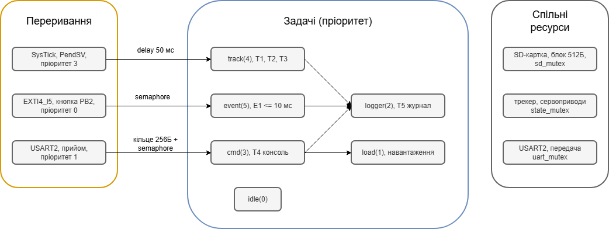

Національний технічний університет України
«Київський політехнічний інститут імені Ігоря Сікорського»

Факультет інформатики та обчислювальної техніки
Кафедра обчислювальної техніки

**Лабораторна робота №4**
з дисципліни «Системне програмування»
на тему «Реалізація вимог продукту на FreeRTOS: перехід від super loop до задач ОС і кількісне порівняння підходів»

Виконав:
студент групи ІО-31
Бобруйко Олексій Євгенович

Перевірив:
Гордієнко Нікіта Юрійович

Київ – 2026

---

## 1. Мета лабораторної роботи

Метою роботи є реалізація тих самих вимог продукту – геліостата (чотири потенціометри як замінник датчиків освітленості, два сервоприводи, мікро-SD картка, USART2, кнопка негайного паркування) – на FreeRTOS і кількісне порівняння з суперциклом ЛР3: що операційна система дала, а що забрала. Прошивка ЛР3 лишається збираною з того самого репозиторію (коміт `04eed11`, тег `lab3`). Обидві прошивки виміряно на одному стенді в Wokwi в один день тими самими сценаріями, скриптами аналізу й вимірювальним кодом. Роботу виконано у формі B (симулятор): усі часи в звіті – часи симулятора з ядром 12 МГц. Відхилення від методичних вказівок, узгоджене з викладачем: плата NUCLEO-C031C6 має ядро Cortex-M0+, тому використано порт `GCC/ARM_CM0` (у вказівках – `ARM_CM4F`), а замість DWT, BASEPRI і `configMAX_SYSCALL_INTERRUPT_PRIORITY` – лічильник тактів із ЛР3 і маскування PRIMASK.

Очікування, сформульовані в реєстрі обмежень ЛР3, справдилися там, де їх формулювали. Реакція на кнопку в S3 зменшилась з 17,851 мс до 0,370 мс (у 48 разів; вимога 10 мс), запізнення початку T2 в S3 – з 20,363 мс до 2,421 мс, втрата байтів у потоці – з 1520 (сума за шість вікон) до 0. Заплачено пам'яттю й складністю: flash 32 144 Б із 32 768 (98,1% проти 74,3% у суперциклі тієї самої збірки), RAM 87,6% проти 34,1%, завантаження CPU в S2 7,3% проти 3,4% і в S3 10,2% проти 5,9% (з обхідним механізмом, описаним нижче; без нього 4,4% і 7,2%), код на 24% більший. Крім того, перехід на ОС породив проблеми, яких суперцикл не мав. У ядрі знайдено два механізми втрати пробудження задачі, що обробляє кнопку (прийнято 4 із 40 і 8 із 40 натискань); обидва усунено в прошивці. Верхня за пріоритетом задача друкує рядок через UART з опитуванням і на 3,2 мс затримує T1 і T2: T1 до 3,07 мс у S3, а в трьох прогонах понад 5 мс. Втрата вхідних байтів під час відповіді `stats` (224 із 486) не змінилась, бо кільце читає та сама задача, що друкує відповідь.

Колонка FreeRTOS для S2, S3 і `stats` – фінальний ELF `ee5ac2e18182`. Позначка † біля числа означає, що його виміряно на ELF `76905721e8a1`, у якому ще немає сторожового таймера задачі кнопки; такі числа лишено там, де прогону на фінальному ELF немає (`stow`, `stow-busy`, 100 Гц), або поруч із фінальним значенням для порівняння. Сторожовий таймер додає близько 2,9 процентного пункту завантаження CPU (S2: 4,4% -> 7,3%, S3: 7,2% -> 10,2%) і до 0,25 мс до запізнення початку T2.

## 2. Розподіл обов'язків

Роботу виконано індивідуально; за кожну з п'яти ролей розділу 8 методичних вказівок відповідальним є автор звіту. Як і в ЛР3, роль «Тестування на обладнанні» охоплює стенд у Wokwi (`scenarios/lr3.diagram.json`), виконання сценаріїв у симуляторі, логічний аналізатор і «фізичні» відмови, змодельовані зміною схеми. Артефакти та коміти кожної ролі наведено в таблиці; результати останнього етапу (документи, інструменти порівняння, звіт) зібрано у фінальному коміті з тегом `lab4`.

| № | Роль | Відповідальний | Ключові артефакти | Коміти |
|---|---|---|---|---|
| 1 | Розробка на FreeRTOS | Бобруйко О. Є. | `firmware/rtos/{inc/FreeRTOSConfig.h,src/rtos_app.c}`, підмодуль FreeRTOS-Kernel V11.1.0, `firmware/rtos/kernel/tasks_lr4.c` і `tasks.c.patch`, `firmware/build_rtos.mk`, хуки й службові входи в `app.c`, `docs/rtos-design.md` | [f4a0160](https://github.com/IO31-Bobruiko-Oleksii/systems-programming-2026/commit/f4a0160e3e46836f388f1713a2f27a441c53ab22), [a9525a0](https://github.com/IO31-Bobruiko-Oleksii/systems-programming-2026/commit/a9525a0dbfad451ac631e1dde7768172fd295df7), [7a7a803](https://github.com/IO31-Bobruiko-Oleksii/systems-programming-2026/commit/7a7a803afee9867cdee88f0bfe7996894a8376ec), [50f0b6e](https://github.com/IO31-Bobruiko-Oleksii/systems-programming-2026/commit/50f0b6ec596b04b49469a572ba6097ab6f3fe496), [56bd0ba](https://github.com/IO31-Bobruiko-Oleksii/systems-programming-2026/commit/56bd0ba2a6ca100227b57b0650e152398e043fe4), [b1317ea](https://github.com/IO31-Bobruiko-Oleksii/systems-programming-2026/commit/b1317eace9242c34a3c9b705c3b20cf636e5d76d) |
| 2 | Метрики | Бобруйко О. Є. | `LR_TAG` і `LR_ELF` у `tools/lr3_run.sh` і `lr3_capture.sh`; команди `tasks`, `heap`, `ctx` (вартість перемикання й тіка); лічильник часу виконання; службовий вивід PB6 у `traceTASK_SWITCHED_IN`; `tools/lr4_os.sh`; `tools/lr4_compare.py`, `lr4_footprint.py`, `lr4_loc.py`, `lr4_timeline.py` | [c66cebb](https://github.com/IO31-Bobruiko-Oleksii/systems-programming-2026/commit/c66cebbd5ff3dda3a7e7fc516458886f94941422), [b185438](https://github.com/IO31-Bobruiko-Oleksii/systems-programming-2026/commit/b185438abf8ce62e2d57bec83783c98e11a5e8f3), [4254395](https://github.com/IO31-Bobruiko-Oleksii/systems-programming-2026/commit/42543959db4466264cc7a2a8cadb9edbc1426348), [b1317ea](https://github.com/IO31-Bobruiko-Oleksii/systems-programming-2026/commit/b1317eace9242c34a3c9b705c3b20cf636e5d76d), тег [lab4](https://github.com/IO31-Bobruiko-Oleksii/systems-programming-2026/tree/lab4) |
| 3 | Тестування | Бобруйко О. Є. | сценарії `os-*.yaml` (п. 7.2), `rtos-*.yaml`, `e1-evt.yaml`, правки `stats.yaml` і `stow-busy.yaml` для обох прошивок, `docs/comparison.md` (порівняльна таблиця, гіпотези) | [3568418](https://github.com/IO31-Bobruiko-Oleksii/systems-programming-2026/commit/3568418f8de054546eb50e9e5b94d271694adc4c), [6b279cb](https://github.com/IO31-Bobruiko-Oleksii/systems-programming-2026/commit/6b279cb2edb017796905504608dc365ef8f9222c), [4254395](https://github.com/IO31-Bobruiko-Oleksii/systems-programming-2026/commit/42543959db4466264cc7a2a8cadb9edbc1426348), [b1317ea](https://github.com/IO31-Bobruiko-Oleksii/systems-programming-2026/commit/b1317eace9242c34a3c9b705c3b20cf636e5d76d), тег [lab4](https://github.com/IO31-Bobruiko-Oleksii/systems-programming-2026/tree/lab4) |
| 4 | Тестування на обладнанні (Wokwi) | Бобруйко О. Є. | прогони обох прошивок на одному стенді, записи аналізатора `docs/captures/lr4/**/*.vcd`, журнали, `docs/metrics/lr4/`; відмова картки (`nosd-log.diagram.json`) | [3568418](https://github.com/IO31-Bobruiko-Oleksii/systems-programming-2026/commit/3568418f8de054546eb50e9e5b94d271694adc4c), [70e3b37](https://github.com/IO31-Bobruiko-Oleksii/systems-programming-2026/commit/70e3b37bf798dea75be5f4a983639326c87336db), [df6705b](https://github.com/IO31-Bobruiko-Oleksii/systems-programming-2026/commit/df6705bcd096b3519aa059e3ba2c20aa1781dec7), [50909c2](https://github.com/IO31-Bobruiko-Oleksii/systems-programming-2026/commit/50909c2484d02f1907b900cb451cdd63c9170375), [4876a86](https://github.com/IO31-Bobruiko-Oleksii/systems-programming-2026/commit/4876a862787d8412499ae03998107019efbe2a0c), [6b279cb](https://github.com/IO31-Bobruiko-Oleksii/systems-programming-2026/commit/6b279cb2edb017796905504608dc365ef8f9222c), [56bd0ba](https://github.com/IO31-Bobruiko-Oleksii/systems-programming-2026/commit/56bd0ba2a6ca100227b57b0650e152398e043fe4), [b1317ea](https://github.com/IO31-Bobruiko-Oleksii/systems-programming-2026/commit/b1317eace9242c34a3c9b705c3b20cf636e5d76d) |
| 5 | Звіт | Бобруйко О. Є. | `docs/rtos-design.md`, `docs/comparison.md`, `docs/lab4-report.md`, журнал змін `docs/baseline-lab4.md`, відеозвіт | [c66cebb](https://github.com/IO31-Bobruiko-Oleksii/systems-programming-2026/commit/c66cebbd5ff3dda3a7e7fc516458886f94941422), [56bd0ba](https://github.com/IO31-Bobruiko-Oleksii/systems-programming-2026/commit/56bd0ba2a6ca100227b57b0650e152398e043fe4), [b1317ea](https://github.com/IO31-Bobruiko-Oleksii/systems-programming-2026/commit/b1317eace9242c34a3c9b705c3b20cf636e5d76d), тег [lab4](https://github.com/IO31-Bobruiko-Oleksii/systems-programming-2026/tree/lab4) |

Результат здається pull request-ом `lab4` -> `main` з тегом `lab4` на фінальному коміті. Репозиторій: [https://github.com/IO31-Bobruiko-Oleksii/systems-programming-2026](https://github.com/IO31-Bobruiko-Oleksii/systems-programming-2026)

## 3. Опис прошивки на FreeRTOS

Продукт, командний інтерфейс, формати рядків `STAT`, `EVT` і `CMD` та вимірювальний код лишилися тими самими, тому хостові скрипти аналізу ЛР3 обробляють журнали ЛР4 без змін (додано лише команди `tasks`, `heap`, `ctx` і службові сценарні команди, жодна стара не змінена). Шари й правило залежностей збережено: `firmware/app` не знає ядра, а викликає таблицю хуків `app_os_t` (блокування, запис у чергу журналу, вивантаження черги, старт навантаження, скидання статистики), яка в суперциклі порожня, а в RTOS-збірці заповнюється функцією `rtos_start()`. Нічого з коду драйверів не переписано; колишні кроки циклу (`button_poll`, `track_poll`, `load_poll`, `console_poll`) стали службовими входами `app_service_*`, які тепер викликають задачі. Новий шар `firmware/rtos` може включати лише заголовки `app`, `devices`, `platform` і ядра, а `platform` не включає нічого з ядра (`scripts/check_deps.sh`). Хостові тести застосунку (703 перевірки в `test_app.c`) охоплюють ті самі входи в обох збірках.

### 3.1. Конфігурація ядра

| Параметр | Значення |
|---|---|
| Ядро | FreeRTOS-Kernel **V11.1.0**, коміт `dbf70559b27d39c1fdb68dfb9a32140b6a6777a0`, git submodule `firmware/Middlewares/FreeRTOS-Kernel` (без змін); єдина зміна ядра лежить у копії `firmware/rtos/kernel/tasks_lr4.c` |
| Порт | `GCC/ARM_CM0` (ядро Cortex-M0+; `ARM_CM4F` з вказівок неможливий) |
| Збірка ядра | `tasks_lr4.c`, `queue.c`, `list.c`, `port.c`, `portasm.c`, `heap_1.c`; без таймерів, груп подій і stream buffer |
| Heap | `heap_1`, статичний масив 6144 Б (`RTOS_HEAP_BYTES`); задачі й об'єкти створюються лише під час старту, тож пам'ять не звільняється |
| Тік | 1000 Гц (100 Гц для сценарію 7.2.6); джерело – той самий SysTick, обробник проєкту викликає `HAL_IncTick()`, потім `xPortSysTickHandler()` |
| Частота ядра, компілятор | 12 МГц, як у ЛР3; `arm-none-eabi-gcc` 10.3.1 у Docker-образі проєкту, `-Os` в обох прошивках |

Ключові параметри `FreeRTOSConfig.h` і причина, з якої кожен відрізняється від типового:

| Параметр | Значення | Для чого |
|---|---|---|
| `configUSE_PREEMPTION` | 1 | причина роботи: E1 має витісняти довгу операцію |
| `configUSE_TIME_SLICING` | 1 | задачі з однаковим пріоритетом ділять процесор (видно в сценарії голодування) |
| `configUSE_PORT_OPTIMISED_TASK_SELECTION` | 0 | у Cortex-M0+ немає інструкції `CLZ`, використовується загальний пошук у списках готових задач (саме в ньому зміна ядра з розділу 9) |
| `configMAX_PRIORITIES` | 6 | пріоритети 0…5: idle, load, logger, cmd, track, event |
| `configMINIMAL_STACK_SIZE` | 64 слова | стек idle 256 Б (виміряний пік 84 Б) |
| `configUSE_TASK_NOTIFICATIONS` | 0 | вказівки радять сповіщення, але запас flash 524 Б; використано двійкові семафори, код сповіщень не лінкується |
| `configUSE_COUNTING_SEMAPHORES`, `configUSE_RECURSIVE_MUTEXES`, `configUSE_TIMERS` | 0 | не потрібні, кожен додав би код у частину на 32 КБ |
| `configUSE_TRACE_FACILITY`, `configUSE_STATS_FORMATTING_FUNCTIONS` | 0 | дані по задачах беруться з `ulTaskGetRunTimeCounter()` і `uxTaskGetStackHighWaterMark()` через таблицю дескрипторів; функції форматування коштують flash |
| `configGENERATE_RUN_TIME_STATS` | 1 | лічильник `plat_time_cycles() >> 4` (одиниця 1,33 мкс, переповнення через 95 хв); DWT у M0+ немає, одне читання коштує 88 тактів |
| `configCHECK_FOR_STACK_OVERFLOW` | 2 | перевірка шаблону при кожному перемиканні; хук друкує через запис у регістр UART |
| `configUSE_MALLOC_FAILED_HOOK` | 1 | називає причину, коли heap замалий |
| `configASSERT` | `rtos_assert(__LINE__)` | друкує `FATAL assert line=N` і зупиняється |
| `INCLUDE_vTaskSuspend` | 0 | економія flash; `portMAX_DELAY` тоді означає 2^32 тіків |
| `traceTASK_SWITCHED_IN` | `rtos_trace_switched_in()` | рахує перемикання й керує службовим виводом PB6 (високий, коли працює не idle) для аналізатора |

**Часова база.** HAL лишився на SysTick, і той самий SysTick дає тік ядра: обробник проєкту спершу викликає `HAL_IncTick()`, а коли планувальник працює – `xPortSysTickHandler()`. 32-бітний лічильник тактів із ЛР3, складений із `uwTick` і поточного значення SysTick, тому працює без змін при 1000 Гц. При 100 Гц `uwTick` рахує по 10 мс, тайм-аути `HAL_GetTick()` стають вдесятеро довшими, а сам лічильник лишається точним, бо береться зі значення перезавантаження SysTick.

### 3.2. Задачі, пріоритети, стеки

| Задача | Пр. | Запуск | Вимога | Стек, Б | Статичний бік* | Пік | Період |
|---|---|---|---|---|---|---|---|
| `event` | 5 | семафор від EXTI; також кожні 8 мс (сторожовий таймер) | E1: від фронту до сервоприводу <= 10 мс | 640 | 528 | 428 | подія |
| `track` | 4 | `vTaskDelayUntil`, 50 мс | T1 <= 5 мс, початок T2 <= 25 мс, T3, записи T5 | 640 | 576 | 256 | 50 мс |
| `cmd` | 3 | семафор від прийому USART2 | T4: відповідь <= 100 мс, жодного втраченого байта | 1024 | 808 | 780 | подія |
| `logger` | 2 | черга `log_q`, тайм-аут 100 мс | T5: блок записано <= 10 с після першого запису | 512 | 488 | 400 | подія |
| `load` | 1 | семафор команди `load`; прохід 5 мс | вимірювальна задача: «нова робота» найнижчого пріоритету | 768 | 632 | 604 | 5 мс |
| idle | 0 | ядро | – | 256 | – | 84 | – |

\* найгірший ланцюг викликів за машинним кодом (кадри; `tools/lr4_taskstack.py`, gcc 13.2.1, фінальний код) плюс 72 Б на кадр винятку й збереження регістрів PendSV; виклики через вказівник (`blx`) отримують ребра таблиці хуків уручну. Виправлення вивантаження журналу зробило ланцюг запису на SD досяжним із `event`, `track` і `logger`, тому їхні межі 528, 576 і 488 Б лишають до виділеного стека 112, 64 і 24 Б. Піки виміряно `uxTaskGetStackHighWaterMark` після найважчих шляхів (`selftest`, `sd`, `log`, `stats`, вікно голодування 300 мс, де `cmd` досяг 780 Б). Виділено 3840 Б, сума піків 2552 Б (66%). T6 (самоперевірка) виконується в `main()` до старту планувальника, T1 є частиною роботи `track`.

**Обгрунтування пріоритетів.** Правило – deadline-monotonic: чим коротший дедлайн, тим вищий пріоритет, довгі роботи – найнижче.

- `event` (5): E1 – єдина вимога, що надходить у непередбачуваний момент і яку суперцикл порушив у звичайній ситуації (18,5 мс проти 10 мс під час запису на SD). Обробник короткий (0,17 мс), тож стоїть вище за періодичну задачу, не шкодячи їй.
- `track` (4): строго періодична робота, дедлайн початку 25 мс, ЦП близько 1 мс на 50 мс.
- `cmd` (3): користувач чекає, але ліміт 100 мс; крім того, `cmd` розбирає приймальне кільце й мусить витісняти довгу низькопріоритетну роботу, інакше кільце 256 Б переповнюється (обмеження 4 з ЛР3).
- `logger` (2): запис блоку на SD займає 13,4 мс опитування SPI, а запис може чекати до 10 с; це «довга операція C» зі вказівок.
- `load` (1): синтетична робота команди `load` на найнижчому робочому пріоритеті.

**Відома слабкість призначення.** За deadline-monotonic T1 (5 мс) мав би стояти вище за E1 (10 мс), але T1 – частина роботи `track`, дедлайн якої як цілого 25 мс. Крім того, задача `event` сама друкує рядок `EVT stow`: при передачі з опитуванням 86,7 мкс на байт це близько 3,2 мс на пріоритеті 5, упродовж яких `track` не може працювати. Виправлення – передати друк задачі `cmd` або `logger` через чергу – не зроблено, бо змінило б вимірювану прошивку; це відкрите питання проєктування.

### 3.3. Взаємодія і переривання



*Рис. 1: схема задач і взаємодії: три переривання, п'ять задач із пріоритетами, спільні ресурси під м'ютексами. `log_q` – черга 16 записів по 16 Б; `state_mutex` беруть event, track, cmd; `sd_mutex` – logger, cmd; `uart_mutex` – усі задачі*

| Від | До | Механізм | Що передається |
|---|---|---|---|
| обробник EXTI | `event` | двійковий семафор | факт події; лічильник фронтів і мітка першого фронту лишаються в платформному шарі (`plat_button_take`), бо реакцію рахують від фронту, а не від пробудження |
| обробник USART2 | `cmd` | двійковий семафор + кільце 256 Б із ЛР3 | пробудження за CR/LF, при 128 байтах у кільці та після помилки; `cmd` читає кільце. Stream buffer не використано: кільце вже протестовано на хості й не коштує коду ядра |
| тік | `track` | `vTaskDelayUntil` | строгий період 50 мс; номінальний час – сітка від першого запуску, втрачені періоди пропускаються й лічаться в `missed`, як у ЛР3 |
| `track`, `event`, `cmd` | `logger` | черга 16 x 16 Б, копія | записи журналу; повна черга відкидає запис і лічить його (`log_dropped`) |
| `cmd` | `load` | двійковий семафор | початок вікна `load` |
| `event`, `track`, `cmd` | трекер і сервоприводи | `state_mutex` (успадкування пріоритету) | `stow`, `zero`, `deadband`, `resume` і оновлення стеження не перемежовуються |
| `logger`, `cmd` | SD-картка, спільний блок 512 Б | `sd_mutex` | команди `sd`, `log`, `selftest` і запис блоку |
| усі задачі | передача USART2 | `uart_mutex` | один рядок `say()` за раз; довгий вивід (`stats`) не атомарний у цілому й може чергуватися з рядком `EVT` |

Обробники переривань лише фіксують подію й викликають `xSemaphoreGiveFromISR`; уся робота виконується в задачах. На Cortex-M0+ немає BASEPRI і групування пріоритетів: порт CM0 маскує переривання регістром PRIMASK, тож критична секція ядра блокує **всі** переривання, зокрема кнопку з пріоритетом 0, а функції `FromISR` можна викликати на будь-якому рівні. Пріоритети: EXTI4_15 – 0, USART2 – 1 (як у ЛР3), SysTick і PendSV – 3 (найнижчий, встановлює порт). Найдовшу критичну секцію ядра не виміряно; виміряна затримка від фронту до першої інструкції задачі – 0,135…0,148 мс. Обробник кнопки викликає семафор лише при переході лічильника фронтів 0 -> 1, а Wokwi дає 52…146 фронтів на натискання, тож одне натискання будить задачу один або кілька разів.

## 4. Статус вимог PRD для двох підходів

Статуси ті самі, що в ЛР3: **виконана** (критерій виконано в усіх вимірюваних сценаріях), **виконана з обмеженням** (вимога реалізована, але в описаних умовах критерій не виконується або перевірка неповна) і **недосяжна**. Вердикт «виконана» ставиться лише тоді, коли максимум у найгіршому сценарії не перевищує вимоги. Недосяжних вимог немає. Колонка «Суперцикл» повторює таблицю ЛР3 (збірка `lr3-ref`, повторно виміряна цього дня).

| Вимога | Суперцикл | FreeRTOS | Що змінилось | Докази FreeRTOS |
|---|---|---|---|---|
| FR-01 | виконана: T1 не більше 0,726 мс (S3) | виконана з обмеженням: T1 до 3,073 мс (S3) проти 5 мс, у S2 0,671 мс; але в e1-idle † (без сторожового таймера) 5,194 мс і в двох прогонах 100 Гц 5,34 і 5,45 мс: понад 5 мс. `adc.yaml` пройдено (`raw=1025,2050,3074,4095`). | T1 став гіршим: його може затримати задача `event`, що друкує рядок | `adc.yaml`, `stats-s3-worst.txt`, `stats-e1-idle.txt` |
| FR-02 | виконана | виконана: S1–S3 без пропущених запусків (5001, 2584, 948). `track.yaml` пройдено: `track`, `stow`, `resume`, нічне паркування (`parked=1 dark=20`). | без змін | `track.yaml`, `stats-s1-idle.txt` |
| FR-03 | виконана: початок T2 не більше 20,363 мс, запас 4,6 мс | виконана: початок T2 не більше 2,421 мс (S3), у S1 0,081 мс ‡; `servo.yaml` пройдено: 1000/2000/1250 мкс. | запас 22,6 мс замість 4,6 мс | `servo.yaml`, `stats-s3-worst.txt` |
| FR-04 | виконана | виконана: `calibrate.yaml` пройдено (смуга нечутливості 0 і 100, відхилення `range`, нуль 80/100, паркування в новому нулі). | без змін (спільний `state_mutex`) | `calibrate.yaml` |
| FR-05 | виконана з обмеженням: журнал не циркулярний, проста сума, без картки відкинуто 144 з 160 подій, запис блоку блокує цикл 13,4 мс | виконана з обмеженням: ті самі обмеження формату (`dropped=144` без картки); запис блоку більше не блокує T2 (запізнення 0,081 мс без картки). Черга журналу на 16 записів: за швидкого потоку (`qflood`) втрачено 48 із 64. `log.yaml` пройдено (`seq=90 stored=80 blocks=5 dropped=0`, `log get 0` і `89` з `ok=1`, `log get 90` – `FAIL reason=range`), `sdread.yaml`: `sig=55AA`. | запис блоку витісняється; з'явилась межа черги | `log.yaml`, `stats-nosd-log.txt`, `os-qflood` |
| FR-06 | виконана з обмеженням: паркування T3 16 з 16; **E1 в S3 17,851 мс проти 10 мс** | виконана з обмеженням: T3 16 з 16 (запас не менше 70 мс) ‡; E1 найгірше 0,370 мс (S3, прийнято 30 з 30), у e1-idle 1,348 мс на фінальному ELF (0,358 мс † без сторожового таймера); **у S3 на ELF без сторожового таймера † прийнято 29 з 30** | дедлайн E1 виконано із запасом у 27 разів; втрату натискання усунено сторожовим таймером | `park.yaml`, `stats-s3-worst.txt`, `stats-e1-idle.txt` |
| FR-07 | виконана з обмеженням: пачка з 20 – 8 вчасно, потік втрачає 32…604 байти, `stats` 224 з 486 | виконана з обмеженням: пачка з 20 – 9 вчасно (межа дроту), потік 0 втрат, **`stats` 224 з 486 без змін**. `console.yaml` пройдено (`help`, `unknown`, `too-long`). | потік вирішено; два обмеження лишились | `console.yaml`, `analyzer-burst.txt`, `analyzer-flood.txt` |
| FR-08 | виконана: цикл працює через 54,7 мс | виконана: перший запуск T2 через 106,7 мс проти 99,3 мс у суперциклі (T6: 1 с). `boot.yaml` пройдено: `SELFTEST END total=5 passed=5 failed=0`, `RTOS up tick_hz=1000 core_hz=12000000 heap_free=1432 tasks=5`. | +7,4 мс | `boot.yaml`, `analyzer-stats.txt` |

Значення суперциклу в цій таблиці взято з повторних прогонів цього дня (S3: 17,851 мс замість 18,511 мс у ЛР3, T2 20,363 мс замість 20,956 мс); різниця в межах очікуваного розкиду між прогонами. Паркування T3 у S3 не вимірювалось ані в ЛР3, ані тут окремо від T2: T2 у S3 не пропустив жодного запуску. ‡ – значення з ELF `3abf0e9bd068` (S1, `park`) без сторожового таймера: на фінальному ELF запізнення початку T2 до 0,25 мс більше, що на вердикт не впливає.

## 5. Вимірювання

Усі числа взято з файлів `docs/metrics/lr4/{loop,rtos,rtos-wd,rtos-final,…}/*.txt` і журналів `docs/captures/lr4/…`; кожен рядок порівняльної таблиці розділу 6 вказує файл. Таблиці без позначки – від прошивки, виміряної повністю цього дня: суперцикл (`loop`) і FreeRTOS (для S2, S3 і `stats` – фінальний ELF, каталог `rtos-final`). Повний опис сценаріїв, кроків відтворення й правил повторення – `docs/baseline-lab4.md`, розбір порівняння – `docs/comparison.md`.

### 5.1. Методика і збірки

Вимірювальний інструментарій ЛР3 використано без змін: лічильник тактів прошивки (мітки часу в `STAT`/`EVT`), логічний аналізатор Wokwi зі службовими виводами PB4 (T2), PB6 (зайнятість), PB7 (EVENT), ті самі сценарії, генератор і скрипти аналізу. Відмінності обмежуються трьома пунктами. (1) У RTOS-збірці PB6 керується з `traceTASK_SWITCHED_IN`: він високий, поки працює не idle-задача, тож «прохід циклу» в `STAT` відсутній (рядок `loop` має нулі), а аналізатор показує зайнятість ЦП. (2) Скрипти `lr3_run.sh` і `lr3_capture.sh` читають змінні `LR_TAG` і `LR_ELF`, тож результати двох прошивок лежать у різних каталогах і не змішуються. (3) Сценарії `stats.yaml` і `stow-busy.yaml` не очікують поведінки циклу: перший приймає 60 і 61 запуск T2 у вікні (у RTOS період прив'язано до тіка, а не до `stats reset`), другий не чекає рядка `CMD sd-write OK` перед `EVT stow`, бо в RTOS ці рядки йдуть у зворотному порядку.

Оптимізація в обох колонках `-Os` (FreeRTOS не вміщується в 32 КБ при `-Og`), тож прошивку ЛР3 перезібрано з коміту `04eed11` з `OPT = -Os` і виміряно заново; числа ЛР3 розділів 5 і 6, взяті при `-Og`, у порівняння не входять. Час виконання, виміряний між двома мітками (T1, T2, T4, T5), включає витіснення (методичні вказівки, п. 6.1): його зростання – ціна витіснення, а не повільніший код.

| Каталог | Прошивка | Результати |
|---|---|---|
| `loop` | ЛР3, коміт `04eed11`, `-Os` | усі числа суперциклу |
| `rtos` | ELF `76905721e8a1` (†): ядро з виправленням, без сторожового таймера | `stow`, `stow-busy`; `e1-idle`, `s2-nominal`, `s3-worst` (замінено прогонами фінального ELF, лишено як значення без сторожового таймера) |
| `rtos` | ELF `3abf0e9bd068`: раніша збірка (без виправлення ядра, з помилкою вивантаження журналу) | `s1-idle`, `load`, `flood`, `burst`, `sweep-*`, `nosd-log`, `park`; змінений код стосується вибору задачі й журналу, а в `sweep-ms` усі три натискання кожного вікна прийнято. На фінальному ELF не повторювались: сторожовий таймер додає там до 0,25 мс до запізнення початку T2 і близько 29‰ завантаження CPU |
| `rtos-wd` | ELF `ee5ac2e18182` (фінальний): сторожовий таймер 8 мс, запис у регістр UART у хуках | `e1-idle` |
| `rtos-final` | той самий ELF `ee5ac2e18182` | `s2-nominal`, `s3-worst`, `stats`; функціональні сценарії – `captures/lr4/os/*.rtos.*` |
| `rtos-t100`, `rtos-t100-unpatched`, `rtos-nowd-failed` | варіанти для сценарію 7.2.6 і два прогони, що виявили дефекти ядра | S3 при 100 Гц; e1-idle (8 із 40) |
| `captures/lr4/os/` | по одному ELF на сценарій | шість сценаріїв розділу 7 |

Дві відмінності колон не пов'язані з ядром: прошивка гілки `lab4` має власний форматувальник чисел (`fmt.c` замість `printf` newlib, коміт [f4a0160](https://github.com/IO31-Bobruiko-Oleksii/systems-programming-2026/commit/f4a0160e3e46836f388f1713a2f27a441c53ab22)) і керує TIM3 регістрами замість HAL, бо інакше ядро не вміщується. Колонку суперциклу зібрано без цього, тому у розділі 5.6 розмір суперциклу наведено в обох варіантах. Хеш ELF у журналах прогонів не записується; хеші RTOS-прогонів відомі лише для збірок із таблиці. Для порівняння розмірів використано `arm-none-eabi-gcc` 13.2.1 і `tools/lr4_footprint.py` за map-файлами; Docker-образ проєкту (10.3.1) дає близько 100 Б більше (`firmware.bin` 32 244 Б проти 32 144 Б).

### 5.2. S1, S2, S3

| Метрика | S1 цикл | S1 RTOS ‡ | S2 цикл | S2 RTOS | S3 цикл | S3 RTOS |
|---|---|---|---|---|---|---|
| запусків T2/пропущено | 5000/0 | 5001/0 | 2582/0 | 2584/0 | 946/0 | 948/0 |
| T2, запізнення початку, середнє, мкс | 2 615 | 81 | 3 219 | 147 | 3 266 | 126 |
| T2, запізнення початку, max, мкс (вимога 25 000) | 4 618 | 81 | 11 077 | 336 | 20 363 | **2 421** |
| T2, період, max, мкс | 54 003 | 50 000 | – | 50 254 | 66 839 | 52 337 |
| T1, опитування, max, мкс (вимога 5 000) | 630 | 631 | 726 | 671 | 726 | **3 073** |
| T2, тіло, max, мкс (з витісненням) | – | – | – | – | 1 084 | 3 320 |
| T4, команда, max, мкс (вимога 100 000) | 2 373 | 2 531 | 12 052 | 14 519 | 19 084 | 27 560 |
| T5, запис блоку, max, мкс | – | – | 80 записів | 80 записів | 13 366 | 14 766 |
| E1, натискань/прийнято | – | – | 4/4 | 4/4 | 30/30 | 30/30 |
| E1 stow, avg/max, мкс (вимога 10 000) | – | – | 1 101/3 757 | 414/481 | 7 217/**17 851** | 321/370 |
| завантаження CPU | 1,6% | 2,3% | 3,4% | 7,3% | 5,9% | 10,2% |
| байтів втрачено | 0 | 0 | 0 | 0 | 0 | 0 |
| кільце прийому, max (з 256) | 1 | 6 | 55 | 55 | 114 | 114 |
| обробник прийому, середнє, такти | 108 | 252 | – | – | 106 | 207 |

‡ S1 виміряно на ELF `3abf0e9bd068` без сторожового таймера.

Періодична задача в RTOS починається від тіка, тому її період майже ідеальний (S1: 49 998…50 000 мкс без сторожового таймера, 49 744…50 254 мкс у фінальному ELF, де 8-мілісекундне пробудження задачі `event` на 0,22 мс може затримати запуск не більше ніж на 0,25 мс; у циклі 46 997…54 003 мкс), а запізнення початку не залежить від довжини чужих ділянок. У суперциклі воно визначається проходом (6 мс у спокої, до 20 мс під час команди); це видно в запізненні 4,6 / 11,1 / 20,4 мс. У S3 запізнення в RTOS 2,421 мс, а не 0,3 мс, і T1 піднявся з 0,726 до 3,073 мс, а тіло T2 – до 3,320 мс: усе це пояснюється одним явищем, натисканням, що припало перед запуском T1/T2, бо задача `event` сама друкує рядок `EVT stow`. Без сторожового таймера завантаження CPU зростало на 0,7, 1,0 і 1,3 процентного пункту (тік, перемикання, обробник прийому вдвічі довший); у фінальному ELF додається ще близько 2,9 пункту через сторожовий таймер (S2: 4,4% -> 7,3%, S3: 7,2% -> 10,2%, e1-idle: 4,7% -> 7,5%).

### 5.3. Реакція на подію (E1) і хронологія виконання задач

| Прогін | n | min | середнє | медіана | p90 | max | понад 10 мс |
|---|---|---|---|---|---|---|---|
| S3, суперцикл | 30 | 293 | 7 217 | 4 917 | 15 537 | 17 851 | 9 |
| S3, FreeRTOS (фінальний ELF) | 30 | 270 | 321 | 317 | 358 | 370 | 0 |
| S3, FreeRTOS † (без сторожового таймера) | 29 з 30 | 267 | 325 | 325 | 356 | 363 | 0 |
| e1-idle, суперцикл | 40 | 157 | 2 618 | 2 357 | 5 057 | 5 807 | 0 |
| e1-idle, FreeRTOS † (без сторожового таймера) | 40 | 269 | 318 | 319 | 343 | 358 | 0 |
| e1-idle, фінальний ELF | 40 | 269 | 341 | 320 | 351 | **1 348** | 0 |

Значення в мікросекундах, від мітки в перериванні до кінця обробника. У суперциклі затримка залежить від того, коли натискання припало на довгу операцію: натискання через *d* мс після рядка `sd write` чекає близько 21 мс − *d* (3 мс: 17,1…17,9 мс; 15 мс: 2,9…5,1 мс), в RTOS такої залежності немає: 270…370 мкс для всіх 30 натискань (27 під час запису: max 367 мкс). У спокої суперцикл ділить затримку рівномірно по проходу в 6 мс (медіана 2,357 мс), RTOS тримає 0,27…0,36 мс. Єдине натискання з 40 на фінальному ELF чекало 1,348 мс: це узгоджується з пробудженням, яке відновив сторожовий таймер (не доведено); максимум суперциклу в 4,3 раза більший.

**Хронологія виконання задач.** Рисунок 2 – одна й та сама ситуація на логічному аналізаторі в обох прошивках: команда `sd write` виконується, коли надходить натискання кнопки (сценарій `stow-busy`; він відтворює найгірший випадок S3, натискання під час запису блоку на SD; увесь S3 на аналізатор не записувався). Канали: D3 кнопка, D2 імпульс `EVENT`, D0 зайнятість PB6, D6 вибір SD-картки, D4 UART TX, D5 ШІМ сервоприводу 1. Нуль осі – перший спадний фронт кнопки; рисунок побудовано з `stow-busy.vcd` скриптом `tools/lr4_timeline.py`.

| Момент (після першого спадного фронту) | Суперцикл | FreeRTOS † (без сторожового таймера) |
|---|---|---|
| обробник `EVENT` починається | 18 190 мкс | **135 мкс** |
| обробник закінчується | 18 278 мкс | 309 мкс |
| новий імпульс сервоприводу починається (вимога 30 мс) | 31 133 мкс | 12 278 мкс |
| команда, що виконувалась | закінчується першою, потім обробляється натискання | витіснена, продовжується після натискання |
| ділянка зайнятості, що містила фронт | 23 313 мкс | 23 815 мкс |

!(lab_4/img/timeline-stow-busy1.png)
!(lab_4/img/timeline-stow-busy2.png)

*Рис. 2: натискання кнопки під час запису блоку на SD: зверху суперцикл (`loop/stow-busy.vcd`), знизу FreeRTOS (`rtos/stow-busy.vcd`). Обробник stow у суперциклі починається через 18,19 мс, у RTOS – через 0,135 мс*

У суперциклі натискання помічається, лише коли закінчиться прохід із записом на SD і відповіддю (фронт припав на 706 мкс від початку 23-мілісекундної ділянки). В RTOS переривання кнопки робить задачу `event` готовою, вона виконується через 135 мкс після фронту й витісняє `cmd`; вибір картки команди переходить у низький стан через 5,3 мс після фронту замість 0,5 мс у суперциклі, бо спершу працюють задача `event` і її друк. Сума роботи однакова (ділянка зайнятості 23,3 і 23,8 мс), змінився порядок.

Рисунок показує й ціну. Одразу після обробника (0,17 мс) задача `event` друкує рядок `EVT stow ...` передачею з опитуванням: **UART TX від 1,0 до 4,2 мс**, тобто 3,2 мс на пріоритеті 5. Упродовж цього часу жодна нижча задача не виконується, зокрема `track` (T1, T2) і `cmd`. Це ймовірна причина (випливає з цього запису, окремого прогону з винесеним друком не було) T1 до 3,073 мс у S3 (фінальний ELF) та T1 5,194 мс (e1-idle †), 5,338 і 5,454 мс (S3 при 100 Гц), тобто понад 5 мс, коли натискання припадає на 0,6 мс виконання T1. У реєстрі ЛР3 цього не передбачено: ціна довгого друку переходить від циклу до інших задач. Виправлення (передати друк задачі `cmd` або `logger` через чергу) не зроблено, бо змінило б прошивку, виміряну в цьому звіті.

### 5.4. Консоль і приймальний буфер

- **Потік** (1440 байтів на швидкості лінії, вікно на кожну величину додаткової роботи *X* між байтами): суперцикл втратив 0, 32, 131, 247, 506 і 604 байти при *X* = 0, 8, 17, 34, 68 і 100 мкс (кільце повне, 256 Б, у всіх вікнах крім першого); FreeRTOS – 0 у всіх шести вікнах, максимум кільця 49 Б.
- **Вікно `sd-write`** (255 байтів, поки команда пише блок на SD): 0 втрат, максимум кільця 240 Б в обох прошивках.
- **Вікно відповіді `stats`** (486 байтів, поки друкується відповідь): **224 втрати в обох прошивках** (прийнято 262 = кільце 256 Б + 6 уже прочитаних). Числа збігаються, бо кільце читає задача, яка друкує відповідь: поки вона друкує тисячу байтів з опитуванням, ніхто не бере байти з кільця. Планувальник цього не змінює; допомогли б більший буфер, окрема задача прийому, що не друкує, або друк, що не блокує споживача.
- **Пачка з 20 рядків `track`** (відповіді по 100 Б): суперцикл відповідає вчасно (за 100 мс) на 8 рядків (одна відповідь на 11,95 мс), RTOS – на 9 (одна на 11,07 мс: 9,97 мс на дроті плюс 1,15 мс паузи). В RTOS межа – дріт (9 відповідей по 11,07 мс = 99,6 мс), а суперцикл витрачав 2,3 мс паузи на відповідь. Рядки 10…20 однаково запізнюються (11 із 20). Запуски T2 під час пачки: суперцикл 60,0; 47,9; 48,0; 47,9 мс, RTOS 50,0 мс чотири рази.
- **Обробник прийому** в RTOS середньо 207 тактів (17,3 мкс) проти 106 (8,8 мкс): різниця – `xSemaphoreGiveFromISR` і запит перемикання; максимум 567 проти 114 тактів (47 мкс проти 9,5 мкс), що набагато менше за час байта 86,7 мкс.

### 5.5. Навантаження, відмова пристрою, паркування, старт

**Навантаження** (`sweep-ms`: синтетичний прохід *X* мс у задачі найнижчого пріоритету / у циклі, три натискання на вікно):

| *X*, мс | Суперцикл: T2 запізнення max, E1 max, мкс | FreeRTOS: T2 запізнення max, E1 max, мкс | Примітка |
|---|---|---|---|
| 1 | 11 001; 5 552 | 116; 344 |  |
| 2 | 12 157; 5 565 | 97; 329 |  |
| 4 | 10 964; 9 406 | 81; 325 |  |
| 6 | 11 775; **12 059** | 97; 340 | E1 суперциклу ламається |
| 10 | 15 285; 12 897 | 81; 366 |  |
| 20 | 27 794 (**T2 ламається**); 19 894 | 81; 358 |  |
| 30 | 33 991; 23 570 | 81; 358 |  |

RTOS не має точки зламу до 30 мс (E1 не більше 378 мкс за виводом, T2 не більше 116 мкс), суперцикл ламає E1 за 6 мс і T2 за 20 мс, як і в ЛР3. У `sweep-uart` жоден байт не втрачено в обох прошивках.

**Відмова пристрою** (`nosd-log`: картку відключено, журнал увімкнено): обидві прошивки закінчують із `dropped=144 errors=12`. Запізнення початку T2: суперцикл 4 613 мкс, RTOS **81 мкс**; T4 10,2 і 9,9 мс. Невдала ініціалізація картки (близько 4 мс раз на секунду) блокує цикл, а в RTOS чекає лише задача `logger`.

**Паркування T3** (`park`, 16 циклів): в обох прошивках 16 з 16 вірних на кожній із трьох перевірок, пропущених запусків T2 0; через 920 мс після зникнення світла панель не запаркована, через 1030 мс запаркована (вимога 1,1 с). Лічильник «темних» зразків 18 з'являється 13 разів у суперциклі й 8 разів у RTOS (фаза сітки 50 мс), результат не змінюється.

**Старт** (аналізатор, `stats.vcd`, нуль – скидання): перший байт на UART через 3,4 мс (суперцикл) і 5,0 мс (RTOS); перший запуск T2 через 99,3 мс і 106,7 мс, тобто +7,4 мс (+7%). З різниці 1,7 мс припадає на початок до першого байта (причину не досліджено), близько 5,4 мс – на передачу рядка `RTOS up tick_hz=1000 core_hz=12000000 heap_free=1432 tasks=5` (62 байти по 86,7 мкс), решта 0,3 мс – на створення задач і запуск планувальника. Вимога T6 1 с виконана в обох.

### 5.6. Метрики ОС: задачі, стеки, heap, пам'ять, вартість ядра

**Завантаження за задачами** (команда `tasks`, сценарій `rtos-metrics.yaml`: навантаження як у S2, вікно `load`, вікно 1,2 с, 1207 тіків, 277 перемикань):

| Задача | Пр. | Час виконання, мкс | Частка CPU | Стек, Б | Пік стека, Б | Запас, Б |
|---|---|---|---|---|---|---|
| `event` | 5 | 7 330 | 0,6% | 640 | 416 | 224 |
| `track` | 4 | 26 357 | 2,1% | 640 | 256 | 384 |
| `cmd` | 3 | 4 550 | 0,3% | 1024 | 640 | 384 |
| `logger` | 2 | 35 652 | 2,9% | 512 | 400 | 112 |
| `load` | 1 | 560 640 | 46,4% | 768 | 604 | 164 |
| idle | 0 | 573 624 | 47,5% | 256 | 84 | 172 |

Частка idle – вільний ресурс ЦП. Пік стека зростає на важчих шляхах (`cmd` 780 Б у вікні голодування, `event` 428 Б). Стек переривань (MSP): 456…464 Б (суперцикл мав один стек 1108 Б). Статичну оцінку стека кожної задачі (`tools/lr4_taskstack.py`, кадри з машинного коду) наведено в таблиці розділу 3.2: найгірший ланцюг `cmd` – 808 Б проти виміряного піку 780 Б.

**Heap ОС** (команда `heap`): пул 6144 Б, після старту використано 5040 Б, вільно 1104 Б (`heap_1` не звільняє, тож «використано» = «зайнято на старті»). Склад: стеки задач 3840 Б, шість блоків керування задач близько 430 Б, черга журналу (16 x 16 Б плюс заголовок) 328 Б, три м'ютекси й три семафори близько 430 Б.

**Вартість ядра** (збірка з `-DRTOS_BENCH=1`, команда `ctx`): перемикання контексту в один бік (від `give` у `cmd` до першої інструкції після `take` в `event`) – мінімум 1041 такт = 86,8 мкс, у середньому 90 мкс; тіло обробника тіка – 140 тактів = 11,7 мкс у середньому і 429 тактів = 36 мкс найбільше, тобто близько 1,4% процесора при 1000 Гц і 0,14% при 100 Гц (обробник тіка виконується в часі idle, тому в завантаженні CPU не видно).

| Складова | Суперцикл `04eed11` | Суперцикл (дерево lab4) | FreeRTOS |
|---|---|---|---|
| flash, `.text + .data` | 28 508 Б (87,0%) | 24 340 Б (74,3%) | **32 144 Б (98,1%)**, запас 624 Б (524 Б з Docker) |
| у т. ч. ядро (`tasks_lr4` 2684, `queue` 1684, `port` 512, `portasm` 166, `list` 104, `heap_1` 146) | – | – | 5 296 Б |
| у т. ч. шар RTOS (`rtos_app.o`) | – | – | 2 086 Б |
| у т. ч. libc (`printf` newlib / власний форматувальник) | 4 340 Б | 716 Б | 716 Б |
| у т. ч. HAL | 8 540 Б | 6 968 Б | 6 968 Б |
| RAM, статика + резерв компонувальника | 4 132 Б (33,6%) | 4 188 Б (34,1%) | **10 768 Б (87,6%)** |
| у т. ч. масив heap | 0 | 0 | 6 152 Б (використано 5 040 Б) |
| у т. ч. власні дані ядра й шару RTOS | – | – | 248 Б + 184 Б |
| рядків коду (`app`, `devices`, `platform`, `Core`) | 3 283 | – | 4 064 (+272 лише вимірювального коду) |

Ядро і шар RTOS коштують 7 382 Б flash. На незміненій прошивці ЛР3 це дало б 28 508 + 7 382 = 35 890 Б, тобто 109,5% flash: ядро вміщається лише тому, що дерево lab4 спершу відмовилось від `printf` newlib (-3,6 КБ libc) і модуля HAL TIM (-1,6 КБ HAL). Зовнішні оцінки з FAQ FreeRTOS (5…10 КБ flash, близько 236 Б RAM ядра) виконано для flash (5,3 КБ) і для власних даних ядра (248 Б); решта RAM – пул heap. Приріст коду (+781 рядок, +24%): 467 рядків – шар RTOS (402 рядки в `rtos_app.c`, 65 в `FreeRTOSConfig.h`), 151 – хуки й службові входи в `app.c`, решта – форматувальник і TIM3 регістрами.

### 5.7. Що симулятор не показав і межі достовірності

- Усі часи – часи симулятора з ядром 12 МГц. Обидві прошивки виміряно на одному стенді тими самими сценаріями й скриптами, тож різниця між ними надійніша за абсолютні числа; часи SPI (6 МГц), UART (86,7 мкс на байт) і моделі SD-картки не є часами кремнію. Обидва дефекти ядра (застарілий `uxTopReadyPriority`, втрата пробудження за наявного токена), ймовірно, артефакти симулятора: на справжньому ядрі PendSV виконується з маскованими перериваннями. Їх обійдено в прошивці, бо результати без обхідного шляху брати не можна; на платі не доведено, що вони виникають.
- Колонка RTOS складається з трьох ELF (таблиця в 5.1): S2, S3, `e1-idle` (`rtos-wd`) і `stats` виміряно на фінальному ELF `ee5ac2e18182`, `stow`, `stow-busy`, прогін на 100 Гц і попередні прогони S2, S3 та `e1-idle` – на `76905721e8a1` (†), решту сценаріїв – на `3abf0e9bd068` (‡). Обидва ELF без сторожового таймера, тож там запізнення початку T2 до 0,25 мс і завантаження CPU близько 29‰ нижчі, ніж у фінальній прошивці. Жоден вердикт від цього не залежить (H2b: 97 мкс проти межі 2 мс).
- Вибірка натискань на фінальному ELF – 74 (S2 – 4, S3 – 30, `e1-idle` – 40), усі прийнято; це менше за 100, яких вимагає гіпотеза H5, тож її вердикт «частково». Сесія Wokwi CLI обмежена 5 хв реального часу, а S2 і S3 займають близько 3,9 хв кожен, тому збільшити вибірку в одному прогоні не можна.
- Рядки виконання за стінним годинником (T1, тіло T2, T4, T5) містять витіснення (п. 6.1 методичних вказівок): збільшення в них – ціна витіснення, а не повільніший код.
- Суперцикл виміряно без форматувальника чисел і без TIM3 на регістрах, якими користується дерево lab4; час суперцикла на цьому дереві не перемірювався, а в розмірах (5.6) наведено обидва варіанти. Розміри в таблицях зібрано `arm-none-eabi-gcc` 13.2.1, у Docker-образі проєкту (10.3.1) прошивка приблизно на 100 Б більша (`firmware.bin` 32 244 Б проти 32 144 Б).
- Не виконано: паркування T3 під навантаженням S3; S3 повністю на логічному аналізаторі (хронологія – сценарій `stow-busy`, що відтворює його найгірший випадок); прогін понад годину, втрата живлення й перезапуск; окремий вимір впливу критичних секцій ядра (PRIMASK маскує всі переривання, зокрема кнопку) на E1; обхідні шляхи без ОС (паркування в обробнику EXTI, розбиття запису блоку на кроки) не вимірювались.

### 5.8. Відтворення

```bash
make build                      # прошивка ЛР3 (суперцикл)
make build-rtos                 # прошивка FreeRTOS, firmware/build/rtos
make check                      # хостові тести і перевірка залежностей
LR_TAG=rtos-final LR_ELF=firmware/build/rtos/firmware.elf tools/lr3_run.sh s3-worst 600000
LR_TAG=rtos-final LR_ELF=firmware/build/rtos/firmware.elf tools/lr3_capture.sh stats loop
tools/lr4_os.sh adc rtos 120000
python3 tools/lr4_compare.py docs/metrics/lr4/loop docs/metrics/lr4/rtos-final docs/metrics/lr4/rtos-wd
python3 tools/lr4_taskstack.py firmware/build/rtos
```

Прошивку суперцикла для порівняння збирають із коміту `04eed11` з `OPT = -Os` (журнал змін `docs/baseline-lab4.md`); її ELF лежить у `firmware/build/lr3-ref`, результати – у `docs/metrics/lr4/loop`. Токен симулятора передається змінною `WOKWI_CLI_TOKEN` і не зберігається в репозиторії. Сценарії п. 7.2 запускає `tools/lr4_os.sh <сценарій> <каталог збірки> <тайм-аут, мс>`; відповідність каталогів результатів і ELF – у `docs/comparison.md`, розділ 1.

## 6. Порівняльна таблиця

Центральний результат: кожен рядок має значення обох підходів, різницю й вердикт з урахуванням вимоги PRD. Максимум порівнюється з максимумом, середнє – лише доповнення; обидві колонки виміряно одним інструментом (лічильник прошивки, для E1 і старту ще й аналізатор) на одному стенді того самого дня. Колонка RTOS для S2, S3 і `stats` – фінальний ELF; †: значення з ELF без сторожового таймера (лишено, де прогону на фінальному ELF немає, або для порівняння; сторожовий таймер додає близько 2,9 п. п. CPU). «Хто кращий»: «нічия» – різниця в межах розкиду або обидва виконують вимогу із запасом.

| Метрика | Тест | Цикл (ЛР3) | RTOS (ЛР4) | Різниця | Вимога PRD | Хто кращий | Джерело |
|---|---|---|---|---|---|---|---|
| E1, max, мкс | S3 | 17 851 | 370 (363 †) | -17 481 (у 48 разів) | 10 000 | **RTOS** (цикл не виконує) | `stats-s3-worst.txt` |
| E1, max, мкс | e1-idle | 5 807 | 358 † / 1 348 | -5 449 / -4 459 | 10 000 | RTOS | `stats-e1-idle.txt` |
| E1, від фронту до першої інструкції задачі, мкс | stow | – | 135…148 | – | – | RTOS | `analyzer-stow*.txt` |
| фронт -> новий імпульс сервоприводу, мкс | stow-busy | 31 133 | 12 278 † | -18 855 | 30 000 | RTOS | `analyzer-stow-busy.txt` |
| T2, запізнення початку, max, мкс | S1 / S2 / S3 | 4 618 / 11 077 / 20 363 | 81 ‡ / 336 / 2 421 | -4 537 / -10 741 / -17 942 | 25 000 | RTOS | `stats-s*.txt` |
| T2, період, max, мкс | S3 | 66 839 | 52 337 | -14 502 | – | RTOS | `stats-s3-worst.txt` |
| T2, пропущені запуски | S3 | 0 | 0 | 0 | 0 | нічия | `stats-s3-worst.txt` |
| T1, опитування, max, мкс | S3 | 726 | **3 073** | +2 347 (у 4,2 раза) | 5 000 | **цикл** (обидва вкладаються) | `stats-s3-worst.txt` |
| T1, опитування, max, мкс | e1-idle | 661 | **5 194 †** (не виконано) / 671 | +4 533 / +10 | 5 000 | цикл | `stats-e1-idle.txt` |
| T4, команда, max, мкс | S3 | 19 084 | 27 560 | +8 476 (у 1,4 раза) | 100 000 | цикл (обидва вкладаються) | `stats-s3-worst.txt` |
| T5, запис блоку, max, мкс | S3 | 13 366 | 14 766 | +1 400 (у 1,1 раза) | – | нічия | `stats-s3-worst.txt` |
| T4, відповідь у пачці з 20: вчасно | burst | 8 з 20 | 9 з 20 | +1 | 20 з 20 | нічия (обидва не виконують) | `analyzer-burst.txt` |
| втрачено байтів, потік 1440 | flood, 6 вікон | 0 / 32 / 131 / 247 / 506 / 604 | 0 у всіх | -1520 разом | 0 | **RTOS** | `analyzer-flood.txt` |
| втрачено байтів, відповідь `stats` | flood | 224 з 486 | 224 з 486 | 0 | 0 | нічия (обидва не виконують) | `analyzer-flood.txt` |
| обробник прийому, середнє | S3 | 106 тактів (8,8 мкс) | 207 тактів (17,3 мкс) | +101 такт | – | цикл | `stats-s3-worst.txt` |
| завантаження CPU | S1 / S2 / S3 | 1,6% / 3,4% / 5,9% | 2,3% ‡ / 7,3% (4,4% †) / 10,2% (7,2% †); S1 ≈ 5,2% у фінальному ELF (оцінка) | +0,7 / +3,9 / +4,3 п. п. (без сторожового таймера +0,7 / +1,0 / +1,3) | – | **цикл** | `stats-s*.txt` |
| натискань прийнято, фінальний ELF | S2 / S3 / e1-idle | 4 з 4 / 30 з 30 / 40 з 40 | 4 з 4 / 30 з 30 / 40 з 40 (74; без сторожового таймера в S3 – 29 з 30 †) | 0 | усі | нічия (RTOS лише зі сторожовим таймером) | `stats-s3-worst.txt` |
| flash, `.text + .data` (те саме дерево) | – | 24 340 Б (74,3%) | 32 144 Б (98,1%) | +7 804 Б (+32%) | 32 768 Б | **цикл** | `lr4_footprint.py` |
| RAM, статика + резерв | – | 4 188 Б (34,1%) | 10 768 Б (87,6%) | +6 580 Б | 12 288 Б | **цикл** | `lr4_footprint.py` |
| стеки: виділено / пік | S3 | 1 стек 1 108 Б (пік) | 3 840 Б / 2 552 Б + MSP 464 Б | – | – | цикл | `tasks`, `stats-s3-worst.txt` |
| рядків коду | – | 3 283 | 4 064 | +781 (+24%) | – | цикл | `lr4_loc.py` |
| місць у коді для нової періодичної задачі | – | не менше 4 | 2 (функція й `add_task`) | -2 | – | RTOS | `rtos_app.c` |
| старт: перший запуск T2, мс | – | 99,3 | 106,7 | +7,4 | 1 000 | нічия (цикл на 7%) | `stats.vcd` |
| перемикання контексту, один бік | `ctx` | – | 86,8 мкс (1041 такт) | – | – | – | `rtos-metrics.serial.log` |
| обробка тіка | `ctx` | лише SysTick | 11,7 мкс середнє, 36 мкс max; близько 1,4% CPU | – | – | – | `rtos-metrics.serial.log` |

Висновок з таблиці одним абзацом: RTOS значно краща саме там, де це передбачав реєстр ЛР3: реакція на кнопку й початок періодичної задачі під час довгої роботи (x0,02 і x0,12 від значень циклу), приймальне кільце не переповнюється, поки консоль зайнята. RTOS гірша там, де рахується ціна: на 7,8 КБ більше flash, на 6,6 КБ більше RAM, на третину більше коду, на 3,9…4,3 п. п. більше CPU в S2 і S3 (0,7…1,3 п. п. без сторожового таймера), вдвічі довший обробник прийому, а короткі задачі більше не захищені одна від одної: T1 зріс з 0,73 до 3,07 мс, T4 – з 19 до 27,6 мс. Нічого з того, що суперцикл виконував, не втрачено у фінальному ELF (прийнято 74 з 74 натискань); збірка без сторожового таймера втратила одне натискання з тридцяти в S3.

## 7. Сценарії, специфічні для ОС

Шість сценаріїв п. 7.2 методичних вказівок виконано варіантами збірки з окремими `BUILD_DIR` (сценарії `scenarios/os-*.yaml`, запуск `tools/lr4_os.sh`, журнали `docs/captures/lr4/os/`).

| № | Сценарій | Результат | Пояснення |
|---|---|---|---|
| 1 | інверсія пріоритетів: низька задача (пр. 1) тримає блокування, висока чекає, середня (пр. 2, 60 мс) займає процесор | м'ютекс (успадкування пріоритету): висока чекає **21,5 і 20,3 мс**; двійковий семафор: **83,0 і 82,7 мс** | з м'ютексом очікування – 20 мс роботи низької задачі; з семафором додається 60 мс середньої й перемикання, і в загальному випадку воно необмежене. Спільні ресурси продукту тому під м'ютексами |
| 2 | переповнення стека задачі `load` (576 Б) з увімкненим і вимкненим контролем | контроль вимкнено: повідомлення немає, перезаписано блок керування сусіднього `logger` (`run_us=202115052`), вікно тривало 356 мс замість 300; увімкнено: `FATAL stack overflow in load`, зупинка. Перша збірка **мовчала** | виявлення при наступному перемиканні, після пошкодження: останній рубіж, а не захист. Мовчання пояснюється тим, що хук друкував через HAL, який повертає HAL_BUSY, поки інша задача передає; тепер хук пише в регістр UART (`plat_uart_panic_write`) |
| 3 | голодування: задача `hog` пріоритету 5 опитує годинник 300 мс | запізнення `track` до **286,6 мс**, пропущено 5 запусків, відповідь `cmd` лише після вікна; `event` (той самий пріоритет) обслуговується за поділом часу: `EVT stow` через 1 004 мкс (у спокої 150…350 мкс); `hog` узяв 23,7% CPU, idle 70,2% | нескінченна задача нагорі зупиняє все нижче; однакові пріоритети ділять час тіками, тож E1 деградує до одного тіка |
| 4 | вичерпання черги: `qflood 64 0` і `qflood 64 100` у черзі 16 записів | очікування 0: надіслано 16, **втрачено 48** за 2,9 мс; очікування 100 мс: 64 надіслано, 0 втрачено, але `cmd` заблокований на 61,8 мс, а задача `track` (вищого пріоритету) втратила 1 запис | блокувальний відправник міняє втрату даних на затримку; повна черга – єдине місце, де задача вищого пріоритету все одно втрачає дані; втрати видно в `log_dropped` |
| 5 | вичерпання heap: пул 4000 Б замість 6144 Б | збірка з хуком: `FATAL malloc failed`; без хука: `FATAL assert line=569` (рядок перевірки в `add_task`): ні причини, ні назви задачі | обидві зупиняються до старту планувальника; хук коштує flash, але називає причину |
| 6 | тік 1000 -> 100 Гц, S3 | E1 30 з 30, середнє 313, max 348 мкс; запізнення T2 max 1 953 мкс (1000 Гц, той самий ELF: 2 237 †); T1 max **5 454 мкс** (не виконано; 1000 Гц: 3 054 †); T4 27,0 мс; CPU 7,2% (як при 1000 Гц †); T5 15,8 мс; втрат 0 | тік коштує 1,4% CPU при 1000 Гц і 0,14% при 100 Гц (розрахунок за 11,7 мкс тіла; обробник у часі idle в завантаженні не видно); E1 і T2 не потребують дрібного тіка (E1 – від переривання, T2 – 5 тіків); два перевищення T1 мають причину з розділу 5.3 |

Дві інші помилки, які виявили прогони, описано в журналі проблем: застарілий `uxTopReadyPriority` (прийнято 4 із 40 натискань; незміненe ядро при 100 Гц – 14 із 30, усі до 21 с, той самий підпис) і втрата пробудження за наявного токена (фінальний ELF без сторожового таймера – 8 із 40; діагностична збірка показала задачу в стані Blocked зі семафором, що тримає токен, і 2 697 фронтів у черзі).

## 8. Перевірка гіпотез ЛР3

### 8.1. Усі гіпотези реєстру

Реєстр містить 8 обмежень і 16 гіпотез (H1a…H8b). «Базова лінія» – суперцикл, виміряний повторно цього дня (там, де його повторювали). Вердикт: **підтверджено**, **частково** або **спростовано**. † – значення з ELF без сторожового таймера (лишено там, де прогону на фінальному ELF немає, або для порівняння); ‡ – ELF `3abf0e9bd068` без сторожового таймера.

| Id | Сценарій і метрика | Базова лінія | Гіпотеза | Результат ЛР4 | Вердикт |
|---|---|---|---|---|---|
| H1a | S3, E1 max, 30 натискань | 17 851 мкс | не більше 1 мс | 370 мкс (прийнято 30 з 30, min 270, медіана 317); 363 мкс † (29 з 30) без сторожового таймера | **підтверджено** |
| H1b | e1-idle, E1 max | 5 807 мкс | не більше 1 мс | 358 мкс † (40 з 40, без сторожового таймера); фінальний ELF: 1 348 мкс (39 з 40 до 0,35 мс); S3 і S2 на фінальному ELF: 370 і 481 мкс | **частково** |
| H1c | stow-busy, фронт -> новий імпульс сервоприводу | 31 133 мкс | близько 21 мс | 12 278 мкс † | **підтверджено** |
| H2a | S1/S2/S3, T2 запізнення max | 4 618 / 11 077 / 20 363 мкс | не більше 2 мс у всіх | 81 ‡ / 336 / 2 421 мкс (без сторожового таймера в S2 і S3: 92 / 2 237) | **частково** (S3 перевищує на 0,42 мс) |
| H2b | вікно відповіді `stats`: пропущені запуски T2, запізнення | 1 запуск, 54 989 мкс | 0, не більше 2 мс | 0, 97 мкс ‡; `stats` на фінальному ELF: 0, 336 мкс | **підтверджено** |
| H3a | пачка з 20 рядків: відповіді вчасно | 8 | близько 10 (межа дроту) | 9 (одна відповідь на 11,07 мс = межа дроту) | **підтверджено** |
| H3b | вікно `time` у e1-idle: пропущені запуски T2 | 17 | 0 | 0 (22 запуски у вікні замість 3) | **підтверджено** |
| H4a | потік, шість вікон: втрачено з 1440 | 0 / 32 / 131 / 247 / 506 / 604 | 0 у всіх | 0 у всіх шести | **підтверджено** |
| H4b | потік, вікно `sd-write` | 0 з 255, кільце 240 | 0 | 0 з 255, кільце 240 | **підтверджено** |
| H4c | потік, вікно відповіді `stats` | 224 з 486 | не більше близько 30 | **224 з 486** | **спростовано** |
| H5 | не менше 100 натискань: прийнято = надіслано; час від переривання до задачі | e1-idle 40/40, S3 30/30 | 0 аномалій | фінальний ELF: S2 4/4, S3 30/30, e1-idle 40/40 (74 натискання, менше за 100); фронт -> задача 135…148 мкс; без сторожового таймера S3 29/30 †; до виправлень 4/40, 8/40, 14/30 | **частково** |
| H6 | nosd-log: T2 запізнення max; `dropped` | 4 613 мкс; 144 | не більше 2 мс; 144 | 81 мкс; 144 | **підтверджено** |
| H7a | sweep-ms: перший *X*, де ламається E1 або T2 | E1 за 6 мс, T2 за 20 мс | не ламається до 30 мс | не ламається (E1 до 378 мкс, T2 до 116 мкс) | **підтверджено** |
| H7b | місць у коді для нової періодичної задачі | не менше 4 | 2 | 2 (функція й `add_task`) | **підтверджено** |
| H8a | flash до скорочень | 96,77% (`-Og`); 87,0% (`-Os`) | понад 100% | 109,5% (розрахунок: цикл + ядро + шар RTOS); 98,1% після скорочень | **підтверджено** (розрахунком) |
| H8b | RAM, той самий інструмент | 31,18% (`-Og`); 33,6% (`-Os`) | близько 40…55% | **87,6%** (пул heap 6144 Б, використано 5040 Б; поза пулом 37,6%) | **спростовано** |

Підсумок: 11 гіпотез підтверджено (H8a – лише розрахунком), 3 частково (H1b, H2a, H5), 2 спростовано (H4c, H8b). Результати H1a, H2a і H5 визначено за прогоном S3 на фінальному ELF.

### 8.2. Записи за обмеженнями

#### Обмеження 1 з ЛР3: реакція на подію чекає найдовшої блокувальної ділянки

- **Гіпотеза з ЛР3:** E1 max у S3 з 18,5 мс до не більше 1 мс; у спокої з 6,1 мс до не більше 1 мс. **Механізм FreeRTOS:** задача `event` (пріоритет 5) з двійковим семафором від EXTI; `cmd` і `logger` витісняються.
- **Результат:** ЛР3 = 17 851 мкс (S3), 5 807 мкс (e1-idle), 31,133 мс до нового імпульсу; ЛР4 = 370 мкс (S3, 30 з 30; 363 мкс † без сторожового таймера), 1 348 мкс (e1-idle, фінальний ELF; 358 мкс † без нього), 12,278 мс † (`stats-s3-worst.txt`, `stats-e1-idle.txt`, `analyzer-stow-busy.txt`).
- **Вердикт:** підтверджено (H1a, H1c), частково (H1b). **Ціна:** задача зі стеком 640 Б, семафор, перемикання контексту 86,8 мкс, сторожовий таймер +2,9 п. п. CPU. **Нова проблема:** втрата пробудження; друк у задачі найвищого пріоритету затримує T1.

#### Обмеження 2 з ЛР3: джитер періодичної задачі

- **Гіпотеза з ЛР3:** запізнення початку T2 не більше 2 мс у S1–S3; пропущені запуски у вікні `stats` 1 -> 0. **Механізм FreeRTOS:** задача `track` (пріоритет 4) з `vTaskDelayUntil` на 50 мс.
- **Результат:** ЛР3 = 4,618 / 11,077 / 20,363 мс; вікно `stats`: 1 запуск, 54,989 мс; ЛР4 = 0,081 ‡ / 0,336 / 2,421 мс (без сторожового таймера в S2 і S3: 0,092 / 2,237); вікно `stats`: 0 запусків, 0,097 мс ‡ (на фінальному ELF 0,336 мс).
- **Вердикт:** частково (S3 2,421 мс проти 2 мс), у вікні `stats` підтверджено. **Ціна:** тіло T2 у S3 вимірюється 3,3 мс (з витісненням), T1 зріс до 3,073 мс. **Нова проблема:** T2 і T1 затримує задача `event`, що друкує рядок 3,2 мс.

#### Обмеження 3 з ЛР3: відповіді консолі й довгі команди блокують цикл

- **Гіпотеза з ЛР3:** вчасно відповідає близько 10 рядків пачки (межа дроту); пропусків T2 під час `time` немає. **Механізм FreeRTOS:** `cmd` (пріоритет 3) нижче за `track`: T2 витісняє команду.
- **Результат:** ЛР3 = 8 вчасних відповідей, 17 пропущених запусків T2 за три виклики `time`; ЛР4 = 9 відповідей (одна на 11,07 мс = дріт), 0 пропущених (`analyzer-burst.txt`, `stats-e1-idle.txt`).
- **Вердикт:** підтверджено. **Ціна:** виконання команди T4 у S3 з 19,1 до 27,0 мс (з витісненням); передача все ще з опитуванням. **Нова проблема:** вимога «відповідь на кожен із 20 рядків за 100 мс» не виконана в жодній прошивці: 11 із 20 запізнюються через швидкість дроту.

#### Обмеження 4 з ЛР3: вхід втрачається, поки цикл заблоковано довше за кільце

- **Гіпотеза з ЛР3:** 0 втрат у вікнах потоку, не більше близько 30 у вікні `stats`. **Механізм FreeRTOS:** кільце 256 Б з ЛР3 читає `cmd` (пріоритет 3), яка витісняє довгу низькопріоритетну роботу; пробудження семафором від обробника.
- **Результат:** ЛР3 = 0 / 32 / 131 / 247 / 506 / 604 з 1440 і 224 з 486 у вікні `stats`; ЛР4 = 0 у всіх шести вікнах, 0 у вікні `sd-write`, **224 з 486** у вікні `stats` (`analyzer-flood.txt`).
- **Вердикт:** частково (H4a, H4b підтверджено, H4c спростовано). **Ціна:** обробник прийому вдвічі довший (17,3 мкс проти 8,8 мкс). **Нова проблема:** споживач кільця – та сама задача `cmd`, що друкує відповідь `stats`; числа 224 однакові в обох прошивках, тож планувальник тут нічого не змінює. Потрібні окрема задача прийому, що не друкує, більший буфер або друк без блокування споживача; цього не зроблено.

#### Обмеження 5 з ЛР3: дані, спільні з перериванням, потребують ручного захисту

- **Гіпотеза з ЛР3:** 0 аномалій у не менше ніж 100 натисканнях; виміряти час від переривання до задачі. **Механізм FreeRTOS:** семафор з обробника, `state_mutex` з успадкуванням пріоритету, черга журналу.
- **Результат:** ЛР3 = 40 з 40 і 30 з 30; ЛР4 (фінальний ELF) = S2 4 з 4, S3 30 з 30, e1-idle 40 з 40 (разом 74, менше за 100), час від фронту до першої інструкції задачі 0,135…0,148 мс; без сторожового таймера S3 29 з 30 †; до виправлень 4 з 40 і 8 з 40, а ядро без виправлення при 100 Гц – 14 з 30. Інверсія пріоритетів виміряна окремо.
- **Вердикт:** частково: у фінальному ELF аномалій немає, але лише після зміни ядра й сторожового таймера, а вибірка (74) менша за 100. **Ціна:** копія ядра зі зміною (`tasks_lr4.c`), сторожовий таймер, діагностична збірка. **Нова проблема:** втрата пробудження (проблеми 1 і 2); критичні секції порту CM0 маскують усі переривання, зокрема кнопку.

#### Обмеження 6 з ЛР3: несправний пристрій блокує цикл

- **Гіпотеза з ЛР3:** без картки T2 і E1 не залежать від відмови (не більше 2 мс); `dropped` лишається 144. **Механізм FreeRTOS:** запис на SD виконує `logger` (пріоритет 2) під `sd_mutex`, T2 не чекає.
- **Результат:** ЛР3 = запізнення T2 4,613 мс, `dropped=144`; ЛР4 = 0,081 мс, `dropped=144` (`stats-nosd-log.txt`).
- **Вердикт:** підтверджено. **Ціна:** черга журналу 328 Б. **Нова проблема:** немає (формат журналу не змінено, мовчазна втрата записів лишилась).

#### Обмеження 7 з ЛР3: додавання задачі змінює час усіх наявних

- **Гіпотеза з ЛР3:** без зламу до 30 мс на прохід, якщо нова робота має найнижчий пріоритет; місць для редагування 4 -> 2. **Механізм FreeRTOS:** задача `load` пріоритету 1.
- **Результат:** ЛР3 = E1 ламається за 6 мс, T2 – за 20 мс, не менше 4 місць; ЛР4 = E1 до 378 мкс, T2 до 116 мкс до 30 мс; 2 місця: функція задачі й рядок `add_task(...)`, таблиця дескрипторів для `tasks` заповнюється всередині (`analyzer-sweep-ms.txt`, `rtos_app.c`).
- **Вердикт:** підтверджено. **Ціна:** стек 768 Б; у пулі лишається 1104 Б, тобто місце ще для однієї такої задачі. **Нова проблема:** вичерпання heap (сценарій 5 розділу 7).

#### Обмеження 8 з ЛР3: пам'ять

- **Гіпотеза з ЛР3:** flash до скорочень понад 100%, RAM з 31% до близько 40…55%. **Механізм FreeRTOS:** `heap_1`, 6144 Б; п'ять стеків.
- **Результат:** ЛР3 = flash 96,77% (`-Og`), RAM 31,18%; ЛР4 = 109,5% за розрахунком до скорочень і 98,1% після (власний форматувальник, TIM3 регістрами); RAM 87,6% (стеки 3840 Б із пулу 6144 Б; поза пулом 37,6%) (`lr4_footprint.py`).
- **Вердикт:** flash підтверджено (розрахунком: некоректну прошивку не збирали), RAM спростовано: нижня межа оцінки (40%) – це лише heap, і її додано до статичних даних. **Ціна:** це і є ціна. **Нова проблема:** RAM став обмежувальним ресурсом, запас flash 624 Б; наступна функція без скорочення стеків (пік 66% виділеного) не вміститься.

### 8.3. Що суперцикл робить краще

| Властивість | ЛР3 | ЛР4 | Вердикт |
|---|---|---|---|
| Детермінованість розкладу | S1: 5000 запусків, 0 пропущених, запізнення до 4,6 мс, період до 54,0 мс | RTOS S1: 5001 запуск, 0 пропущених, запізнення 81 мкс, період 49 998…50 000 мкс (без сторожового таймера; у фінальному ELF у S2: запізнення 336 мкс, період 49 744…50 254 мкс). Дефект, що залежить від розкладки коду (старіший ELF 40 з 40, наступний 8 з 40) | **RTOS краща за вимірюваним джитером**; у суперциклі кожен шлях – той самий код |
| Пам'ять | heap 0 Б, один стек, RAM 31…34% | RAM 87,6%, пул 6144 Б | **суперцикл** |
| Старт | перший запуск T2 через 99,3 мс | 106,7 мс | **суперцикл** на 7,4 мс; обидва набагато менше 1 с |
| Поясненість | кожна затримка – сума відомих ділянок (11,74 мс на відповідь = 8,667 + 0,75 + 2,33; E1 близько 21 мс − *d*) | E1 0,135…0,37 мс пояснюється пріоритетами; T1 понад 5 мс знайшов лише аналізатор; втрата пробудження не пояснена | **суперцикл**, але ціну RTOS можна виміряти тими самими засобами |
| Немає помилок між задачами | жодного м'ютекса, черги, інверсії, взаємоблокування | п'ять задач, три м'ютекси, три семафори, черга: два механізми втрати натискання, мовчазний хук, втрати записів журналу, інверсія 21 проти 83 мс за неправильного примітива | **суперцикл** |
| Низькі накладні витрати | жодних перемикань; CPU у S2 3,4%, у S3 5,9% | CPU у S2 7,3%, у S3 10,2% у фінальному ELF (4,4% і 7,2% без сторожового таймера), перемикання 86,8 мкс, тік 1,4% CPU, обробник прийому вдвічі довший | **суперцикл** |

Рядки, де виграє суперцикл, – це те, що продукт платить щосекунди (RAM, CPU, код для супроводу); рядки, де виграє RTOS, – дедлайни PRD (E1, T2, консоль без втрат байтів).

## 9. Журнал проблем

Нижче – дефекти, знайдені під час роботи (помилка в коді, сценарії або засобі вимірювання). Проблеми 1–5 специфічні для ОС, проблема 6 – у сценаріях.

#### Проблема 1 (ОС): задача кнопки втрачає пробудження – застарілий uxTopReadyPriority

- **Симптом:** у e1-idle прийнято лише 4 із 40 натискань, решта не доходила до обробника, хоча суперцикл і хостові тести дають 40 із 40; при 100 Гц на ядрі без виправлення прийнято 14 із 30 (усі до 21 с, потім жодного): той самий підпис.
- **Root cause:** загальний вибір задачі (`taskSELECT_HIGHEST_PRIORITY_TASK`; в Cortex-M0+ немає `CLZ`, тому оптимізований вибір вимкнено) іде вниз від змінної `uxTopReadyPriority`. Якщо переривання кнопки робить задачу `event` готовою, поки перемикання виконує цикл вибору, перемикання записує назад старе значення, і задача лишається в списку готових, невидима, доки щось інше не підніме змінну. Чому переривання може писати всередині перемикання, не доведено: на справжньому ядрі PendSV виконується з маскованими перериваннями, тож головний підозрюваний – артефакт симулятора.
- **Фікс:** пошук починається з `configMAX_PRIORITIES - 1` (зміна лежить у копії `firmware/rtos/kernel/tasks_lr4.c`, різниця – `tasks.c.patch`, підмодуль лишається без змін). Дві помилки процесу: виправлення спершу жило лише в робочій копії підмодуля й не потрапило до коміту (звідси прогін 14 із 30); копія з назвою `tasks.c` не збиралась, бо `make` (vpath) знаходив `Middlewares/FreeRTOS-Kernel/tasks.c` першим, і помилку виявив файл залежностей `tasks.d`. Копію перейменовано на `tasks_lr4.c`. Зафіксовано в комітах: [https://github.com/IO31-Bobruiko-Oleksii/systems-programming-2026/commit/b1317eace9242c34a3c9b705c3b20cf636e5d76d](https://github.com/IO31-Bobruiko-Oleksii/systems-programming-2026/commit/b1317eace9242c34a3c9b705c3b20cf636e5d76d) (копія й правка), [https://github.com/IO31-Bobruiko-Oleksii/systems-programming-2026/commit/56bd0ba2a6ca100227b57b0650e152398e043fe4](https://github.com/IO31-Bobruiko-Oleksii/systems-programming-2026/commit/56bd0ba2a6ca100227b57b0650e152398e043fe4) (повторні прогони п'яти сценаріїв).

#### Проблема 2 (ОС): втрата пробудження за наявного токена – сторожовий таймер

- **Симптом:** після виправлення 1 фінальний e1-idle без сторожового таймера прийняв лише 8 із 40 натискань. Діагностична збірка (`RTOS_DIAG`, команда `evt`) показала `notified=252 woken=251 pending=2697 sem=1 state=2`: задача `event` у стані Blocked, її семафор тримає токен, у лічильнику 2697 необроблених фронтів.
- **Root cause:** обробник кнопки викликає `xSemaphoreGiveFromISR` лише при переході лічильника фронтів 0 -> 1, тому одне загублене сповіщення мовчить усі наступні натискання. Чому `give` не розбудив задачу, не доведено (знов підозрюється симулятор); старіший ELF проходив 40 із 40 і близько 120 натискань у діагностичних прогонах, тобто що спрацьовує, залежить від розкладки коду.
- **Фікс:** задача `event` чекає на семафор не довше `RTOS_EVENT_WATCHDOG_MS` = 8 мс і потім у будь-якому разі читає лічильник фронтів; утрачене пробудження коштує до 8 мс (дедлайн E1 10 мс), натискання не втрачається. Ціна: 125 пробуджень на секунду, +2,8…3,0 п. п. CPU (e1-idle 4,7% -> 7,5%, S2 4,4% -> 7,3%, S3 7,2% -> 10,2%) і до 0,25 мс більший джитер запуску T2. На фінальному ELF прийнято всі натискання S2, S3 і e1-idle (4 + 30 + 40). Значення 0 збирає версію без таймера для відтворення. Фінальний ELF: e1-idle 40 із 40. Зафіксовано в комітах: [https://github.com/IO31-Bobruiko-Oleksii/systems-programming-2026/commit/6b279cb2edb017796905504608dc365ef8f9222c](https://github.com/IO31-Bobruiko-Oleksii/systems-programming-2026/commit/6b279cb2edb017796905504608dc365ef8f9222c) (діагностична команда), [https://github.com/IO31-Bobruiko-Oleksii/systems-programming-2026/commit/b1317eace9242c34a3c9b705c3b20cf636e5d76d](https://github.com/IO31-Bobruiko-Oleksii/systems-programming-2026/commit/b1317eace9242c34a3c9b705c3b20cf636e5d76d) (таймер).

#### Проблема 3 (ОС): хук переповнення стека мовчить

- **Симптом:** сценарій 7.2.2 з увімкненим контролем закінчувався після `CMD load OK us=40 ms=300` без рядка `FATAL`; хуки вичерпання heap працювали.
- **Root cause:** хук, `fatal_text` і `rtos_assert` друкували через `HAL_UART_Transmit`, а він повертає HAL_BUSY, якщо перервана задача `load` була всередині власної передачі (друк `stats`): нічого не передавалось, далі хук крутився в нескінченному циклі. Хуки heap працювали лише тому, що UART тоді був вільний. Шлях аварії не повинен залежати від стану драйвера коду, який перервано.
- **Фікс:** `plat_uart_panic_write` пише байти в `USART2->TDR` після `TXE` з обмеженим очікуванням, без стану HAL, блокувань і тайм-аутів; ним користуються `fatal_text`, `rtos_assert` і хук стека. Тепер `FATAL stack overflow in load` з'являється посеред першого рядка друку (хук спрацював під час передачі). Зафіксовано в комітах: [https://github.com/IO31-Bobruiko-Oleksii/systems-programming-2026/commit/42543959db4466264cc7a2a8cadb9edbc1426348](https://github.com/IO31-Bobruiko-Oleksii/systems-programming-2026/commit/42543959db4466264cc7a2a8cadb9edbc1426348) (хуки й сценарій), [https://github.com/IO31-Bobruiko-Oleksii/systems-programming-2026/commit/b1317eace9242c34a3c9b705c3b20cf636e5d76d](https://github.com/IO31-Bobruiko-Oleksii/systems-programming-2026/commit/b1317eace9242c34a3c9b705c3b20cf636e5d76d) (виправлення).

#### Проблема 4 (ОС): стек задачі load замалий – Wokwi зупиняє симуляцію

- **Симптом:** `rtos-smoke.yaml` проходив до `CMD load OK us=5000 ms=300`, після чого Wokwi перервав симуляцію: `[CortexM0] read from address 8006f26, which is not 32 bit aligned` одразу після початку першого рядка `STAT`.
- **Root cause:** наприкінці вікна 300 мс задача `load` друкує всю таблицю `stats` (`print_stats` > `print_stat` > `say` з буфером 160 Б). Її стек був 64 слова = 256 Б; пік 132 Б виміряно лише на шляху холостого навантаження. У `heap_1` стек і блок керування лежать поруч у порядку створення, тож переповнення стека `load` дійшло до блока керування `logger`; `configCHECK_FOR_STACK_OVERFLOW 2` перевіряє лише при перемиканні, тому збій настав раніше за перевірку.
- **Фікс:** розміри стеків визначено статичним аналізом ланцюгів викликів за машинним кодом (`tools/lr4_taskstack.py`, межа `load` 632 Б) і виміряними піками, а не пробними запусками: `load` 64 -> 192 слова, `cmd` 224 -> 256, heap 5120 -> 6144 Б. Той самий механізм відтворено навмисно в сценарії 7.2.2. Зафіксовано в коміті: [https://github.com/IO31-Bobruiko-Oleksii/systems-programming-2026/commit/50f0b6ec596b04b49469a572ba6097ab6f3fe496](https://github.com/IO31-Bobruiko-Oleksii/systems-programming-2026/commit/50f0b6ec596b04b49469a572ba6097ab6f3fe496).

#### Проблема 5 (ОС): записи журналу губляться – вивантаження черги не пише повний блок

- **Симптом:** у S3 на RTOS відкинуто 2 записи журналу (у суперциклі 0), хоча картка справна.
- **Root cause:** хук вивантаження черги `hook_log_drain` переносив записи з черги в одноблоковий буфер у RAM, але не записував буфер на картку, коли той уже повний; задача `logger` має низький пріоритет і не встигала, тож наступний запис потрапляв у повний буфер.
- **Фікс:** `hook_log_drain` спершу викликає `app_service_log` (запис повного блоку), потім переносить записи. Повторний S3: 28 блоків, 0 відкинуто. Зафіксовано в коміті: [https://github.com/IO31-Bobruiko-Oleksii/systems-programming-2026/commit/56bd0ba2a6ca100227b57b0650e152398e043fe4](https://github.com/IO31-Bobruiko-Oleksii/systems-programming-2026/commit/56bd0ba2a6ca100227b57b0650e152398e043fe4).

#### Проблема 6: сценарії ЛР3 містили припущення про порядок подій у циклі

- **Симптом:** `stow-busy.yaml` на RTOS завершувався тайм-аутом; `stats.yaml` чекав `runs=60`, а RTOS давала то 60, то 61.
- **Root cause:** у суперциклі `EVT stow` завжди йде після `CMD sd-write OK` (натискання чекає закінчення команди), і сценарій чекав спершу перший рядок, потім другий; в RTOS обробка натискання витісняє команду, і рядки йдуть у зворотному порядку. У суперциклі сітка 50 мс перезапускається при `stats reset`, а задача `track` в RTOS прив'язана до тіка, тож вікно 3,03 с містить 60 або 61 запуск залежно від фази.
- **Фікс:** `stow-busy.yaml` утримує кнопку фіксовані 28 мс замість очікування двох рядків `wait-serial` (момент натискання той самий), `stats.yaml` приймає 60 і 61; прогін суперциклу повторено, щоб обидві колонки виміряно тим самим сценарієм. Зафіксовано в комітах: [https://github.com/IO31-Bobruiko-Oleksii/systems-programming-2026/commit/3568418f8de054546eb50e9e5b94d271694adc4c](https://github.com/IO31-Bobruiko-Oleksii/systems-programming-2026/commit/3568418f8de054546eb50e9e5b94d271694adc4c) (stats), [https://github.com/IO31-Bobruiko-Oleksii/systems-programming-2026/commit/6b279cb2edb017796905504608dc365ef8f9222c](https://github.com/IO31-Bobruiko-Oleksii/systems-programming-2026/commit/6b279cb2edb017796905504608dc365ef8f9222c) (stow-busy).

## 10. Висновки

Відповідь на головне питання ЛР4 – що ОС дала, а що забрала – у цифрах така. Дала: реакцію на кнопку під час довгої операції з 17,851 мс до 0,370 мс (вимога 10 мс; у S3 суперцикл перевищував її в 9 із 30 натискань), запізнення початку T2 з 20,363 мс до 2,421 мс, 0 втрачених байтів у потоці замість 1520, стійкість до відмови картки (запізнення T2 з 4,613 мс до 0,081 мс), два місця правки замість чотирьох для нової задачі й відсутність точки зламу до 30 мс навантаження. Забрала: flash 32 144 Б із 32 768 (98,1% проти 74,3%), RAM 87,6% проти 34,1%, 7,8 КБ коду й 781 рядок (+24%), 3,9…4,3 п. п. CPU в S2 і S3 (0,7…1,3 п. п. без сторожового таймера), 7,4 мс старту, а головне – простоту аналізу: два механізми втрати натискання в ядрі, мовчазний хук помилки, інверсія пріоритетів 21 проти 83 мс за неправильного примітива, T1 до 3,07 мс і в трьох прогонах понад 5 мс.

З обмежень суперциклу FreeRTOS найкраще розв'язала перше (реакція) і друге (джитер T2): запас дедлайну E1 – у 27 разів, початок T2 – 2,4 мс проти 20,4 мс. Не розв'язала зовсім четверте у вікні відповіді `stats` (224 із 486 втрат в обох прошивках, бо споживач кільця – задача, що друкує) і вимогу до відповіді на кожен із 20 рядків пачки (межа дроту). Нові класи помилок: втрата пробудження задачі, друк у задачі найвищого пріоритету, інверсія пріоритетів, переповнення стека без негайного виявлення, голодування (T2 затримано до 286,6 мс), втрата даних у повній черзі; їх виявили вимірювання (діагностична збірка, аналізатор, сценарії 7.2), а не функціональні перевірки.

**Вибір для продукту.** Якщо продовжувати розробку, я обрав би FreeRTOS. Підстава – рядки порівняльної таблиці: суперцикл не виконує вимогу E1, коли натискання припадає на запис блоку журналу (13,4 мс на кожні 16 записів) або іншу довгу операцію (максимум 17,9 мс проти 10 мс), а RTOS виконує її із запасом у 27 разів. Обхідні шляхи без ОС (паркування в обробнику EXTI, розбиття запису блоку на кроки) я не вимірював; вони вручну відтворюють частину планувальника. Умови, за яких вибір чесний: (1) винести друк `EVT` із задачі `event` (T1 понад 5 мс у трьох прогонах); (2) прибрати сторожовий таймер, якщо на справжній платі втрата пробудження не відтворюється (+2,9 п. п. CPU); (3) скоротити стеки (піки 66% виділеного) і розв'язати втрату `stats` окремою задачею прийому; (4) перевірити два механізми втрати пробудження на платі. Ціну треба враховувати прямо: при 98,1% flash і 87,6% RAM нова функція без скорочень не вміститься.

**Коли вибір змінився б.** (1) Якщо вимога до E1 послабиться до 25 мс або більше (суперцикл у S3 дає 17,9 мс), а решта – періодична робота з періодом 50 мс, суперцикл виграє: 24,3 КБ flash, 34% RAM, жодного м'ютекса й жодної помилки між задачами, а початок T2 до 20,4 мс вкладається в 25 мс. (2) Якби МК мав менше пам'яті або запас flash був би потрібен під нову функцію, ядро з 7,4 КБ коду й пулом 6 КБ було б надто дорогим. (3) Якби паркування можна було виконати повністю в обробнику EXTI (не перевірено; ціна – ручний захист даних, спільних з обробником, обмеження 5) і довгих команд не було, гібрид «цикл + обробник» не потребував би стеків і пулу. (4) Якщо потрібен статично аналізований розклад або сертифікація, суперцикл простіший для доказу, ніж ядро з двома виявленими дефектами пробудження.

Межі достовірності: усі числа – час симулятора, і два механізми втрати пробудження, ймовірно, його артефакти (на справжньому ядрі PendSV виконується з маскованими перериваннями), проте результати без обхідного шляху брати не можна, тож він у прошивці. Колонку RTOS для S2, S3 і `stats` виміряно на фінальному ELF; рядки з † – на ELF без сторожового таймера (`stow`, `stow-busy`, 100 Гц; решта сценаріїв – на `3abf0e9bd068` без нього: там запізнення початку T2 до 0,25 мс і завантаження CPU близько 29‰ нижчі, ніж у фінальній прошивці, але жоден вердикт від цього не залежить). Натискань на фінальному ELF 74 з 74, що менше за 100, яких вимагає H5. Суперцикл виміряно без форматувальника й TIM3 регістрами, якими користується дерево lab4; розміри наведено в обох варіантах. Паркування T3 не вимірювалось під навантаженням S3, а S3 не записувався на аналізатор повністю (хронологія – сценарій `stow-busy`, що відтворює його найгірший випадок). Прогін понад годину, втрату живлення й перезапуск не виконано. Сценарії 7.2 виконано варіантами збірки. Вплив критичних секцій ядра (PRIMASK маскує всі переривання, зокрема кнопку) на E1 окремо не вимірювався.

## 11. Матеріали та посилання

1. Методичні вказівки до ЛР4 «Реалізація вимог продукту на FreeRTOS: перехід від super loop до задач ОС і кількісне порівняння підходів».
2. Документи репозиторію: `docs/rtos-design.md` (задачі, пріоритети, механізми), `docs/comparison.md` (порівняльна таблиця, гіпотези), `docs/baseline-lab4.md` (сценарії, журнал змін), `docs/limitations.md`, `docs/PRD.md`, `docs/tasks.md`; результати – `docs/metrics/lr4/`, записи й журнали – `docs/captures/lr4/`, сценарії – `scenarios/`, інструменти порівняння – `tools/lr4_*.py`, `tools/lr4_os.sh`.
3. FreeRTOS-Kernel V11.1.0, порт `GCC/ARM_CM0`: https://github.com/FreeRTOS/FreeRTOS-Kernel
4. FreeRTOS, «Stack Usage and Stack Overflow Checking»: https://freertos.org/Documentation/02-Kernel/02-Kernel-features/09-Memory-management/02-Stack-usage-and-stack-overflow-checking
5. FreeRTOS FAQ, «How much RAM and ROM does FreeRTOS use?» (5…10 КБ flash, 236 Б RAM ядра, 64 Б на задачу, 76 Б на чергу): https://freertos.org/FAQMem.html
6. R. Barry, «Mastering the FreeRTOS Real Time Kernel» – задачі, черги, семафори, м'ютекси, керування пам'яттю, переривання.
7. DS13867 Rev 4, STM32C031x4/x6 (datasheet); RM0490, довідковий посібник STM32C0x1; UM2953, плата STM32 Nucleo-64 (MB1717) – ST Microelectronics.
8. Wokwi, плата NUCLEO-C031C6: https://docs.wokwi.com/parts/board-st-nucleo-c031c6; логічний аналізатор: https://docs.wokwi.com/parts/wokwi-logic-analyzer; Wokwi CLI: https://docs.wokwi.com/wokwi-ci/cli-usage
