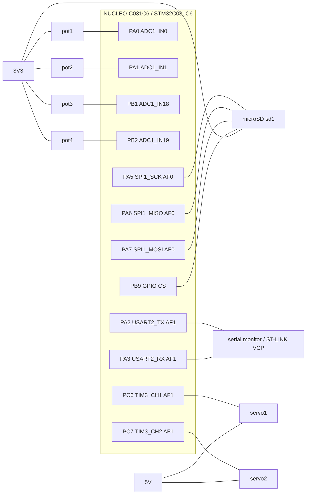

# Pinout, bus parameters and power budget

Heliostat controller, LR2. Board: NUCLEO-C031C6 (STM32C031C6, Cortex-M0+), simulated in Wokwi.

Sources: DS13867 Rev 4 (STM32C031x4/x6 datasheet), RM0490 (reference manual), UM2953 (Nucleo-64 board manual, MB1717), generated code in `firmware/Core/Src/`. Values marked *(assumed)* do not come from a datasheet. Items marked TODO are collected in section 6.

## 1. Pin table

Every pin has exactly one function. The AF numbers below are the ones written by CubeMX into `stm32c0xx_hal_msp.c` (`GPIO_AF0_SPI1`, `GPIO_AF1_TIM3`, `GPIO_AF1_USART2`) and agree with DS13867 Table 13 (port A) and Table 17 (port C).

| Pin | Signal | AF | Connected to (Wokwi) | Board note |
|---|---|---|---|---|
| PA0 | ADC1_IN0 | analog | pot1:SIG | |
| PA1 | ADC1_IN1 | analog | pot2:SIG | |
| PB1 | ADC1_IN18 | analog | pot3:SIG | |
| PB2 | ADC1_IN19 | analog | pot4:SIG | |
| PA2 | USART2_TX | AF1 | serial monitor RX | ST-LINK virtual COM port, SB27/SB32 (UM2953 section 6.9) |
| PA3 | USART2_RX | AF1 | serial monitor TX | same |
| PA5 | SPI1_SCK | AF0 | sd1:SCK | also drives LD4 through SB26 (UM2953 section 6.10) |
| PA6 | SPI1_MISO | AF0 | sd1:DO | |
| PA7 | SPI1_MOSI | AF0 | sd1:DI | |
| PB9 | GPIO output, SD chip select (software, active low) | none | sd1:CS | |
| PC6 | TIM3_CH1 | AF1 | servo1:PWM | |
| PC7 | TIM3_CH2 | AF1 | servo2:PWM | |

ADC channels are hardware-locked to their pins (IN2 and IN3 exist only on PA2 and PA3), so the four potentiometers use IN0, IN1, IN18 and IN19 and leave PA2/PA3 to USART2.

Power and ground nets:

| Net | Connected parts |
|---|---|
| 3V3 | pot1..pot4 VCC, sd1 VCC |
| 5V | servo1 V+, servo2 V+ |
| GND | all grounds, logic analyzer GND |

Logic analyzer probes: D0 PA5 (SCK), D1 PA7 (MOSI), D2 PA6 (MISO), D3 PB9 (CS), D4 PA2 (UART TX), D5 PC6 (servo 1), D6 PC7 (servo 2), D7 reserved for the ADC timing marker.

## 2. Clock tree and bus parameters

Clock tree as configured in `SystemClock_Config()`:

HSI 48 MHz, HSIDIV /4 -> SYSCLK 12 MHz -> AHB /1 -> HCLK 12 MHz -> APB1 /1 -> PCLK1 12 MHz -> timer clock 12 MHz (APB prescaler 1, so the multiplier is 1). Flash latency 0 wait states. The run-time value `tim_clk=12000000` printed at boot confirms the timer clock.

| Bus | Clock | Parameters | Derived values |
|---|---|---|---|
| USART2 | PCLK1 12 MHz | 115200 baud, 8N1, oversampling 16, no flow control | BRR = 12 000 000 / 115 200 = 104; actual 115 385 baud (+0.16 %); one byte = 86.8 us |
| SPI1 | PCLK 12 MHz | master, mode 0 (CPOL 0, CPHA first edge), 8 bit, MSB first, software NSS (PB9), prescaler /2 | SCK 6 MHz. SD initialisation needs 100..400 kHz: prescaler /32 gives 375 kHz (planned for the driver) |
| TIM3 | 12 MHz | PSC = tim_clk / 1 MHz - 1 = 11, ARR = 19999, set at run time (the CubeMX values PSC 0 / ARR 65535 are placeholders overwritten in code) | tick 1 us, period 20 ms (50 Hz), CCR 1500 = 1.5 ms neutral pulse, servo range 1000..2000 counts |
| ADC1 | PCLK/1 = 12 MHz | 12 bit, right aligned, software trigger, one channel per conversion, sampling time 1.5 cycles | conversion = 1.5 + 12.5 = 14 cycles = 1.17 us; 1 LSB = 3.3 V / 4096 = 0.81 mV |
| SysTick | HCLK | 1 kHz HAL tick | `HAL_Delay` resolution 1 ms |

## 3. Power budget

Limits from UM2953 (section 6.5, Table 7): USB supply 500 mA after enumeration (100 mA before); board plus shield on the 3V3 rail must stay under 500 mA. The USB budget is shared by the board, the 3V3 loads and the 5V loads.

| Rail | Consumer | Typical | Worst case | Basis |
|---|---|---|---|---|
| 3V3 | STM32C031C6 at 12 MHz | TODO | TODO | DS13867 Table 28 (Run mode from flash) |
| 3V3 | 4 x potentiometer | 1.3 mA | 1.3 mA | 4 x 3.3 V / 10 kOhm *(assumed 10 kOhm)* |
| 3V3 | microSD, SPI mode | 20 mA *(assumed)* | 100 mA *(assumed)* | SD default-speed ceiling; confirm with the card datasheet |
| 5V | 2 x micro servo, idle | 20 mA *(assumed)* | | 10 mA each, SG90-class servo |
| 5V | 2 x micro servo, moving | 400 mA *(assumed)* | | 200 mA each |
| 5V | 2 x micro servo, stalled | | 1300 mA *(assumed)* | 650 mA each |

Result:

- 3V3 rail: worst case about 100 mA plus the MCU, well under 500 mA. Acceptable.
- 5V rail: two moving servos already use about 400 mA of the 500 mA USB budget; a stall needs 1300 mA. Not acceptable from the board's 5V pin on real hardware. On hardware the servos need a separate 5 V supply with a common ground. In the Wokwi simulation the 5V pin is used because the simulator does not model supply current.

## 4. Rejected layouts

**Variant A: USART2 moved to PA4/PA13, ADC on IN0..IN3 (contiguous PA0..PA3).**
Rejected because (1) PA2/PA3 are the ST-LINK virtual COM port pins (SB27/SB32), so the serial log would need an external USB-UART adapter; (2) PA13 is the SWDIO debug pin, so using it for USART2 would block SWD debugging; (3) the gain, a tidier ADC pin block, has no functional value.

**Variant B: servo 2 PWM on PC14.**
Rejected because PC14/PC15 are wired to the on-board 32.768 kHz crystal X2 by default (UM2953 section 6.7.1). Using PC14 as a GPIO needs solder-bridge rework (SB3/SB4, UM2953 Table 10). The simulator does not model the crystal, so this layout would work in Wokwi and fail on the real board, which is exactly the class of hidden wiring conflict the pin plan must avoid.

## 5. Connection diagram

