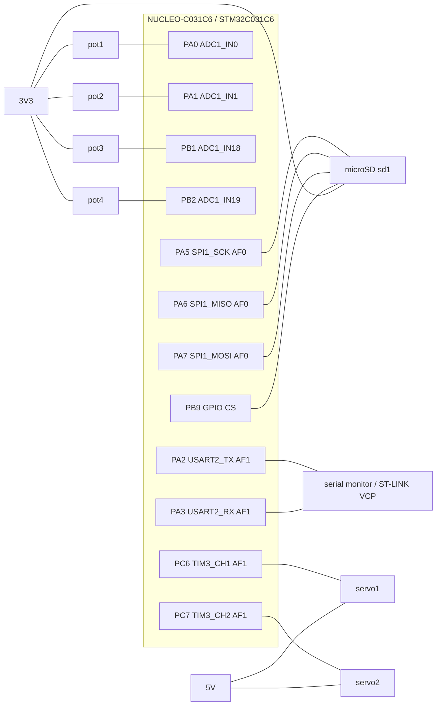

# Pinout, bus parameters and power budget

Heliostat controller, LR2. Board: NUCLEO-C031C6 (STM32C031C6, Cortex-M0+), simulated in Wokwi.

Sources: DS13867 Rev 4 (STM32C031x4/x6 datasheet), RM0490 (reference manual), UM2953 (Nucleo-64 board manual, MB1717), generated code in `firmware/Core/Src/`. Values marked *(assumed)* do not come from a datasheet. The checks against the documents and the open findings are in section 6.

## 1. Pin table

Every pin has exactly one function. The AF numbers below are the ones written by CubeMX into `stm32c0xx_hal_msp.c` (`GPIO_AF0_SPI1`, `GPIO_AF1_TIM3`, `GPIO_AF1_USART2`) and agree with DS13867 Table 13 (port A) and Table 17 (port C).

| Pin | Signal | AF | Connected to (Wokwi) | Board note |
|---|---|---|---|---|
| PA0 | ADC1_IN0 | analog | pot1:SIG | |
| PA1 | ADC1_IN1 | analog | pot2:SIG | |
| PB1 | ADC1_IN18 | analog | pot3:SIG | |
| PB2 | ADC1_IN19 | analog | pot4:SIG | |
| PA2 | USART2_TX | AF1 | serial monitor RX | ST-LINK virtual COM port, SB27/SB32 (UM2953 section 6.9) |
| PA3 | USART2_RX | AF1 | serial monitor TX | same |
| PA5 | SPI1_SCK | AF0 | sd1:SCK | also drives LD4 through SB26 (UM2953 section 6.10) |
| PA6 | SPI1_MISO | AF0 | sd1:DO | |
| PA7 | SPI1_MOSI | AF0 | sd1:DI | |
| PB9 | GPIO output, SD chip select (software, active low) | none | sd1:CS | must be high from reset; the generated `MX_GPIO_Init()` drives it low until `plat_spi_init()` (section 6.3) |
| PB3 | GPIO output, ADC timing marker (high while `plat_adc_read()` runs) | none | logic analyzer D7 only | test aid, not a product signal |
| PC6 | TIM3_CH1 | AF1 | servo1:PWM | |
| PC7 | TIM3_CH2 | AF1 | servo2:PWM | |

ADC channels are hardware-locked to their pins (IN2 and IN3 exist only on PA2 and PA3), so the four potentiometers use IN0, IN1, IN18 and IN19 and leave PA2/PA3 to USART2.

Power and ground nets:

| Net | Connected parts |
|---|---|
| 3V3 | pot1..pot4 VCC, sd1 VCC |
| 5V | servo1 V+, servo2 V+ |
| GND | all grounds, logic analyzer GND |

Logic analyzer probes: D0 PA5 (SCK), D1 PA7 (MOSI), D2 PA6 (MISO), D3 PB9 (CS), D4 PA2 (UART TX), D5 PC6 (servo 1), D6 PC7 (servo 2), D7 PB3 (ADC timing marker). Capture parameters and results: [captures/analysis.md](captures/analysis.md).

## 2. Clock tree and bus parameters

Clock tree as configured in `SystemClock_Config()`:

HSI 48 MHz, HSIDIV /4 -> SYSCLK 12 MHz -> AHB /1 -> HCLK 12 MHz -> APB1 /1 -> PCLK1 12 MHz -> timer clock 12 MHz (APB prescaler 1, so the multiplier is 1). Flash latency 0 wait states. The run-time value `tim_clk=12000000` printed at boot confirms the timer clock.

| Bus | Clock | Parameters | Derived values |
|---|---|---|---|
| USART2 | PCLK1 12 MHz | 115200 baud, 8N1, oversampling 16, no flow control | BRR = 12 000 000 / 115 200 = 104; actual 115 385 baud (+0.16 %); one byte = 86.8 us |
| SPI1 | PCLK 12 MHz | master, mode 0 (CPOL 0, CPHA first edge), 8 bit, MSB first, software NSS (PB9), prescaler /2 | SCK 6 MHz. SD initialisation needs 100..400 kHz: prescaler /32 gives 375 kHz, used by `sdcard.c` through `plat_spi_set_speed()` until the card is initialised, then /2. Measured in the captures: 374.8 kHz and 5957 kHz ([captures/analysis.md](captures/analysis.md), section 4.4) |
| TIM3 | 12 MHz | PSC = tim_clk / 1 MHz - 1 = 11, ARR = 19999, set at run time (the CubeMX values PSC 0 / ARR 65535 are placeholders overwritten in code) | tick 1 us, period 20 ms (50 Hz), CCR 1500 = 1.5 ms neutral pulse, servo range 1000..2000 counts |
| ADC1 | PCLK/1 = 12 MHz | 12 bit, right aligned, software trigger, one channel per conversion, sampling time 1.5 cycles (125 ns; see section 6.3, item 5, for real hardware) | conversion = 1.5 + 12.5 = 14 cycles = 1.17 us; 1 LSB = 3.3 V / 4096 = 0.81 mV |
| SysTick | HCLK | 1 kHz HAL tick | `HAL_Delay` resolution 1 ms |

## 3. Power budget

Limits from UM2953 (section 6.5, Table 7): USB supply 500 mA after enumeration (100 mA before); board plus shield on the 3V3 rail must stay under 500 mA. The USB budget is shared by the board, the 3V3 loads and the 5V loads.

| Rail | Consumer | Typical | Worst case | Basis |
|---|---|---|---|---|
| 3V3 | STM32C031C6 at 12 MHz | 1.45 mA | 2.70 mA | DS13867 Table 28, fHCLK 12 MHz from HSI48/HSIDIV, code from flash, all peripherals disabled: typical at 25 degC and 3.0 V, maximum at 125 degC and 3.6 V |
| 3V3 | 4 x potentiometer | 1.3 mA | 1.3 mA | 4 x 3.3 V / 10 kOhm *(assumed 10 kOhm)* |
| 3V3 | microSD, SPI mode | 20 mA *(assumed)* | 100 mA *(assumed)* | SD default-speed ceiling; confirm with the card datasheet |
| 5V | 2 x micro servo, idle | 20 mA *(assumed)* | | 10 mA each, SG90-class servo |
| 5V | 2 x micro servo, moving | 400 mA *(assumed)* | | 200 mA each |
| 5V | 2 x micro servo, stalled | | 1300 mA *(assumed)* | 650 mA each |

Result:

- 3V3 rail: worst case about 104 mA (SD card 100 mA assumed, MCU 2.70 mA, potentiometers 1.3 mA), a margin of about 390 mA under 500 mA. Table 28 is for all peripherals disabled; the enabled peripherals add to it, but the margin is far larger. Acceptable.
- 5V rail: two moving servos already use about 400 mA of the 500 mA USB budget; a stall needs 1300 mA. Not acceptable from the board's 5V pin on real hardware. On hardware the servos need a separate 5 V supply with a common ground. In the Wokwi simulation the 5V pin is used because the simulator does not model supply current.

## 4. Rejected layouts

**Variant A: USART2 moved to PA4/PA13, ADC on IN0..IN3 (contiguous PA0..PA3).**
Rejected because (1) PA2/PA3 are the ST-LINK virtual COM port pins (SB27/SB32), so the serial log would need an external USB-UART adapter; (2) PA13 is the SWDIO debug pin, so using it for USART2 would block SWD debugging; (3) the gain, a tidier ADC pin block, has no functional value.

**Variant B: servo 2 PWM on PC14.**
Rejected because PC14/PC15 are wired to the on-board 32.768 kHz crystal X2 by default (UM2953 section 6.7.1). Using PC14 as a GPIO needs the solder bridges SB3 and SB4 closed and R31 and R32 removed (UM2953 section 6.7.1, Table 10). The simulator does not model the crystal, so this layout would work in Wokwi and fail on the real board, which is exactly the class of hidden wiring conflict the pin plan must avoid.

## 5. Connection diagram

## 6. Verification against the documents

### 6.1 Claims and their sources

DS13867 is the STM32C031x4/x6 datasheet, UM2953 the Nucleo-64 board manual (MB1717).

| # | Claim in this file | Document and place | What the document says |
|---|---|---|---|
| 1 | SPI1 on PA5, PA6, PA7 is AF0 | DS13867 Table 13 (Port A alternate function mapping, AF0 to AF7) | PA5 SPI1_SCK, PA6 SPI1_MISO, PA7 SPI1_MOSI, all in the AF0 column |
| 2 | USART2 on PA2, PA3 is AF1 | DS13867 Table 13 | PA2 USART2_TX, PA3 USART2_RX in the AF1 column |
| 3 | TIM3_CH1 and TIM3_CH2 on PC6, PC7 are AF1 | DS13867 Table 17 (Port C alternate function mapping, AF0 to AF7) | PC6 TIM3_CH1, PC7 TIM3_CH2 in the AF1 column |
| 4 | USB supplies 500 mA after enumeration, 100 mA before | UM2953 section 6.5, Table 7 (Power supply capabilities) | 500 mA with good enumeration, 100 mA without |
| 5 | USART2 is the ST-LINK virtual COM port | UM2953 section 6.9 (VCP communication), Table 10 | PA2 and PA3 reach the ST-LINK through SB27 and SB32 |
| 6 | PA5 also drives LD4 | UM2953 section 6.10 (LEDs), Table 10 | SB26 closed: PA5 controls LD4 |
| 7 | PC14 and PC15 belong to the crystal X2 | UM2953 section 6.7.1 (LSE clock reference), Table 10 | X2 is the default; to use PC14 and PC15 as GPIO, close SB3 and SB4 and remove R31 and R32 |

### 6.2 Conflict check

| Class of conflict | Result |
|---|---|
| Pin | None. Every pin in section 1 has one function. PB3 was added later as the timing-marker output and nothing else uses it. |
| Peripheral block | TIM3 serves both servos. Both channels need the same 50 Hz period, so the shared prescaler and period are not a conflict (1 us tick, 20 ms period, section 2). ADC1 serves four potentiometers by one conversion per call, one channel at a time. SPI1 has one master and one slave. |
| Board wiring | PA2 and PA3 are the virtual COM port and are used as such. PA5 is also LD4 (SB26), so the LED shows the SCK activity. PC14 and PC15 (crystal X2) and PA13 and PA14 (SWD) are not used. |
| DMA | The product uses no DMA: ADC, UART and SPI transfers are polled, so there is no request-mapping conflict. |
| Electrical | No 5 V signal reaches an MCU pin: the potentiometers are on 3V3 and the servo signal lines are MCU outputs. The 5V rail cannot carry the servos on real hardware (section 3). |
| Package | The alternate-function tables used (DS13867 Tables 13 and 17) belong to this device; the pins were not copied from a layout made for another board. |

### 6.3 Findings and open items

1. **PB9 starts low.** CubeMX generates `MX_GPIO_Init()` with the output level of PB9 set to low, so the chip select is low from the start of the program until `plat_spi_init()` drives it high, 3.85 ms after reset. The card model in the simulator drives MISO low during that time ([captures/analysis.md](captures/analysis.md), section 8.2). The fix is the CubeMX setting "GPIO output level: High" for PB9. It is not applied; the captures in `captures/` were recorded before it and describe the current firmware.
2. **5V rail.** Two servos cannot run from the board's 5V pin on real hardware (section 3). The real build needs a separate 5 V supply with a common ground. The simulator does not model supply current.
3. **What the simulator cannot show.** Solder bridges, the crystal on PC14 and PC15, the supply current and the sampling capacitor of the ADC are not modelled. Items 4 to 7 of section 6.1, the power budget and the ADC source impedance are therefore checked in the documents only. On hardware: read the bridges on the board, measure the supply current of the servo rail with a multimeter in series, and compare the ADC reading of a high-impedance source at 1.5 and at a longer sampling time.
4. **MCU run current.** DS13867 Table 28 (Current consumption in Run mode from flash memory at different die temperatures), block fHCLK = fHSI48/HSIDIV, row 12 MHz, all peripherals disabled, evaluated by characterization (not tested in production): typical 1.45 mA at 25 degC and 1.50 mA at 85 degC (VDD 3.0 V); maximum 1.70 mA at 25 degC and 2.70 mA at 125 degC (VDD 3.6 V). Section 3 uses 1.45 mA and 2.70 mA.
5. **ADC source impedance (design consequence for real hardware).** DS13867 Table 55 (Maximum ADC RAIN) is given for an ADC clock of 35 MHz and lists the sampling time in nanoseconds, so it has to be applied by time, not by the number of cycles. At 12 MHz one cycle is 83.3 ns, so the configured 1.5 cycles are 125 ns. For 12 bit the table gives 680 Ohm at 100 ns and 2200 Ohm at 214 ns; 125 ns lies between the two rows, so only 680 Ohm is guaranteed. A 10 kOhm potentiometer (assumed value) has up to 2.5 kOhm source impedance at mid travel, which is above that. The simulator does not model the sampling capacitor, so Wokwi returns exact values; on real hardware the sampling time must be raised. Up to 2.5 kOhm the table requires at least 357 ns (the 4700 Ohm row); the first available setting at or above that is 7.5 cycles, 625 ns at 12 MHz (3.5 cycles, 292 ns, is not enough). Up to 10 kOhm, for example a photoresistor divider, it requires at least 1129 ns (the 15000 Ohm row); the first available setting is 19.5 cycles, 1.625 us (12.5 cycles, 1.04 us, is not enough). The price is a longer conversion, 20 cycles = 1.67 us (7.5) or 32 cycles = 2.67 us (19.5) instead of 14 cycles = 1.17 us, which does not matter for a slowly changing light measurement.
