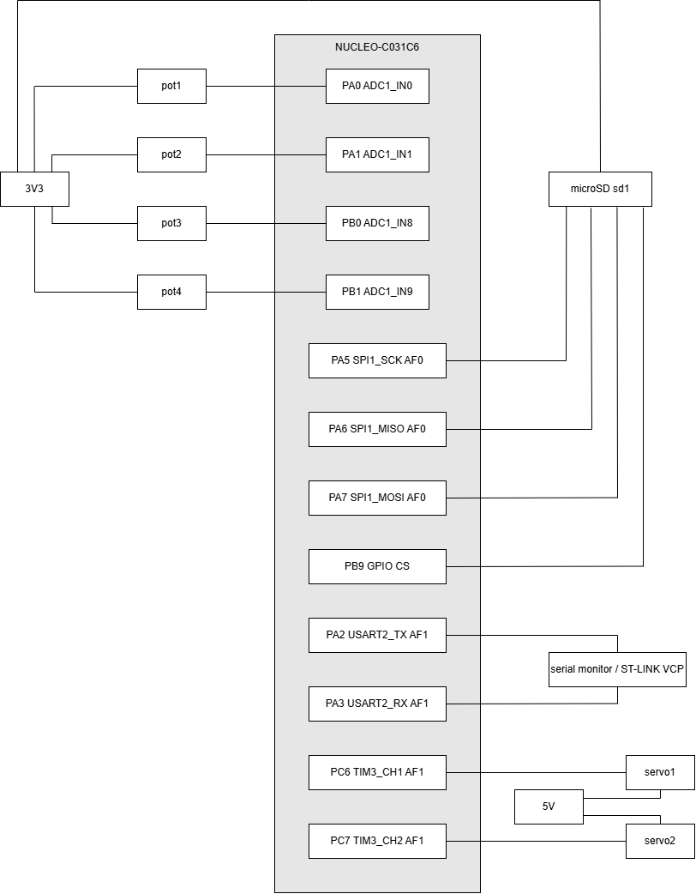
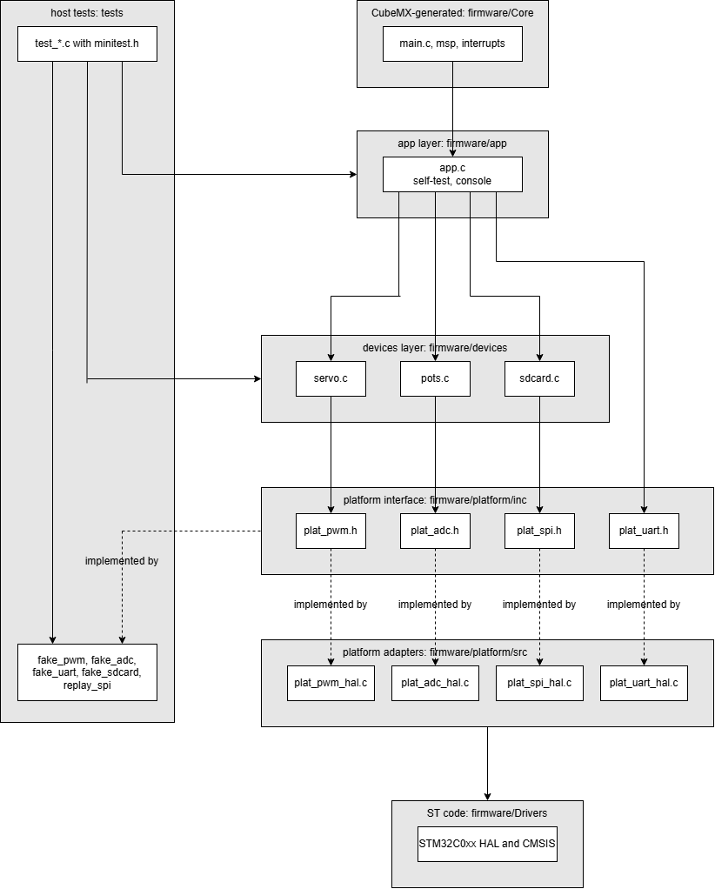

Національний технічний університет України
«Київський політехнічний інститут імені Ігоря Сікорського»

Факультет інформатики та обчислювальної техніки
Кафедра обчислювальної техніки

**Лабораторна робота №2**
з дисципліни «Системне програмування»
на тему «Інтеграція сенсорної підсистеми: схема підключення, верифікація інтерфейсів логічним аналізатором, архітектура програмного проєкту»

Виконав:
студент групи ІО-31
Бобруйко Олексій Євгенович

Перевірив:
Гордієнко Нікіта Юрійович

Київ – 2026

---

## 1. Мета лабораторної роботи

Метою роботи є доведення того, що апаратна частина продукту – геліостата (чотири потенціометри як замінник датчиків освітленості, два сервоприводи, модуль мікро-SD карти на шині SPI, USART2 для самоперевірки й консолі) – логічно й фізично сумісна: усі пристрої працюють одночасно без конфліктів виводів і периферійних блоків, кожна шина працює так, як описано в документації, а це підтверджено не лише журналом UART, а й незалежним вимірюванням на рівні сигналів. Додатково потрібно було відокремити логіку продукту від апаратно-залежного коду та покрити тестами ту частину коду, що виконується без плати.

На початковому етапі склалося уявлення, згідно з яким лабораторна робота №2 є розширенням лабораторної роботи №1: до працюючого конвеєра слід додати документ із розподілом виводів, кілька записів логічного аналізатора й розкласти код за каталогами, причому аналізатор лише підтверджує те, що вже повідомляє прошивка. У процесі виконання встановлено, що основну цінність має розбіжність між журналом UART і сигналами на виводах: самоперевірка SD-картки повідомляла `OK`, тоді як лінія CS понад 3,8 мс лишалася низькою, а модель картки тримала MISO низькою (проблема 5). Висновок лабораторної роботи №1 про те, що збій АЦП є обмеженням симулятора, спростовано (проблема 1), а тестовий скрипт виявився таким, що мовчки пропускає тести (проблема 3).

## 2. Розподіл обов'язків

Роботу виконано індивідуально; за кожним із шести напрямів розділу 5 методичних вказівок відповідальним є автор звіту. Артефакти та коміти кожного напряму наведено в таблиці.

| № | Напрям | Відповідальний | Ключові артефакти | Коміти |
|---|---|---|---|---|
| 1 | Звіт і документація | Бобруйко О. Є. | `docs/lab2-report.md`, `docs/lab_2/img/`, `README.md`, відеозвіт | [e6bfa74](https://github.com/IO31-Bobruiko-Oleksii/systems-programming-2026/commit/e6bfa74bff68b7aeaa9657354c114e23ee090fa7), [1ba4034](https://github.com/IO31-Bobruiko-Oleksii/systems-programming-2026/commit/1ba4034b456c6015af05b4e43f138167587e6247), [bd434b3](https://github.com/IO31-Bobruiko-Oleksii/systems-programming-2026/commit/bd434b324f1b5fed8069f24a538b5390f367628b) |
| 2 | Документація і pinout | Бобруйко О. Є. | `docs/pinout.md`, `docs/hardware-components.md`, `.ioc` (виводи) | [c1ef566](https://github.com/IO31-Bobruiko-Oleksii/systems-programming-2026/commit/c1ef566dce6cd96d628250a678099e93021de212), [10d3714](https://github.com/IO31-Bobruiko-Oleksii/systems-programming-2026/commit/10d371413293d2a8695e7dc75f24445d7a49d4f7), [1ba4034](https://github.com/IO31-Bobruiko-Oleksii/systems-programming-2026/commit/1ba4034b456c6015af05b4e43f138167587e6247), [bd434b3](https://github.com/IO31-Bobruiko-Oleksii/systems-programming-2026/commit/bd434b324f1b5fed8069f24a538b5390f367628b) |
| 3 | Робота з апаратурою | Бобруйко О. Є. | `diagram.json`, `scenarios/`, `scripts/capture.sh`, `docs/captures/*.vcd` | [03df4ec](https://github.com/IO31-Bobruiko-Oleksii/systems-programming-2026/commit/03df4ecddc9dabdacb773454877e67ebf7234eaf), [10d3714](https://github.com/IO31-Bobruiko-Oleksii/systems-programming-2026/commit/10d371413293d2a8695e7dc75f24445d7a49d4f7), [e0c1609](https://github.com/IO31-Bobruiko-Oleksii/systems-programming-2026/commit/e0c16094e055da35fbfdeac6681b177bc03610e0) |
| 4 | Декодування і аналіз | Бобруйко О. Є. | `scripts/vcd_tool.py`, `scripts/decode_captures.sh`, `docs/captures/analysis.md` | [95f2989](https://github.com/IO31-Bobruiko-Oleksii/systems-programming-2026/commit/95f2989b09ec5e9b63e5d4b95f28f2a59d868f04), [e6bfa74](https://github.com/IO31-Bobruiko-Oleksii/systems-programming-2026/commit/e6bfa74bff68b7aeaa9657354c114e23ee090fa7) |
| 5 | Структура проєкту і збірка | Бобруйко О. Є. | `firmware/{platform,devices,app}`, `firmware/build.mk`, `Makefile`, `scripts/check_deps.sh`, `.github/workflows/lab2.yml`, `docs/architecture.md` | [cbd0f68](https://github.com/IO31-Bobruiko-Oleksii/systems-programming-2026/commit/cbd0f6847f214b41f4e27826e425ebb8fa892203), [f82f95d](https://github.com/IO31-Bobruiko-Oleksii/systems-programming-2026/commit/f82f95d56069a95e18617ee090dc836ed97c450c), [52c0a18](https://github.com/IO31-Bobruiko-Oleksii/systems-programming-2026/commit/52c0a18c5960c788acf0fc6c5e0f3431dadc8cb8), [7769457](https://github.com/IO31-Bobruiko-Oleksii/systems-programming-2026/commit/776945759af34659f20102dea22e61828097c3cc), [fe42e59](https://github.com/IO31-Bobruiko-Oleksii/systems-programming-2026/commit/fe42e593b6d84682fedad4a6f4aac2fe2ef5ee16), [ea9aec5](https://github.com/IO31-Bobruiko-Oleksii/systems-programming-2026/commit/ea9aec5104a4b62144a6e20eccdf11f3736bc45d), [6476344](https://github.com/IO31-Bobruiko-Oleksii/systems-programming-2026/commit/6476344eab11b6b67b85fdee2d5d1236b5456746), [e6bfa74](https://github.com/IO31-Bobruiko-Oleksii/systems-programming-2026/commit/e6bfa74bff68b7aeaa9657354c114e23ee090fa7) |
| 6 | Тестування | Бобруйко О. Є. | `tests/`, `tests/coverage.sh`, `tests/vectors/` | [0de118c](https://github.com/IO31-Bobruiko-Oleksii/systems-programming-2026/commit/0de118c6acdd2b3a1df2696efd1d852ef6550b01), [645039a](https://github.com/IO31-Bobruiko-Oleksii/systems-programming-2026/commit/645039ab3e4da64d341628242a359e3a8c4201fe), [2635d63](https://github.com/IO31-Bobruiko-Oleksii/systems-programming-2026/commit/2635d63d3e1dfdd2da5ae6e19be607fee636fc01), [fe42e59](https://github.com/IO31-Bobruiko-Oleksii/systems-programming-2026/commit/fe42e593b6d84682fedad4a6f4aac2fe2ef5ee16), [95f2989](https://github.com/IO31-Bobruiko-Oleksii/systems-programming-2026/commit/95f2989b09ec5e9b63e5d4b95f28f2a59d868f04), [e6bfa74](https://github.com/IO31-Bobruiko-Oleksii/systems-programming-2026/commit/e6bfa74bff68b7aeaa9657354c114e23ee090fa7) |

Результат здається pull request-ом у `main` з тегом `lab2` на фінальному коміті. Репозиторій: https://github.com/IO31-Bobruiko-Oleksii/systems-programming-2026.

## 3. Аргументація архітектурних рішень

Аргументацію наведено за документом `docs/pinout.md`; кожне твердження спирається на первинний документ – DS13867 Rev 4 (STM32C031x4/x6), RM0490 або UM2953 (плата NUCLEO-C031C6) – або на виміряне значення. Значення, яких немає в документації, позначено як припущені (*assumed*). Камери, I²C і SCCB у продукті немає, тож конфлікту паралельного інтерфейсу камери з іншими шинами не виникає.

### 3.1. Інтерфейс для кожного пристрою і вибір виводів

| Пристрій | Інтерфейс і виводи | Чому саме так |
|---|---|---|
| Датчики освітленості (GM5528; у Wokwi – 4 потенціометри) | АЦП: `PA0`, `PA1` (`IN0`, `IN1`), `PB1`, `PB2` (`IN18`, `IN19`) | Аналоговий вихід, протоколу немає; у Wokwi немає фоторезистора, потенціометр має той самий електричний інтерфейс. Канали АЦП жорстко прив'язані до виводів; `IN2`/`IN3` існують лише на `PA2`/`PA3`, які належать віртуальному COM-порту, тому взято `IN18`/`IN19` |
| Сервоприводи SG92R x 2 | ШІМ: `PC6`, `PC7` (`TIM3_CH1`, `CH2`, AF1, DS13867, табл. 17) | Імпульс 1…2 мс з періодом 20 мс. Обидва канали одного таймера: однаковий період, тож спільні PSC і ARR конфлікту не створюють |
| Носій для журналу (у PRD – SPI-flash W25Q64; у Wokwi – мікро-SD) | SPI1: `PA5`, `PA6`, `PA7` (AF0, табл. 13), CS – `PB9` | У Wokwi немає SPI-flash, мікро-SD має ті самі лінії (ЛР1, проблема 4). `PA5` водночас керує LD4 через SB26 (UM2953, 6.10): світлодіод показує активність SCK, конфліктом це не є |
| Консоль і самоперевірка | USART2: `PA2`, `PA3` (AF1, табл. 13) | Віртуальний COM-порт ST-LINK (UM2953, 6.9, SB27/SB32), окремий USB-UART не потрібен |

**Чому CS програмний і на `PB9`.** Транзакція картки (команда, відповідь, блок даних) потребує утримання CS у низькому рівні весь обмін: у записах такі проміжки тривають 3,390 мс і 11,659 мс і охоплюють десятки викликів функції передачі (розділ 6.3). Апаратний NSS пов'язаний зі станом модуля SPI і не призначений для утримання вибору між викликами. Для програмного CS придатний будь-який вільний вивід; `PB9` не належить службовим функціям плати (VCP, SWD, кварц) і не має іншої ролі. Службовий `PB3` – маркер вимірювання АЦП для каналу D7 аналізатора, а не сигнал продукту (розділ 6.5).

### 3.2. Параметри шин і тактування

Тактування: HSI 48 МГц, HSIDIV /4, SYSCLK = HCLK = PCLK1 = 12 МГц, частота таймера дорівнює PCLK1 (підтверджено виведенням `tim_clk=12000000`).

| Шина | Параметри | Розрахунок | Виміряно |
|---|---|---|---|
| USART2 | 115200, 8N1 | BRR = 12 000 000 / 115 200 = 104; фактично 115 385 біт/с (+0,16 %) | 115 348 біт/с |
| SPI1 | ведучий, режим 0, 8 біт, MSB, програмний NSS | ініціалізація: /32 –> 375 кГц; далі /2 –> 6 МГц | 374,8 кГц; 5957 кГц |
| TIM3 | ШІМ, 2 канали | PSC = 12 МГц / 1 МГц − 1 = 11, ARR = 19999: крок 1 мкс, період 20 мс | 20 000,000 мкс |
| ADC1 | 12 біт, один канал за перетворення, 1,5 такту вибірки | 1,5 + 12,5 = 14 тактів = 1,17 мкс; 1 LSB = 0,81 мВ | див. розділ 6.5 |

Під час ініціалізації картка має отримувати 100…400 кГц, тому 375 кГц; потім – 6 МГц, максимум подільника /2 при PCLK 12 МГц, що менше за 25 МГц режиму Default Speed. Вище підвищувати частоту безглуздо: SCK використовується лише 6,5 % часу читання блоку, решту займає програма (розділ 6.3). Крок ШІМ 1 мкс дає 0,18° на одиницю при ході 180°.

### 3.3. Бюджет живлення

Обмеження: USB дає 500 мА після нумерації (UM2953, 6.5, табл. 7).

| Лінія | Споживач | Типове / найгірше | Підстава |
|---|---|---|---|
| 3V3 | STM32C031C6, 12 МГц | 1,45 / 2,70 мА | DS13867, табл. 28 (Run із Flash, `fHCLK` = HSI48/HSIDIV, 12 МГц, периферія вимкнена): 25 °C, 3,0 В / 125 °C, 3,6 В |
| 3V3 | 4 потенціометри | 1,3 / 1,3 мА | 4 x 3,3 В / 10 кОм |
| 3V3 | мікро-SD | 20 / 100 мА | межа режиму Default Speed |
| 5V | 2 сервоприводи | спокій 20, рух 400 / блокування 1300 мА | *(припущено)*, клас SG90 |

На 3V3 найгірший випадок близько 104 мА, запас близько 390 мА до 500 мА. На 5V рух двох сервоприводів уже споживає близько 400 мА з 500 мА USB, а блокування – 1300 мА, тому на реальному стенді сервоприводи потребують окремого джерела 5 В зі спільною «землею» (без неї керувальний сигнал не має визначеного рівня щодо живлення сервоприводу). У Wokwi використано вивід 5V плати, бо симулятор не моделює струм.

### 3.4. Відхилені варіанти

**A. USART2 на `PA4`/`PA13`, АЦП на `IN0`…`IN3`.** Відхилено: `PA2`/`PA3` – віртуальний COM-порт (потрібен був би зовнішній USB-UART); `PA13` – `SWDIO`, його використання блокує налагодження; виграш (охайний блок АЦП) функціональної цінності не має.

**B. ШІМ другого сервоприводу на `PC14`.** Відхилено: `PC14`/`PC15` за замовчуванням з'єднані з кварцом X2; для GPIO потрібно замкнути SB3, SB4 і зняти R31, R32 (UM2953, 6.7.1, табл. 10). Симулятор кварц не моделює, тож такий варіант працював би у Wokwi й не працював би на платі.

### 3.5. Перевірка конфліктів

| Клас | Результат |
|---|---|
| Вивід | Кожен вивід має одну функцію |
| Периферійний блок | `TIM3` – два канали з однаковим періодом; `ADC1` – канали по черзі; `SPI1` – один ведучий і один підлеглий |
| Обв'язка плати | `PA2`/`PA3` – VCP за призначенням; `PA5` – ще й LD4; `PC14`/`PC15` і `PA13`/`PA14` не використано |
| DMA | Не використовується (опитування), конфліктів запитів немає |
| Електричний | 5-вольтових сигналів на виводах МК немає; сервоприводи не можна живити від 5V плати (розділ 3.3) |
| Корпус | Таблиці AF (табл. 13, 17) належать саме цьому кристалу |

### 3.6. Відкриті питання

1. **`PB9` стартує низьким.** Згенерована CubeMX `MX_GPIO_Init()` пише на `PB9` низький рівень, тож CS лишається низьким від скидання до `plat_spi_init()` (3,85 мс). Виправлення (CubeMX «GPIO output level: High») свідомо не застосовано: усі записи й числа аналізу отримано на поточній прошивці (розділ 6.7.2).
2. **Опір джерела АЦП.** Табл. 55 DS13867 задано для 35 МГц у наносекундах; налаштовані 1,5 такту при 12 МГц – це 125 нс, для чого гарантовано лише 680 Ом (100 нс). Потенціометр 10 кОм дає до 2,5 кОм, тому на реальній платі потрібно щонайменше 7,5 такту (625 нс), а для джерела до 10 кОм (фоторезистор) – 19,5 такту (1,625 мкс). Wokwi ємність вибірки не моделює.
3. **Чого симулятор не показує:** перемички, кварц, струм, ємність вибірки АЦП, якість фронтів. Перевірка на обладнанні – розділ 6.8.

## 4. Інструкція з підключення

Інструкція відповідає `diagram.json` і таблиці `docs/pinout.md`. Склад стенда: плата `board-st-nucleo-c031c6`, чотири `wokwi-potentiometer` (значення 256, 512, 768, 1023), два `wokwi-servo`, `wokwi-microsd-card`, `wokwi-logic-analyzer` (`bufferSize` 1000000, `triggerMode` `off`) і послідовний монітор.

| Вивід плати | Контакт | Вивід плати | Контакт |
|---|---|---|---|
| `PA0` | `pot1:SIG` | `PA5` | `sd1:SCK` |
| `PA1` | `pot2:SIG` | `PA6` | `sd1:DO` |
| `PB1` | `pot3:SIG` | `PA7` | `sd1:DI` |
| `PB2` | `pot4:SIG` | `PB9` | `sd1:CS` |
| `PC6` | `servo1:PWM` | `PA2` | монітор `RX` |
| `PC7` | `servo2:PWM` | `PA3` | монітор `TX` |

Живлення: `3V3` – `VCC` усіх потенціометрів і `sd1`; `5V` – `V+` обох сервоприводів; `GND` плати – `GND` усіх пристроїв і аналізатора. Канали аналізатора (однакові в усіх записах): D0 – `PA5` (SCK), D1 – `PA7` (MOSI), D2 – `PA6` (MISO), D3 – `PB9` (CS), D4 – `PA2` (UART TX), D5 – `PC6`, D6 – `PC7` (ШІМ), D7 – `PB3` (маркер АЦП).


*Рисунок 1 – Схема з'єднань стенда в редакторі Wokwi*



*Рисунок 2 – Схема підключення (відповідає таблиці `docs/pinout.md`, розділ 1)*

**Порядок складання й перевірки.**

1. Склонувати репозиторій. Потрібні Docker, `make` і `wokwi-cli`; токен `WOKWI_CLI_TOKEN` передається змінною середовища й у репозиторії не зберігається.
2. `make build` – збірка в контейнері `ubuntu:22.04` (власний код із `-Wall -Wextra -Werror`).
3. `make flash` – симуляція; успіх – рядок `SELFTEST END total=5 passed=5 failed=0` протягом 15 с. Формат звіту – `docs/selftest-format.md`.
4. `make capture NAME=boot` записує `docs/captures/boot.vcd` (сценарії: `boot`, `console`, `adc`, `servo`, `sdread`, `nosd`); файл відкривається в PulseView (розділ 6.1).

**Для реального обладнання:** живити сервоприводи від окремого джерела 5 В зі спільною «землею»; перед складанням перевірити перемички SB26 і SB27/SB32 (UM2953, табл. 10), `PC14`/`PC15` не використовуються; «землю» аналізатора з'єднати із «землею» стенда; для джерела понад 680 Ом збільшити час вибірки АЦП (розділ 3.6).

## 5. Процес виконання

Виконання здійснювалося поетапно, окремими фіксаціями змін у системі контролю версій; нижче етапи наведено в порядку фактичного виконання.

**Етап 1. Усунення двох дефектів бази ЛР1.** Опитування чотирьох каналів АЦП одним запуском віддавало лише перше значення – послідовність перенастроєно на один канал за перетворення (проблема 1); канал ШІМ другого сервоприводу не працював – налаштування виправлено, вивід перенесено з `PC14` на `PC7` (проблема 2). Зафіксовано в комітах: [https://github.com/IO31-Bobruiko-Oleksii/systems-programming-2026/commit/03df4ecddc9dabdacb773454877e67ebf7234eaf](https://github.com/IO31-Bobruiko-Oleksii/systems-programming-2026/commit/03df4ecddc9dabdacb773454877e67ebf7234eaf), [https://github.com/IO31-Bobruiko-Oleksii/systems-programming-2026/commit/10d371413293d2a8695e7dc75f24445d7a49d4f7](https://github.com/IO31-Bobruiko-Oleksii/systems-programming-2026/commit/10d371413293d2a8695e7dc75f24445d7a49d4f7).

**Етап 2. Розкладка виводів і документ pinout:** таблиця виводів із AF, тактування, бюджет живлення, відхилені варіанти. Зафіксовано в коміті: [https://github.com/IO31-Bobruiko-Oleksii/systems-programming-2026/commit/c1ef566dce6cd96d628250a678099e93021de212](https://github.com/IO31-Bobruiko-Oleksii/systems-programming-2026/commit/c1ef566dce6cd96d628250a678099e93021de212).

**Етап 3. Шарова структура на прикладі сервоприводу.** Платформний інтерфейс `plat_pwm.h` і драйвер `servo.c`; хостова збірка тестів (`tests/run.sh`, `minitest.h`, `fake_pwm`) і тести сервоприводу; перевірка правила залежностей `scripts/check_deps.sh`; реалізація над HAL (`plat_pwm_hal.c`) і `firmware/build.mk`, що підключає шари до згенерованого `Makefile`. Зафіксовано в комітах: [https://github.com/IO31-Bobruiko-Oleksii/systems-programming-2026/commit/cbd0f6847f214b41f4e27826e425ebb8fa892203](https://github.com/IO31-Bobruiko-Oleksii/systems-programming-2026/commit/cbd0f6847f214b41f4e27826e425ebb8fa892203), [https://github.com/IO31-Bobruiko-Oleksii/systems-programming-2026/commit/0de118c6acdd2b3a1df2696efd1d852ef6550b01](https://github.com/IO31-Bobruiko-Oleksii/systems-programming-2026/commit/0de118c6acdd2b3a1df2696efd1d852ef6550b01), [https://github.com/IO31-Bobruiko-Oleksii/systems-programming-2026/commit/ea9aec5104a4b62144a6e20eccdf11f3736bc45d](https://github.com/IO31-Bobruiko-Oleksii/systems-programming-2026/commit/ea9aec5104a4b62144a6e20eccdf11f3736bc45d), [https://github.com/IO31-Bobruiko-Oleksii/systems-programming-2026/commit/f82f95d56069a95e18617ee090dc836ed97c450c](https://github.com/IO31-Bobruiko-Oleksii/systems-programming-2026/commit/f82f95d56069a95e18617ee090dc836ed97c450c), [https://github.com/IO31-Bobruiko-Oleksii/systems-programming-2026/commit/c408bb4a504eeae4c5d37460f3186e2a2458abca](https://github.com/IO31-Bobruiko-Oleksii/systems-programming-2026/commit/c408bb4a504eeae4c5d37460f3186e2a2458abca).

**Етап 4. Драйвери АЦП і SD-картки за тією самою схемою** (інтерфейс, драйвер, підробка, тести, реалізація над HAL): `pots.c` – коміти [https://github.com/IO31-Bobruiko-Oleksii/systems-programming-2026/commit/645039ab3e4da64d341628242a359e3a8c4201fe](https://github.com/IO31-Bobruiko-Oleksii/systems-programming-2026/commit/645039ab3e4da64d341628242a359e3a8c4201fe), [https://github.com/IO31-Bobruiko-Oleksii/systems-programming-2026/commit/52c0a18c5960c788acf0fc6c5e0f3431dadc8cb8](https://github.com/IO31-Bobruiko-Oleksii/systems-programming-2026/commit/52c0a18c5960c788acf0fc6c5e0f3431dadc8cb8), [https://github.com/IO31-Bobruiko-Oleksii/systems-programming-2026/commit/92013fef19445ed02f3e5429dba5d753c8b776b8](https://github.com/IO31-Bobruiko-Oleksii/systems-programming-2026/commit/92013fef19445ed02f3e5429dba5d753c8b776b8); `sdcard.c` (CMD0, CMD8, ACMD41, CMD58, CMD17) – коміти [https://github.com/IO31-Bobruiko-Oleksii/systems-programming-2026/commit/2635d63d3e1dfdd2da5ae6e19be607fee636fc01](https://github.com/IO31-Bobruiko-Oleksii/systems-programming-2026/commit/2635d63d3e1dfdd2da5ae6e19be607fee636fc01), [https://github.com/IO31-Bobruiko-Oleksii/systems-programming-2026/commit/776945759af34659f20102dea22e61828097c3cc](https://github.com/IO31-Bobruiko-Oleksii/systems-programming-2026/commit/776945759af34659f20102dea22e61828097c3cc), [https://github.com/IO31-Bobruiko-Oleksii/systems-programming-2026/commit/37914b8f9b0ffb1e496c6b4f158c6746b0bfd83e](https://github.com/IO31-Bobruiko-Oleksii/systems-programming-2026/commit/37914b8f9b0ffb1e496c6b4f158c6746b0bfd83e).

**Етап 5. CI, прикладний шар і USART2.** GitHub Actions: перевірка залежностей і тести на кожен push і pull request; `app.c` із самоперевіркою з п'яти пунктів і консоллю; інтерфейс `plat_uart.h` над USART2; формат виведення `docs/selftest-format.md` і розбір журналу `scripts/check_selftest.sh`. Зафіксовано в комітах: [https://github.com/IO31-Bobruiko-Oleksii/systems-programming-2026/commit/6476344eab11b6b67b85fdee2d5d1236b5456746](https://github.com/IO31-Bobruiko-Oleksii/systems-programming-2026/commit/6476344eab11b6b67b85fdee2d5d1236b5456746), [https://github.com/IO31-Bobruiko-Oleksii/systems-programming-2026/commit/fe42e593b6d84682fedad4a6f4aac2fe2ef5ee16](https://github.com/IO31-Bobruiko-Oleksii/systems-programming-2026/commit/fe42e593b6d84682fedad4a6f4aac2fe2ef5ee16), [https://github.com/IO31-Bobruiko-Oleksii/systems-programming-2026/commit/b595a66a3b7bb6a66b5e6e32adff5472b2144849](https://github.com/IO31-Bobruiko-Oleksii/systems-programming-2026/commit/b595a66a3b7bb6a66b5e6e32adff5472b2144849).

**Етап 6. Логічний аналізатор.** Маркер `PB3` (канал D7), компонент `wokwi-logic-analyzer`, `scripts/capture.sh` зі сценаріями й шість записів VCD; засіб декодування `scripts/vcd_tool.py` із перехресною перевіркою за `sigrok-cli`, тест відтворення записів `tests/test_sd_replay.c`, `docs/captures/analysis.md`. Зафіксовано в комітах: [https://github.com/IO31-Bobruiko-Oleksii/systems-programming-2026/commit/e0c16094e055da35fbfdeac6681b177bc03610e0](https://github.com/IO31-Bobruiko-Oleksii/systems-programming-2026/commit/e0c16094e055da35fbfdeac6681b177bc03610e0), [https://github.com/IO31-Bobruiko-Oleksii/systems-programming-2026/commit/95f2989b09ec5e9b63e5d4b95f28f2a59d868f04](https://github.com/IO31-Bobruiko-Oleksii/systems-programming-2026/commit/95f2989b09ec5e9b63e5d4b95f28f2a59d868f04).

**Етап 7. Покриття, архітектура й завершення pinout:** `tests/coverage.sh`, `make coverage` (поріг 90 %), `docs/architecture.md`, виправлення `.gitignore`; розділ перевірки pinout, бюджет живлення за табл. 28 і вимога до опору джерела АЦП за табл. 55 DS13867. Зафіксовано в комітах: [https://github.com/IO31-Bobruiko-Oleksii/systems-programming-2026/commit/e6bfa74bff68b7aeaa9657354c114e23ee090fa7](https://github.com/IO31-Bobruiko-Oleksii/systems-programming-2026/commit/e6bfa74bff68b7aeaa9657354c114e23ee090fa7), [https://github.com/IO31-Bobruiko-Oleksii/systems-programming-2026/commit/1ba4034b456c6015af05b4e43f138167587e6247](https://github.com/IO31-Bobruiko-Oleksii/systems-programming-2026/commit/1ba4034b456c6015af05b4e43f138167587e6247), [https://github.com/IO31-Bobruiko-Oleksii/systems-programming-2026/commit/bd434b324f1b5fed8069f24a538b5390f367628b](https://github.com/IO31-Bobruiko-Oleksii/systems-programming-2026/commit/bd434b324f1b5fed8069f24a538b5390f367628b).

## 6. Аналіз записів логічного аналізатора

Розділ містить по підрозділу на кожен інтерфейс продукту (UART, SPI, ШІМ, АЦП через службовий маркер), а також аномалії та межі застосовності результатів. I²C, SCCB і шини камери в продукті немає. Повний аналіз із усіма числами – `docs/captures/analysis.md`. Час відлічується від скидання, положення фронту відомо з точністю ±25 нс.

### 6.1. Методика і параметри

Згідно з формою B запис робить компонент `wokwi-logic-analyzer` (файли VCD); декодування виконано в PulseView 0.4.2 і незалежно скриптом `scripts/vcd_tool.py`, результати якого збігаються з `sigrok-cli` 0.7.2 на всіх шести записах (від 246 до 372 байтів UART і від 35 до 1102 байтів SPI на запис).

| Параметр | Значення |
|---|---|
| Часова основа | `$timescale 1 ns`, позначки кратні 25 нс (еквівалент 40 МГц): 6,7 відліку на період SCK 6 МГц, 347 відліків на біт UART |
| Тригер | немає (`triggerMode` `off`): запис від скидання до кінця сценарію; на реальному аналізаторі – спадний фронт CS (SPI), початковий біт (UART), фронт маркера (АЦП) |
| Глибина | `bufferSize` 1 000 000; файл VCD (31…260 кБ) зберігає лише зміни, а PulseView розгортає його у вибірку: при коефіцієнті 1 запис `boot` – близько 105 млн відліків (проблема 4) |
| Рівні, «земля» | ідеальні 0/1, «землі» немає; на реальному стенді «земля» аналізатора має бути спільною зі «землею» плати |

Канали (розділ 4): D0 SCK, D1 MOSI, D2 MISO, D3 CS, D4 UART TX, D5/D6 ШІМ, D7 маркер АЦП. Шість записів відтворюються командою `make capture NAME=<ім'я>`:

| Запис | Тривалість | Дія після самоперевірки |
|---|---|---|
| `boot` | 105,228 мс | немає (еталон) |
| `console` | 66,410 мс | `help`, невідома команда, рядок довший за 48 символів |
| `adc` | 60,293 мс | команда `adc` |
| `servo` | 242,180 мс | `servo 1 0`, `servo 1 180`, `servo 2 45` |
| `sdread` | 71,799 мс | команда `sd read 0` |
| `nosd` | 52,187 мс | картка відсутня (навмисна аномалія) |

Імпорт у PulseView: «Import Value Change Dump data», 8 каналів, коефіцієнт зменшення 25 для SPI (40 МГц) і 250 для решти (4 МГц). Декодери: UART – TX = D4, 115200, 8N1; SPI – CLK = D0, MOSI = D1, MISO = D2, CS# = D3, CPOL 0, CPHA 0, MSB першим, поверх нього «SD card (SPI mode)»; PWM – на D5 і D6.

### 6.2. UART (канал D4)


*Рисунок 3 – Запис `boot.vcd`, приблизно 1,5…4,0 мс: рядок `Heliostat boot OK` на D4, декодований декодером UART; на каналах SPI декодер показує обмін без байтів (CS низький без тактування, розділ 6.7.2)*

Декодований текст `boot` (246 байтів, 0 помилок кадрування): `Heliostat boot OK` (1,8957…3,6754 мс), `SELFTEST BEGIN version=1` (4,2806 мс), `SELFTEST adc OK raw=1025,2050,3074,4095`, `SELFTEST spi OK`, `SELFTEST sd OK type=V2HC sig=55AA`, `SELFTEST servo1 OK pulse_us=1500`, `SELFTEST servo2 OK pulse_us=1500`, `SELFTEST END total=5 passed=5 failed=0` (закінчується о 45,4202 мс). Це формат `docs/selftest-format.md`, який розбирає `scripts/check_selftest.sh`. Коди 1025, 2050, 3074, 4095 – положення потенціометрів 256, 512, 768, 1023 з 1023, округлені до 12 біт (256/1023 x 4095 = 1024,8). Зіставлення з документацією: `PA2` – вихід віртуального COM-порту (UM2953, SB27/SB32), швидкість 115200 біт/с.

Ручне декодування першого кадру за фронтами D4 без декодера (`analysis.md`, розділ 3.2): початковий біт о 1,895700 мс, біт T = 8,6694 мкс, рівні в слотах 0 | 0 0 0 1 0 0 1 0 | 1 дають (молодший біт першим) 0100 1000 = 0x48 = `H`; наступні кадри – `e`, `l`, що збігається з `sigrok-cli` (48 65 6C 69).

| Величина | Розраховано | Виміряно |
|---|---|---|
| Швидкість | 12 МГц / 104 = 115 385 біт/с | 115 348 біт/с (+0,13 % до 115 200) |
| Біт / кадр | 8,667 / 86,67 мкс | 8,669 / 86,69 мкс |
| Початок символу до початку наступного | 86,67 мкс | 93,925 мкс (пауза 7,23 мкс між символами) |

Швидкість збігається з розрахунком з точністю 0,03 %; чи пауза 7,23 мкс походить від циклу HAL, чи від моделі USART, невідомо.

### 6.3. SPI і SD-картка (канали D0…D3)

Специфікація: SD Physical Layer Simplified Specification, режим SPI; Wokwi моделює картку версії 2 SDHC.

| Крок за специфікацією | На шині (`boot.vcd`) | Збіг |
|---|---|---|
| >= 74 такти при високому CS, <= 400 кГц | 10 байтів 0xFF (80 тактів) від 13,5694 мс на 375 кГц | так |
| CMD0 (CRC 0x95) –> R1 = 0x01 | `40 00 00 00 00 95`, R1 = 01 | так |
| CMD8 (аргумент 0x1AA, CRC 0x87) –> R7 з тим самим аргументом | `48 00 00 01 AA 87`, R1 = 01, R7 = 000001AA | так |
| CMD55 + ACMD41 (HCS) до R1 = 0 | `77 00 00 00 00 01` –> 01; `69 40 00 00 00 01` –> 00 з першої спроби | так |
| CMD58: OCR біти 31 (живлення), 30 (CCS) | OCR = C0FF8000 | так |
| CMD17: R1 = 0, маркер 0xFE, 512 байтів, CRC16 | R1 = 00, маркер о 19,1667 мс, CRC16 B062 (збігається з обчисленим CRC16/XMODEM), блок закінчується `55 AA` | так |

Вікно 1 (один проміжок із низьким CS, 14,752625…18,142375 мс, 375 кГц) містить п'ять команд – CMD0 (14,7971 мс), CMD8, CMD55, ACMD41, CMD58; вікно 2 (18,305975…29,965025 мс, 6 МГц) – CMD17 для блоку 0 (512 байтів від 19,2725 до 29,7647 мс). Запис `sdread.vcd` містить цю транзакцію вдруге. Вимога про «запис із попередньою командою дозволу» до продукту не застосовна: flash-пам'яті й операції запису немає; найближча аналогія – пара CMD55 + ACMD41, де друга команда дійсна лише після першої.


*Рисунок 4 – Запис `boot.vcd`, вікно приблизно 14,64…15,41 мс: SCK (D0), MOSI (D1), MISO (D2) і CS (D3) під час першої команди CMD0 і відповіді*


*Рисунок 5 – Те саме вікно з декодерами: байти MOSI `40 00 00 00 00 95`, байти MISO `00 FF FF FF FF FF FF 01`, команда CMD0 і відповідь R1 = 01 у стековому декодері SD (CPOL 0, CPHA 0)*

**Ручне декодування й фаза захоплення (без декодера).** CS спадає о 14,752625 мс; SCK до першого такту низький, тобто CPOL = 0.


*Рисунок 6 – Запис `boot.vcd`, вікно 14,71…14,94 мс без декодерів: вісім зростальних фронтів SCK першого байта CMD0 і значення MOSI на них*

| Зростальний фронт | 1 | 2 | 3 | 4 | 5 | 6 | 7 | 8 |
|---|---|---|---|---|---|---|---|---|
| Час, мс | 14,797125 | 14,799800 | 14,802475 | 14,805150 | 14,807800 | 14,810475 | 14,813150 | 14,815800 |
| MOSI | 0 | 1 | 0 | 0 | 0 | 0 | 0 | 0 |

MOSI змінюється в ті самі моменти, що й фронти 1, 2, 3; значення після зміни дає 0100 0000 = 0x40: початковий біт 0, біт передавання 1, індекс 000000 – CMD0. Байти 1…4 – 00, байт 5 – 0x95: CRC7 1001010 (0x4A) і кінцевий біт 1. Якби біт читався перед фронтом, вийшло б `A0 00 00 00 00 4A`, що не є командою. Відповідь у байті від 15,238575 мс: MISO вже 0 до першого такту, зростає на спадному фронті SCK між фронтами 7 і 8, а рівні на восьми зростальних фронтах – 0 0 0 0 0 0 0 1 = 0x01, R1 зі встановленим бітом стану очікування, як вимагає специфікація.

Картка змінює MISO на спадних фронтах і тримає значення на зростальному, тож ведучий має захоплювати на зростальному фронті, першому в циклі: CPHA = 0, разом із CPOL = 0 – режим 0, який налаштовує прошивка. При захопленні на спадних фронтах перші вісім байтів MISO були б `01 FF FF FF FF FF FE 03` замість `00 FF FF FF FF FF FF 01`.


*Рисунок 7 – Те саме вікно при неправильних налаштуваннях декодера SPI: декодер захоплює на спадних фронтах і показує `01 FF FF FF FF FF FE 03`*

Зміна MOSI на зростальному фронті є властивістю симулятора: реальний ведучий у режимі 0 змінює MOSI на спадному (розділ 6.8).

| Величина | Розраховано | Виміряно |
|---|---|---|
| SCK, ініціалізація | 375 кГц (2666,7 нс) | 374,8 кГц (2667,9 нс) |
| SCK, робочий режим | 6 МГц (166,7 нс) | 5957 кГц (167,9 нс) |
| Блок 512 байтів при 6 МГц | 682,7 мкс | 10,492 мс |
| Швидкість даних | 750 кБ/с (6 МГц / 8) | 48,8 кБ/с (6,5 %) |
| Вікно 1 (48 байтів) | 1,02 мс | 3,390 мс |

Різниця 0,7 % для SCK – це сітка часу 25 нс (кожен байт на 6 МГц займає рівно 1,175 мкс від першого до останнього фронту замість 1,1667 мкс), а не похибка тактування. Час витрачається між байтами: усередині одного виклику передавання 17,0 мкс на 6 МГц, між викликами близько 98,6 мкс (блок читається 16 викликами по 32 байти, `SPI_CHUNK`), тож 512 байтів x приблизно 17 мкс = 8,7 мс із 10,5 мс. Отже, підвищення частоти читання не прискорило б; прискорити можна лише легшими викликами. Чи потребує так само довго реальний кристал, невідомо.

### 6.4. ШІМ (канали D5 і D6)

Розраховано: PSC = 11 дає лічильник 1 МГц, ARR = 19999 – період 20 000 мкс, 45° відповідають 1250 мкс.


*Рисунок 8 – Запис `servo.vcd`, 0…228 мс: D5 (сервопривід 1) і D6 (сервопривід 2) та результат двох декодерів PWM; видно різні ширини при спільному періоді 20 мс*

| Запис | Канал | Імпульсів | Ширина, виміряно | Період, виміряно |
|---|---|---|---|---|
| boot | D5, D6 | по 4 | 1500,000 мкс | 20 000,000 мкс |
| servo | D5 | 11 | 1500 (2), 1000 (3), 2000 (6) мкс | 20 000,000 мкс |
| servo | D6 | 11 | 1500 (8), 1250 (3) мкс | 20 000,000 мкс |

Два канали мають різні ширини одночасно (D5 – 2000, D6 – 1250 мкс від 183,9243 мс) при спільному періоді: рівно один лічильник, фронти збігаються в кожному періоді. Нова ширина з'являється на наступній межі періоду, через 16,97, 11,25 і 5,50 мс після рядка відповіді на команду `servo` (затримка 0…20 мс залежно від фази); імпульсів проміжної ширини немає. Перший імпульс завжди о 23,924325 мс (гіпотеза: значення порівняння буферизоване й набуває чинності при першій події оновлення). Реальні межі ходу сервоприводу (1000 і 2000 мкс) потребують перевірки за його технічним описом, якого в репозиторії немає.

### 6.5. АЦП (канал D7, службовий маркер)

АЦП не має цифрового трафіку, тому прошивка піднімає `PB3` на час одного зчитування каналу.


*Рисунок 9 – Запис `adc.vcd`, приблизно 49,3…52,6 мс: пачка з чотирьох імпульсів маркера D7 при команді `adc`; курсори A і B обмежують усю пачку (583,92 мкс)*

| Пачка | Початок | Ширини імпульсів, мкс | Проміжки, мкс | Тривалість |
|---|---|---|---|---|
| самоперевірка | 6,6596 мс | 139,825; 139,925 x 3 | 7,250 x 3 | 581,35 мкс |
| команда `adc` | 50,6639 мс | 142,400; 139,925 x 3 | 7,250 x 3 | 583,92 мкс |

Чотири імпульси відповідають каналам `IN0`, `IN1`, `IN18`, `IN19`, по одному перетворенню (виправлення проблеми 1). Розраховане перетворення триває 1,17 мкс, а маркер – 139,9 мкс, бо `PB3` піднімається перед `convert()` у `plat_adc_read()` і охоплює вибір каналу, `HAL_ADC_Start`, очікування, зчитування та зупинку; тому маркер показує момент і періодичність вимірювань (одна пачка на самоперевірку й одна на команду `adc`), але не час перетворення. Рядок `SELFTEST adc OK …` починається через 854,0 мкс після останнього імпульсу.

### 6.6. Затримка між подією в прошивці й реакцією на шині

| Подія | Реакція | Затримка |
|---|---|---|
| скидання | початковий біт першого символу банера | 1,8957 мс |
| скидання | `PB9` (CS) стає високим | 3,8473 мс |
| CS низький | перший фронт SCK | 44,5 / 43,5 мкс |
| останній такт SD | початок рядка `SELFTEST sd …` | 651,6 мкс |
| відповідь на команду `servo` | перший імпульс із новою шириною | 16,97 / 11,25 / 5,50 мс |

Затримку від надходження символу команди до відповіді виміряти не можна: лінія RX (`PA3`) не є одним із восьми каналів.

### 6.7. Аномалії

#### 6.7.1. Навмисна: SD-картка відсутня (`nosd.vcd`)

CS спадає о 14,752625 мс; далі п'ять кадрів CMD0 `40 00 00 00 00 95` о 14,7971, 15,2491, 15,7010, 16,1554 і 16,6073 мс у одному проміжку з низьким CS (35 байтів, зростання о 17,024275 мс). MISO (D2) не має жодного фронту й дорівнює 0 у всіх байтах. Через 342,9 мкс UART друкує `SELFTEST sd FAIL step=init status=3`, звіт закінчується `passed=4 failed=1`; сервоприводи й ШІМ не зазнають змін.


*Рисунок 10 – Запис `nosd.vcd`, приблизно 14,5…17,3 мс: п'ять кадрів CMD0 на MOSI (D1) при незмінно низькому MISO (D2) в одному проміжку з низьким CS*

Байт після кожної CMD0 дорівнює 0x00: старший біт 0, тож формально це R1, але не очікуваний 0x01, і драйвер повторює CMD0 п'ять разів (`SDCARD_CMD0_TRIES`) та здається зі статусом `PLAT_ERR_BUS` (3). На лінії, що тримається високою (підтяжка), було б 0xFF, `command()` повертала б `TIMEOUT`, і `sdcard_init` завершилась би статусом 2. Платформний шар при цьому повертає `PLAT_OK` для кожного передавання: проблему видно лише на дроті, і це розбіжність між HAL і шиною, яку вимагають знайти методичні вказівки. Ті самі байти відтворює `test_card_that_never_answers_idle_gives_bus_error`: `sdcard_init` повертає `PLAT_ERR_BUS` і споживає рівно 46 записаних байтів. Декодер «SD card (SPI mode)» sigrok після першої CMD0 читає наступні хибно, бо орієнтується на відповіді картки, яких немає.

#### 6.7.2. Знайдена: CS і MISO низькі після запуску

- D3 (`PB9`) дорівнює 0 від t = 0 до зростання о 3,847325 мс (симулятор показує будь-який ненастроєний вивід як 0, тож початок цього проміжку про сам вивід нічого не каже).
- D2 (MISO) спадає о 0,818525 мс і зростає о 3,847325 мс: 3,029 мс модель картки тримає MISO низькою. Те саме в першій транзакції: MISO спадає в момент спаду CS (14,752625 мс) і зростає о 14,817150 мс, тому перший байт MISO вікна 1 дорівнює 0x00, а не 0xFF; у вікнах 2 і 3 цього немає.
- Драйвер надсилає CMD0 через 44,5 мкс після спаду CS без попереднього 0xFF, і модель команду прийняла.

Причина: згенерована CubeMX `MX_GPIO_Init()` викликає `HAL_GPIO_WritePin(…, GPIO_PIN_RESET)` для `PB9` перед `HAL_GPIO_Init()`, а прошивка піднімає CS лише в `plat_spi_init()` після банера (3,847325 мс); увесь цей час модель вважає себе вибраною. Усунення – «GPIO output level: High» для `PB9` – свідомо не застосовано (розділ 3.6). Гіпотеза: модель тримає MISO низькою від вибору до першого байта лише після подачі живлення. Реальна картка, що тримає DO низькою під час зайнятості, потребувала б від ведучого подачі 0xFF до команди; драйвер цього не робить.

### 6.8. Що симулятор показати не може та як це перевірити на обладнанні

| Параметр | У симуляторі | На реальній платі |
|---|---|---|
| Якість фронтів, дзвін, завади на SCK 6 МГц | ідеальні фронти, сітка 25 нс | осцилограф на SCK, MOSI, MISO біля картки; за потреби вкоротити дроти або знизити частоту |
| Час установлення MOSI відносно SCK | MOSI змінюється на зростальному фронті | аналізатор від 100 МГц, порівняння з таблицею часів картки |
| Плаваючі входи, підтяжки | без картки MISO = 0; TX низький до ініціалізації | повторити `nosd` з вилученою карткою |
| Час процесора й HAL (17 мкс на байт, 7,2 мкс між символами) | задає змодельований процесор | повторити читання блоку на платі; лише потім оптимізувати |
| Поведінка картки | відповідає через байт, не буває зайнятою, без помилок CRC | щонайменше дві картки різних виробників |
| АЦП | ідеальні значення, без шуму й похибки від опору джерела | шум при сталому вході, R<sub>AIN</sub> залежно від часу вибірки (розділ 3.6), легший маркер |
| Живлення | без обмеження струму | струм і пульсації 3V3/5V під час руху сервоприводів і читання картки (аналізатор цього не показує) |
| «Земля», навантаження сервопривода | немає | спільна «земля» перед довірою до запису; тремтіння й блокування з реальним сервоприводом |

Пачка маркера починається через 25,9 мкс після початку останнього кадру рядка `BEGIN`, тоді як такти подачі живлення SD починаються в кінці стоп-біта рядка `spi OK`; ці результати не вкладаються в одну просту модель повернення функції передавання UART. Перший імпульс маркера в `adc.vcd` на 2,5 мкс довший за решту.

## 7. Структура проєкту

У ЛР1 код був зосереджений у `main.c` і не піддавався тестуванню без плати. Тепер прошивку розбито на чотири шари з формально перевірюваним правилом залежностей; докладніше – `docs/architecture.md`.

### 7.1. Шари та правила залежностей

| Шар | Каталог | Може включати | Не може включати |
|---|---|---|---|
| платформний інтерфейс | `firmware/platform/inc` | заголовки `platform/inc` | заголовки виробника (`stm32*`, `core_cm*`, `cmsis*`, `arm_*`) |
| платформні адаптери | `firmware/platform/src` | HAL через `main.h`, `platform/inc` | заголовки `devices/inc` і `app/inc` |
| пристрої | `firmware/devices` | `devices/inc`, `platform/inc` | заголовки виробника |
| застосунок | `firmware/app` | `app/inc`, `devices/inc`, `platform/inc` | заголовки виробника |

Крім того, є згенерований CubeMX код (`firmware/Core`) і код ST (`firmware/Drivers`: HAL, CMSIS), який не редагується. Напрямок залежностей: `Core` викликає застосунок, застосунок залежить від пристроїв, пристрої – від платформного інтерфейсу, який реалізують адаптери над HAL. Драйвери й застосунок не знають ні HAL, ні виводів, ні хендлів периферії.

### 7.2. Автоматична перевірка

`scripts/check_deps.sh` читає кожну директиву `#include` у чотирьох каталогах шарів (17 файлів), виводить порушення й завершується з кодом 1; це перша половина `make check`, яка виконується в CI на кожен push і pull request. Щоб довести, що перевірка спрацьовує, у `app.c` навмисно додано `#include <stm32c0xx_hal.h>` (і окремо `#include "servo.h"` у `plat_pwm_hal.c`), після чого файли відновлено:

```text
VIOLATION [app] app/src/app.c: includes <stm32c0xx_hal.h>
check-deps FAILED: 1 violation(s) in 17 file(s)
make: *** [Makefile:28: check-deps] Error 1
...
check-deps OK: 17 file(s), no layer violations
```


*Рисунок 11 – Результат `make check-deps`: два навмисні порушення виявлено (код 1), після відновлення файлів перевірка проходить; порушувальні рядки до репозиторію не фіксувалися*

### 7.3. Діаграма компонентів



*Рисунок 12 – Діаграма компонентів. Суцільні стрілки – залежності на етапі збирання, пунктирні – «реалізується»: ті самі заголовки платформного інтерфейсу реалізують адаптери над HAL на платі й підробки на хості*

| Компонент | Відповідальність | Тести |
|---|---|---|
| застосунок (`app.c`) | самоперевірка з п'яти пунктів; консоль (`help`, `selftest`, `adc`, `servo`, `sd init`, `sd read`, рядок до 48 символів) | 33 тести, 108 перевірок |
| `servo.c` | кут 0…180° –> імпульс 1000…2000 мкс | 7 тестів, 33 перевірки |
| `pots.c` | сирі значення АЦП –> мВ і відсотки | 8 тестів, 41 перевірка |
| `sdcard.c` | ініціалізація SPI-режиму, читання блоку, перевірка сигнатури | 23 + 5 тестів, 116 + 45 перевірок |
| адаптери `plat_*_hal.c` | АЦП (один канал за виклик, маркер `PB3`), ШІМ (TIM3, 1 мкс, 20 мс), SPI1 (режим 0, 375 кГц / 6 МГц, CS `PB9`, блоки по 32 байти), USART2 | на хості не тестуються |
| `Core/` (CubeMX) | тактування, ініціалізація периферії, вектори переривань | немає |

**Доступ драйвера до шини.** `sdcard.c` викликає лише `plat_spi_transfer()`, `plat_spi_cs()`, `plat_spi_set_speed()` із `plat_spi.h`. На платі їх реалізує `plat_spi_hal.c`, у хостовому тесті – `fake_sdcard.c` або `replay_spi.c`, тобто той самий `sdcard.c` виконується без змін. Реалізацію обрано на етапі компонування, а не вказівниками на функції; ціна – один екземпляр шини на інтерфейс (для другої шини знадобиться структура контексту). **Знання про плату:** хендли (`hadc1`, `hspi1`, `htim3`, `huart2`) створює CubeMX, використовують їх лише адаптери; виводи `PB9` і `PB3` названо на початку відповідних адаптерів; індекс усіх виводів – `docs/pinout.md`.

**Повторна генерація з `.ioc`.** Замінюються `firmware/Makefile`, файли `Core/` поза блоками USER CODE, стартовий файл і скрипт компонувальника. Вручну пишуться `platform/`, `devices/`, `app/`, `firmware/build.mk` (підключає згенерований `Makefile` без змін і додає шари; шари збираються з `-Wall -Wextra -Werror`) і чотири блоки USER CODE у `main.c`. Значення-заглушки `.ioc` (PSC 0, ARR 65535) перезаписуються в `plat_pwm_init()`.

### 7.4. Бібліотеки та версії

Увімкнено 11 модулів HAL (`stm32c0xx_hal_conf.h`); п'ять із них службові.

| Модуль | Для чого |
|---|---|
| ADC, SPI, TIM, UART | `plat_adc_hal.c`, `plat_spi_hal.c`, `plat_pwm_hal.c`, `plat_uart_hal.c` |
| GPIO, RCC | налаштування виводів (`msp`, `PB9`, `PB3`); тактування й увімкнення периферії |
| FLASH, CORTEX | `FLASH_LATENCY_0` у `SystemClock_Config()`; NVIC і SysTick для `HAL_Init()`, `HAL_Delay()` (без них збірка не компілюється або не компонується) |
| DMA | продукт DMA не використовує, але заголовки ADC, SPI, TIM, UART оголошують `DMA_HandleTypeDef` (без модуля збірка не компілюється) |
| EXTI, PWR | продуктом не використовуються, збірка проходить і без них; залишено, бо файл генерується CubeMX, а невикористані функції відкидає `--gc-sections` |

| Інструмент | Версія |
|---|---|
| Образ Docker; набір інструментів ARM | `ubuntu:22.04`; пакет `gcc-arm-none-eabi` 15:10.3-2021.07-4 (GCC 10.3.1) |
| STM32CubeMX; пакет FW_C0 | 6.18.1 (DB.6.0.181); V1.4.1 (код HAL і CMSIS у `firmware/Drivers`) |
| gcc і gcov на хості | 11.4.0 |
| Wokwi CLI; sigrok-cli; Python | 0.27.1; 0.7.2; 3.10.12 |

Образ вказано за тегом, а пакети `apt` не прив'язано до версій, тож версії лише записано в документації; повна відтворюваність збірки через рік без фіксації версії пакета чи дайджесту образу не гарантується.

## 8. Результати тестування

### 8.1. Засоби

`make test` (`tests/run.sh`) не потребує плати: кожна програма з таблиці `TESTS` компілюється з `-std=c11 -Wall -Wextra -Werror` разом із підробками й запускається. Замість Unity/CMock використано невеликий `tests/minitest.h`; ціна – немає генератора mock-об'єктів, перевірки порядку викликів понад ту, що веде сама підробка, й автоматичного виявлення тестів (тест має бути у списку `RUN`, а програма – в таблиці `TESTS`; проблема 3).

| Підробка | Замінює | Можливості |
|---|---|---|
| `fake_pwm`, `fake_adc`, `fake_uart` | `plat_pwm`, `plat_adc`, `plat_uart` | записують виклики, повертають задані значення, відмовляють на вимогу |
| `fake_sdcard` | `plat_spi` | поведінка SD-картки в режимі SPI: версія, ємність, зайнятість, хибне CMD8, маркери помилки, відмови передавання |
| `replay_spi` | `plat_spi` | відтворює байти із записів аналізатора (`tests/vectors/*.inc`) і порівнює все, що надсилає драйвер |

Fake має власну поведінку (`fake_sdcard` відповідає як картка), mock перевіряє очікувані виклики. Там, де важлива послідовність (CMD55 перед ACMD41; низька частота до кінця ініціалізації), її перевіряють через історію кадрів `fake_sdcard` (`fake_sd_cmd_at()`, `fake_sd_speed_at()`) – це fake із записом викликів, що виконує роль mock.

### 8.2. Перелік тестів

Усього 76 тестів і 343 перевірки, усі успішні (`ALL TESTS PASSED`); імена тестів друкує `make test`.

| Файл | Тестів / перевірок | Що перевіряється |
|---|---|---|
| `test_servo.c` | 7 / 33 | вектори й обмеження перетворення кута на мкс; нейтраль при запуску; порядок команд до платформи; помилки платформи; нульові вказівники |
| `test_pots.c` | 8 / 41 | вектори й обмеження перетворення в мВ і відсотки; порядок каналів; відмова посередині й на першому каналі; нульові вказівники |
| `test_sdcard.c` | 23 / 116 | ініціалізація (13): кадри за специфікацією, SDHC, SDSC, версія 1, очікування ACMD41, дисципліна тактування й CS, помилки (хибне CMD8, напруга, мовчазна картка, картка, що не виходить зі стану очікування, відмова на кожному передаванні, нульовий вказівник); читання блоку (9): адреса блоку й байтова адреса, нулі, маркер помилки, відсутній маркер, відхилена команда, відмова на кожному передаванні, аргументи; сигнатура (1) |
| `test_app.c` | 33 / 108 | запуск (2); самоперевірка (11): еталонний вивід і збої АЦП, SPI, картки, ШІМ; команди консолі (14): `help`, `selftest`, `servo`, `adc`, `sd`; розбір рядків (6): CRLF, порожні рядки, пробіли, межа 48 символів |
| `test_sd_replay.c` | 5 / 45 | драйвер на записаних байтах (розділ 8.3) |

### 8.3. Вектори з записів логічного аналізатора

`tests/test_sd_replay.c` подає драйверу SD байти, побачені на шині, і перевіряє, що він приходить до того самого результату, який прошивка повідомила через UART у тому ж запуску. Масиви байтів згенеровано із записів, а не набрано вручну (перший коментар `.inc` містить SHA-256 запису):

```bash
python3 scripts/vcd_tool.py vectors docs/captures/boot.vcd --name SD_BOOT --out tests/vectors/sd_boot.inc
python3 scripts/vcd_tool.py vectors docs/captures/nosd.vcd --name SD_NOSD --out tests/vectors/sd_nosd.inc
```

Тести перевіряють: вектор збігається з результатом декодування; ініціалізація й читання дають `type=V2HC`, `sig=55AA`, як журнал UART; байти MOSI драйвера збігаються з байтами на шині; прочитаний блок збігається із записаним і його CRC16; на записі без картки `sdcard_init` повертає `PLAT_ERR_BUS` і споживає рівно 46 байтів. Прикладу розрахунку з технічного опису (як компенсація BMP180) у продукті немає; найближчі еквіваленти – кадри команд SD із CRC (CMD0 – 0x95, CMD8 – 0x87) та вектори перетворень кута й коду АЦП.

### 8.4. Покриття

`make coverage` (`tests/coverage.sh`) будує ті самі програми з `--coverage` і вимірює шари пристроїв і застосунку через gcov:

```text
file                    lines  covered  percent   branches    taken
devices/src/pots.c         19       19  100.00%         10  100.00%
devices/src/sdcard.c      151      146   96.69%        110   95.45%
devices/src/servo.c        22       22  100.00%         10  100.00%
app/src/app.c             214      210   98.13%        140   94.29%
total                     406      397   97.78%        270   95.19%
COVERAGE OK: lines 97.78% >= 90%, branches 95.19% (not gated)
```

Поріг 90 % рядків встановлено нижче за поточне значення: суттєве зниження покриття зупиняє збірку й CI, але поріг не вимагає тестувати недосяжний код; покриття гілок виводиться, проте не є умовою. Дев'ять невиконаних рядків – захисні гілки:

| Рядки | Що це | Чому не виконано |
|---|---|---|
| `sdcard.c`: 100, 125, 135, 151, 158 | неочікувана відповідь R1 на CMD8, CMD55, ACMD41, CMD58 і скинутий біт 31 в OCR –> `PLAT_ERR_BUS` | `fake_sdcard` не вміє її формувати; покривається розширенням підробки (відомий пропуск) |
| `app.c`: 27, 39 | обрізання повідомлення довше за 128 байтів; назва типу `NONE` | повідомлення завжди коротші; назву друкують лише після успішної ініціалізації |
| `app.c`: 173, 185 | порожній аргумент і значення більше за `max` у `parse_uint()` | лексер не повертає порожніх аргументів; усі виклики передають `max = UINT32_MAX` (мертвий код) |

### 8.5. Дефекти, знайдені тестами

Хостові тести не виявили дефектів у драйверах `servo`, `pots` і `sdcard`: драйвери писалися разом із тестами, а кожен файл драйвера має один коміт, тож виправлень після появи тестів немає. Дефекти знайшли інші засоби:

| Дефект | Чим виявлено | Виправлення |
|---|---|---|
| АЦП віддає лише перше значення (проблема 1) | запуск у симуляторі, журнал UART | [https://github.com/IO31-Bobruiko-Oleksii/systems-programming-2026/commit/03df4ecddc9dabdacb773454877e67ebf7234eaf](https://github.com/IO31-Bobruiko-Oleksii/systems-programming-2026/commit/03df4ecddc9dabdacb773454877e67ebf7234eaf) |
| Другий сервопривід без ШІМ (проблема 2) | запис аналізатора, D6 плаский | [https://github.com/IO31-Bobruiko-Oleksii/systems-programming-2026/commit/10d371413293d2a8695e7dc75f24445d7a49d4f7](https://github.com/IO31-Bobruiko-Oleksii/systems-programming-2026/commit/10d371413293d2a8695e7dc75f24445d7a49d4f7) |
| Тести мовчки пропускаються (проблема 3) | перевірка складу виконаних програм | [https://github.com/IO31-Bobruiko-Oleksii/systems-programming-2026/commit/645039ab3e4da64d341628242a359e3a8c4201fe](https://github.com/IO31-Bobruiko-Oleksii/systems-programming-2026/commit/645039ab3e4da64d341628242a359e3a8c4201fe), [https://github.com/IO31-Bobruiko-Oleksii/systems-programming-2026/commit/2635d63d3e1dfdd2da5ae6e19be607fee636fc01](https://github.com/IO31-Bobruiko-Oleksii/systems-programming-2026/commit/2635d63d3e1dfdd2da5ae6e19be607fee636fc01), [https://github.com/IO31-Bobruiko-Oleksii/systems-programming-2026/commit/fe42e593b6d84682fedad4a6f4aac2fe2ef5ee16](https://github.com/IO31-Bobruiko-Oleksii/systems-programming-2026/commit/fe42e593b6d84682fedad4a6f4aac2fe2ef5ee16), [https://github.com/IO31-Bobruiko-Oleksii/systems-programming-2026/commit/95f2989b09ec5e9b63e5d4b95f28f2a59d868f04](https://github.com/IO31-Bobruiko-Oleksii/systems-programming-2026/commit/95f2989b09ec5e9b63e5d4b95f28f2a59d868f04) |
| CS і MISO низькі після запуску (проблема 5) | запис аналізатора | задокументовано в [https://github.com/IO31-Bobruiko-Oleksii/systems-programming-2026/commit/e6bfa74bff68b7aeaa9657354c114e23ee090fa7](https://github.com/IO31-Bobruiko-Oleksii/systems-programming-2026/commit/e6bfa74bff68b7aeaa9657354c114e23ee090fa7); усунення не застосовано |
| `make coverage` падає при десятковій комі (проблема 6) | запуск на віртуальній машині | [https://github.com/IO31-Bobruiko-Oleksii/systems-programming-2026/commit/e6bfa74bff68b7aeaa9657354c114e23ee090fa7](https://github.com/IO31-Bobruiko-Oleksii/systems-programming-2026/commit/e6bfa74bff68b7aeaa9657354c114e23ee090fa7) |

### 8.6. Що не покрито тестами

Адаптери `plat_*_hal.c` і `Core/` залежать від HAL і регістрів та не виконуються на хості; їх перевірено симуляцією (самоперевірка) і записами аналізатора (розділ 6). Часову поведінку хостові тести не відтворюють, а поведінку реальних карток моделює лише підробка (перевірка на обладнанні – розділ 6.8). Запуск: `make test`, `make check-deps`, `make check`, `make coverage`; CI (`.github/workflows/lab2.yml`) виконує їх на кожен push і pull request (завдання `host-tests` і `firmware`).

## 9. Журнал проблем

#### Проблема 1: АЦП у режимі сканування віддає лише перше значення

- **Симптом:** При опитуванні чотирьох каналів одним запуском перше `HAL_ADC_PollForConversion` повертало `HAL_OK`, друге – тайм-аут; у журналі UART – `ADC1 FAIL (status=… at=1)`. У ЛР1 це було помилково віднесено до обмеження симулятора.
- **Root cause:** Послідовність із чотирьох каналів опитувалася без DMA: після першого перетворення виникало переповнення (OVR; `ISR=0x0000281F`, `CHSELR=0x000C0003`), а читання `DR` скидає EOC, тож наступні опитування завершення не бачили. Так само поводиться й реальний кристал.
- **Фікс:** Для кожного вимірювання послідовність перенастроюється на один канал (`ADC_RANK_CHANNEL_NUMBER` для потрібного, `ADC_RANK_NONE` для решти). Потенціометри 256, 512, 768, 1023 дали коди 1025, 2050, 3074, 4095. Виправлено в коміті: [https://github.com/IO31-Bobruiko-Oleksii/systems-programming-2026/commit/03df4ecddc9dabdacb773454877e67ebf7234eaf](https://github.com/IO31-Bobruiko-Oleksii/systems-programming-2026/commit/03df4ecddc9dabdacb773454877e67ebf7234eaf), перенесено до `plat_adc_hal.c` у коміті: [https://github.com/IO31-Bobruiko-Oleksii/systems-programming-2026/commit/52c0a18c5960c788acf0fc6c5e0f3431dadc8cb8](https://github.com/IO31-Bobruiko-Oleksii/systems-programming-2026/commit/52c0a18c5960c788acf0fc6c5e0f3431dadc8cb8). Висновок ЛР1 про «обмеження симулятора» цим скасовано.

#### Проблема 2: Другий сервопривід не формує ШІМ-сигнал

- **Симптом:** Канал D6 аналізатора лишався плоским, а D5 (перший сервопривід) давав імпульси з періодом 20 мс. Запис збережено в історії: [https://github.com/IO31-Bobruiko-Oleksii/systems-programming-2026/blob/10d371413293d2a8695e7dc75f24445d7a49d4f7/docs/captures/smoke.vcd](https://github.com/IO31-Bobruiko-Oleksii/systems-programming-2026/blob/10d371413293d2a8695e7dc75f24445d7a49d4f7/docs/captures/smoke.vcd).
- **Root cause:** У робочому проєкті CubeMX канал 2 TIM3 було налаштовано як «Output Compare CH2» замість «PWM Generation CH2»: згенерований код викликає `HAL_TIM_OC_ConfigChannel`, поле OC2M регістра `CCMR1` лишається нульовим і вихід заморожений. Причину знайдено виведенням у UART регістрів `TIM3->CCMR1`, `GPIOC->MODER`, `GPIOC->AFR[0]`.
- **Фікс:** Канал переведено в «PWM Generation CH2», проєкт згенеровано знову (`CCMR1 = 0x6868`). Тим самим комітом вивід перенесено з `PC14` (кварц X2, розділ 3.4) на `PC7`; сам `PC14` після з'ясування причини не перевірявся. Виправлено в коміті: [https://github.com/IO31-Bobruiko-Oleksii/systems-programming-2026/commit/10d371413293d2a8695e7dc75f24445d7a49d4f7](https://github.com/IO31-Bobruiko-Oleksii/systems-programming-2026/commit/10d371413293d2a8695e7dc75f24445d7a49d4f7).

#### Проблема 3: Тести мовчки пропускаються

- **Симптом:** `make test` друкував `ALL TESTS PASSED`, хоча запускалася лише `test_servo`; `test_pots.c` і `test_sdcard.c` існували, але не виконувалися.
- **Root cause:** `tests/run.sh` запускає лише програми з таблиці `TESTS`, а відсутні там тести пропускає без повідомлення; потрібних рядків у таблиці не було.
- **Фікс:** Рядки додано до таблиці ([https://github.com/IO31-Bobruiko-Oleksii/systems-programming-2026/commit/645039ab3e4da64d341628242a359e3a8c4201fe](https://github.com/IO31-Bobruiko-Oleksii/systems-programming-2026/commit/645039ab3e4da64d341628242a359e3a8c4201fe), [https://github.com/IO31-Bobruiko-Oleksii/systems-programming-2026/commit/2635d63d3e1dfdd2da5ae6e19be607fee636fc01](https://github.com/IO31-Bobruiko-Oleksii/systems-programming-2026/commit/2635d63d3e1dfdd2da5ae6e19be607fee636fc01), далі `test_app` – [https://github.com/IO31-Bobruiko-Oleksii/systems-programming-2026/commit/fe42e593b6d84682fedad4a6f4aac2fe2ef5ee16](https://github.com/IO31-Bobruiko-Oleksii/systems-programming-2026/commit/fe42e593b6d84682fedad4a6f4aac2fe2ef5ee16) і `test_sd_replay` – [https://github.com/IO31-Bobruiko-Oleksii/systems-programming-2026/commit/95f2989b09ec5e9b63e5d4b95f28f2a59d868f04](https://github.com/IO31-Bobruiko-Oleksii/systems-programming-2026/commit/95f2989b09ec5e9b63e5d4b95f28f2a59d868f04)). Тепер `make test` виконує всі п'ять програм (76 тестів, 343 перевірки), а `tests/coverage.sh` читає ту саму таблицю ([https://github.com/IO31-Bobruiko-Oleksii/systems-programming-2026/commit/e6bfa74bff68b7aeaa9657354c114e23ee090fa7](https://github.com/IO31-Bobruiko-Oleksii/systems-programming-2026/commit/e6bfa74bff68b7aeaa9657354c114e23ee090fa7)).

#### Проблема 4: PulseView зависає під час імпорту VCD

- **Симптом:** Імпорт `boot.vcd` з коефіцієнтом зменшення 1 зависав віртуальну машину.
- **Root cause:** Крок часу VCD – 1 нс, тож запис `boot` містить близько 105 млн відліків, які PulseView розгортає у вибірку.
- **Фікс:** Імпорт із коефіцієнтом 25 (SPI) або 250 (UART, ШІМ, АЦП); причину й значення записано в `docs/captures/README.md`. Зафіксовано в коміті: [https://github.com/IO31-Bobruiko-Oleksii/systems-programming-2026/commit/95f2989b09ec5e9b63e5d4b95f28f2a59d868f04](https://github.com/IO31-Bobruiko-Oleksii/systems-programming-2026/commit/95f2989b09ec5e9b63e5d4b95f28f2a59d868f04).

#### Проблема 5: CS низька після скидання, MISO низька в першій транзакції

- **Симптом:** У `boot.vcd` лінія CS (D3) лишалася низькою до 3,85 мс після скидання, а MISO картки була низькою в проміжку 0,8185–3,8473 мс і в першому байті першої транзакції; у журналі UART розбіжності немає (`SELFTEST sd OK`).
- **Root cause:** `MX_GPIO_Init()`, згенерована CubeMX, пише на `PB9` низький рівень перед `HAL_GPIO_Init()`, а CS піднімається лише в `plat_spi_init()` після банера; увесь цей час модель картки вважає себе вибраною.
- **Фікс:** Причину встановлено й задокументовано (`docs/captures/analysis.md`, розділ 8.2; `docs/pinout.md`, розділ 6.3). Усунення («GPIO output level: High» для `PB9`) свідомо не застосовано: усі шість записів і числа аналізу отримано на поточній прошивці. Дефект відкритий. Зафіксовано в комітах: [https://github.com/IO31-Bobruiko-Oleksii/systems-programming-2026/commit/95f2989b09ec5e9b63e5d4b95f28f2a59d868f04](https://github.com/IO31-Bobruiko-Oleksii/systems-programming-2026/commit/95f2989b09ec5e9b63e5d4b95f28f2a59d868f04), [https://github.com/IO31-Bobruiko-Oleksii/systems-programming-2026/commit/e6bfa74bff68b7aeaa9657354c114e23ee090fa7](https://github.com/IO31-Bobruiko-Oleksii/systems-programming-2026/commit/e6bfa74bff68b7aeaa9657354c114e23ee090fa7).

#### Проблема 6: `make coverage` падає в системі з десятковою комою

- **Симптом:** `make coverage` на віртуальній машині завершувався з кодом 1 після першого рядка таблиці: `printf: 100.00: invalid number`, відсоток подавався як `100,00%`.
- **Root cause:** gcov виводить числа з крапкою, а вбудований `printf` bash у локалі з комою їх не приймає; через `set -e` скрипт зупинявся.
- **Фікс:** На початку `tests/coverage.sh` додано `export LC_ALL=C`; тепер виводиться повна таблиця й `COVERAGE OK: lines 97.78%`. Виправлено в коміті: [https://github.com/IO31-Bobruiko-Oleksii/systems-programming-2026/commit/e6bfa74bff68b7aeaa9657354c114e23ee090fa7](https://github.com/IO31-Bobruiko-Oleksii/systems-programming-2026/commit/e6bfa74bff68b7aeaa9657354c114e23ee090fa7).

## 10. Висновки

За результатами роботи встановлено, що цінність незалежного вимірювання на рівні сигналів полягає в розбіжності між повідомленням прошивки й станом виводів. Журнал UART показував успішну самоперевірку картки, тоді як аналізатор виявив низький CS понад 3,8 мс після скидання (проблема 5), а при відсутній картці платформний шар повертав `PLAT_OK`, хоча на дроті були самі нулі (розділ 6.7.1). Аргументація схеми за первинними документами виявила три конфлікти, яких симулятор не відтворює: живлення сервоприводів від виводу 5V, `PC14` із кварцом та вимогу до часу вибірки АЦП при опорі джерела понад 680 Ом (розділи 3.3, 3.4, 3.6); для кожного в розділі 6.8 вказано перевірку на обладнанні.

Шарова структура відокремила логіку від апаратно-залежного коду, а правило залежностей перевіряється автоматично й виявляє навмисні порушення. Завдяки цьому 76 хостових тестів (343 перевірки) виконуються без плати, покриття становить 97,78 % рядків при порозі 90 %, а драйвер SD перевірено на байтах, записаних аналізатором, із результатом, що збігається з журналом UART. Тести дефектів у драйверах не виявили (розділ 8.5); дефекти знайшли симулятор, аналізатор і перевірка самого процесу.

Запланованим до реалізації визначено: усунення вади `PB9` із повторним записом шести VCD і оновленням чисел; очікування високого MISO перед командою в драйвері SD; розширення `fake_sdcard` для п'яти непокритих гілок; перевірки на обладнанні за розділом 6.8; алгоритм стеження (FR-01, FR-02, FR-04, FR-06), команди калібрування консолі (FR-07, понад уже реалізовану діагностику) і запис журналу подій на SD (FR-05, понад ініціалізацію й читання блоку).

## 11. Матеріали та посилання

1. DS13867 Rev 4, STM32C031x4/x6: https://www.st.com/resource/en/datasheet/stm32c031c6.pdf
2. RM0490, довідковий посібник STM32C0: https://www.st.com/resource/en/reference_manual/rm0490-stm32c0x1-advanced-armbased-32bit-mcus-stmicroelectronics.pdf
3. UM2953, плата STM32 Nucleo-64 (MB1717): https://www.st.com/resource/en/user_manual/um2953-stm32-nucleo64-board-mb1717-stmicroelectronics.pdf
4. SD Physical Layer Simplified Specification: https://www.sdcard.org/downloads/pls/
5. Wokwi, логічний аналізатор: https://docs.wokwi.com/parts/wokwi-logic-analyzer
6. Wokwi, плата NUCLEO-C031C6: https://docs.wokwi.com/parts/board-st-nucleo-c031c6
7. Wokwi CLI: https://docs.wokwi.com/wokwi-ci/cli-usage
8. Wokwi, мікро-SD, потенціометр, сервопривід: https://docs.wokwi.com/parts/wokwi-microsd-card, https://docs.wokwi.com/parts/wokwi-potentiometer, https://docs.wokwi.com/parts/wokwi-servo
9. sigrok: https://sigrok.org/wiki/PulseView, https://sigrok.org/wiki/Sigrok-cli
10. Фоторезистор GM5528 та сервопривід SG92R (з ЛР1): https://www.alldatasheet.com/datasheet-pdf/pdf/1131893/ETC2/GL5528.html, https://servodatabase.com/servo/towerpro/sg92r