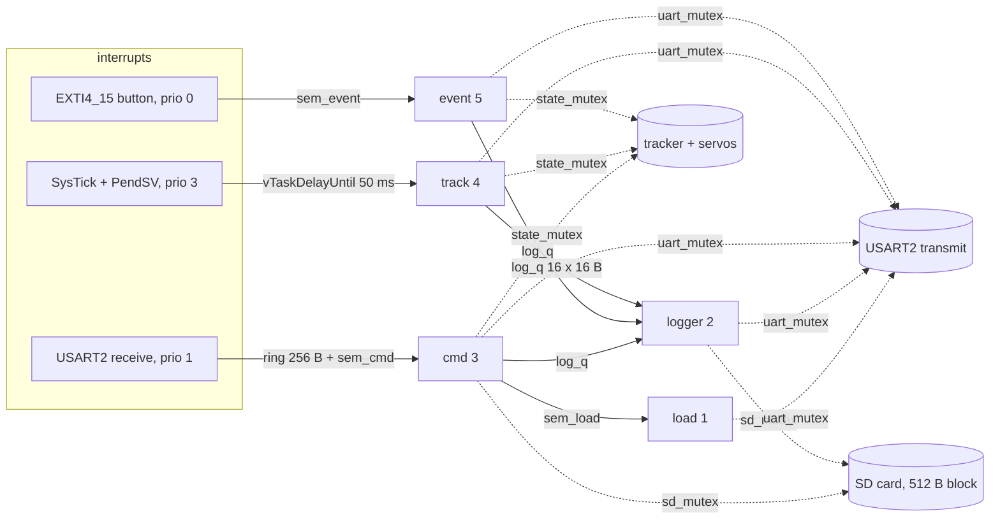

# RTOS design

The FreeRTOS firmware implements the same product as the LR3 super loop: same functional
requirements (FR-01 to FR-08), same command interface, same `STAT`/`EVT`/`CMD` line formats, same
measurement code. This document explains how the work is divided into tasks and why. The
measurements that justify the choices are in [comparison.md](comparison.md); the requirements and
deadlines are in [tasks.md](tasks.md); the limits of the loop that this design answers are in
[limitations.md](limitations.md).

## 1. Kernel and configuration

| Item | Value |
|---|---|
| Kernel | FreeRTOS-Kernel **V11.1.0**, commit `dbf70559b27d39c1fdb68dfb9a32140b6a6777a0`, git submodule `firmware/Middlewares/FreeRTOS-Kernel` (pristine) |
| Port | `GCC/ARM_CM0` (the PDF names `ARM_CM4F`; the board's core is a Cortex-M0+, agreed with the instructor) |
| Kernel files built | `tasks.c` (as `rtos/kernel/tasks_lr4.c`, one change, see section 8), `queue.c`, `list.c`, `port.c`, `portasm.c`, `heap_1.c`. No timers, no event groups, no stream buffers |
| Heap | `heap_1`, 6144 B static array (`RTOS_HEAP_BYTES`). Nothing is created or deleted after start-up, so nothing is freed: used = total - free |
| Tick | 1000 Hz (`RTOS_TICK_HZ`); 100 Hz for scenario 7.2.6 |
| Core clock | 12 MHz, same as LR3 |
| Compiler | `arm-none-eabi-gcc` 10.3.1 in the project's Docker image, `-Os` for both firmwares |

Key `FreeRTOSConfig.h` parameters and why each differs from the usual default:

| Parameter | Value | Reason |
|---|---|---|
| `configUSE_PREEMPTION` | 1 | the reason for the lab: E1 must preempt a long operation |
| `configUSE_TIME_SLICING` | 1 | equal priorities share the CPU (visible in scenario 7.2.3) |
| `configUSE_PORT_OPTIMISED_TASK_SELECTION` | 0 | the Cortex-M0+ has no `CLZ` instruction; the generic ready-list scan is used (this is where the kernel change of section 8 lives) |
| `configMAX_PRIORITIES` | 6 | priorities 0..5: idle, load, logger, cmd, track, event |
| `configMINIMAL_STACK_SIZE` | 64 words | idle task stack 256 B (measured peak 84 B) |
| `configUSE_TASK_NOTIFICATIONS` | 0 | the PDF suggests notifications; binary semaphores were used instead because the flash margin is 524 B. The notification code is not linked |
| `configUSE_COUNTING_SEMAPHORES`, `configUSE_RECURSIVE_MUTEXES`, `configUSE_TIMERS` | 0 | not needed; each would add code to a 32 KB part |
| `configUSE_TRACE_FACILITY`, `configUSE_STATS_FORMATTING_FUNCTIONS` | 0 | per-task numbers come from `ulTaskGetRunTimeCounter()` and `uxTaskGetStackHighWaterMark()` through a table of handles in `rtos_app.c`; the formatting functions cost flash |
| `configGENERATE_RUN_TIME_STATS` | 1 | counter `plat_time_cycles() >> 4` (units of 16 cycles = 1.33 us, wraps after 95 min). The Cortex-M0+ has no DWT; one read costs 88 cycles |
| `configCHECK_FOR_STACK_OVERFLOW` | 2 (`RTOS_STACK_CHECK`) | pattern check at every context switch; the hook prints through a register-level UART write (section 7) |
| `configUSE_MALLOC_FAILED_HOOK` | 1 (`RTOS_MALLOC_HOOK`) | names the cause when the heap is too small |
| `configASSERT` | `rtos_assert(__LINE__)` | prints `FATAL assert line=N` and halts |
| `INCLUDE_vTaskSuspend` | 0 | saves flash; `portMAX_DELAY` then means 2^32 ticks (49 days) |
| `traceTASK_SWITCHED_IN` | `rtos_trace_switched_in()` | counts switches and drives the busy pin PB6 (high unless the idle task runs) for the analyzer |
| `SysTick_Handler` | `xPortSysTickHandler` (kernel files only) | the CM0 port defines its own handler; the project handler calls `HAL_IncTick()` first, then `rtos_systick()` |

**Time base.** The HAL tick stays on SysTick. The kernel tick comes from the same interrupt: the
project's `SysTick_Handler` calls `HAL_IncTick()` and then, once the scheduler runs,
`xPortSysTickHandler()`. `plat_time_cycles()` (the LR3 32-bit cycle counter built from `uwTick`
and the SysTick value) therefore keeps working unchanged at 1000 Hz. At 100 Hz `uwTick` counts
10 ms ticks and `HAL_GetTick()` time-outs become ten times longer; the counter itself stays
correct because it is built from the SysTick reload value.

## 2. Tasks

| Task | Prio | Wakes on | Requirement (tasks.md) | Stack allocated | Static bound* | Peak measured |
|---|---|---|---|---|---|---|
| `event` | 5 | semaphore given by the EXTI handler; also every 8 ms (watchdog, section 8) | E1: edge to servo update <= 10 ms | 640 B | 512 B | 428 B |
| `track` | 4 | `vTaskDelayUntil`, 50 ms | T1 <= 5 ms, T2 start late <= 25 ms, T3 park, produces T5 records | 640 B | 560 B | 256 B |
| `cmd` | 3 | semaphore given by the USART2 receive handler | T4: reply <= 100 ms, no byte lost | 1024 B | 800 B | 780 B |
| `logger` | 2 | queue `log_q`, 100 ms time-out | T5: block written <= 10 s after the first record | 512 B | 432 B | 400 B |
| `load` | 1 | semaphore given by the `load` command; 5 ms pass | measurement tool: stands for "new work of the lowest priority" | 768 B | 624 B | 604 B |
| idle | 0 | kernel | - | 256 B | - | 84 B |

\* static worst call chain from the machine code (frames; `tools/lr4_taskstack.py`, gcc 10.3.1 of the project's
Docker image, the final ELF; output in `docs/metrics/lr4/rtos-final/taskstack.txt`) plus 72 B for the exception frame and the PendSV register save. Calls through a
function pointer (`blx`) are given the edges of the hook table by hand; the log-drain fix made the
SD write chain reachable from `event`, `track` and `logger`, which raised their bounds (512, 560, 432 B)
and left a margin of 128, 80 and 80 B to the allocation. The sandbox compiler (gcc 13.2.1) gave 8 to 56 B more
(528, 576, 808, 488, 632 B); no bound is below a measured peak. Measured peaks come from `uxTaskGetStackHighWaterMark`
after the heaviest paths (`selftest`, `sd`, `log`, `stats`, the 300 ms starvation window of
scenario 7.2.3, where `cmd` reached 780 B). Allocated stacks total 3840 B, the sum of the peaks is
2552 B (66 %). T6 (the self-test) runs in `main()` before the scheduler starts. T1 is a part of
the `track` job.

### Why these priorities

The rule is deadline-monotonic: the shorter the deadline, the higher the priority; long work goes
lowest.

* **`event` (5).** E1 is the only requirement that arrives at an unpredictable moment and the only
  one that the loop failed in a normal situation (18.5 ms against 10 ms during an SD write). Its
  handler is short (0.15 to 0.18 ms), so it can sit above the periodic task without hurting it.
* **`track` (4).** A strictly periodic job. Its deadline (start no later than 25 ms after the
  nominal release) is the next shortest; its CPU time is about 1 ms every 50 ms.
* **`cmd` (3).** A person is waiting, but the limit is 100 ms. It also drains the receive ring, so
  it must preempt the long, low-priority work or the 256-byte ring overflows (limit 4 of LR3).
* **`logger` (2).** The SD block write takes 13.4 ms of polled SPI; the record can wait up to 10 s.
  Everything above it preempts it. This is the "long operation C" of the PDF's example.
* **`load` (1).** The synthetic work of the `load` command: at the lowest working priority, as the
  PDF recommends for long non-critical operations.

**Known weakness of this assignment.** Deadline-monotonic ordering would place T1 (5 ms) above E1
(10 ms), but T1 is a part of the `track` job and the job as a whole has a 25 ms deadline. In the
current code `event` also prints the `EVT stow` line itself: with the polled UART at 86.7 us per
byte that print takes about 3.3 ms at priority 5, during which `track` cannot run (analyzer record,
[comparison.md](comparison.md) section 4). The cost shows as T1 up to 3.1 ms in S3 and, in
three other runs (e1-idle on ELF 76905721e8a1, two S3 runs at 100 Hz), 5.2, 5.3 and 5.5 ms against
the 5 ms deadline. The fix is to hand the print to `cmd` or
`logger` through the queue; it was not made because it changes the measured firmware.

## 3. Interaction



| From | To | Mechanism | What travels |
|---|---|---|---|
| EXTI handler | `event` | binary semaphore | the fact of an event; the edge count and the time stamp of the first edge stay in the platform layer (`plat_button_take`), because the reaction time must be counted from the edge, not from the wake-up |
| USART2 handler | `cmd` | binary semaphore (+ the LR3 ring, 256 B) | wake-up on CR/LF, when the ring holds 128 bytes, and after an error; `cmd` drains the ring. A stream buffer was not used: the ring is already tested on the host and costs no kernel code |
| tick | `track` | `vTaskDelayUntil` | strict 50 ms period; the nominal time is a grid anchored at the first release, periods lost to a long delay are skipped and counted (`missed`), as in LR3 |
| `track`, `event`, `cmd` | `logger` | queue, 16 x 16 B, copy | log records; a full queue drops the record and counts it (`log_dropped`) |
| `cmd` | `load` | binary semaphore | start of a `load` window |
| `event`, `track`, `cmd` | tracker and servos | `state_mutex` (priority inheritance) | `stow`, `zero`, `deadband`, `resume` and the tracking update never interleave |
| `logger`, `cmd` | SD card and the shared 512-byte block | `sd_mutex` | `sd`, `log`, `selftest` commands and the block flush |
| every task | USART2 transmit | `uart_mutex` | one `say()` line at a time; a long print (`stats`) is not atomic as a whole and can be interleaved line by line with an `EVT` line |
| tasks | small counters and the clock | critical section (PRIMASK) | `clock_sync`, run-time counter reads; all interrupts are masked inside |

The interrupt handlers only record the event and call `xSemaphoreGiveFromISR`; all work happens in
tasks. Data between tasks travels through the queue (a copy) or under a mutex with the
priority-inheritance of the kernel. Mutex waits that matter use `portMAX_DELAY`; the event task
uses a time-out (section 8).

## 4. Rules for interrupts on the Cortex-M0+

* The M0+ has no `BASEPRI` and no priority grouping. The CM0 port masks interrupts with `PRIMASK`,
  so a kernel critical section blocks **every** interrupt, including the button handler at priority
  0, and there is no `configMAX_SYSCALL_INTERRUPT_PRIORITY`: `FromISR` functions may be called at any
  level. The longest kernel critical section was not measured; the measured edge-to-task start is
  0.144 to 0.175 ms.
* Priorities: EXTI4_15 0, USART2 1 (unchanged from LR3), SysTick and PendSV 3 (lowest, set by the
  port). The handlers of LR3 keep their code; only the notification callbacks were added
  (`plat_button_set_notify`, `plat_uart_set_rx_notify`), so the `platform` layer does not include
  any kernel header (checked by `scripts/check_deps.sh`).
* The button callback gives the semaphore only on the 0 -> 1 transition of the edge counter. The
  Wokwi button bounces (52 to 146 edges per press), so one press makes one or a few wake-ups.

## 5. Memory

Flash and RAM contributions come from the map file (`tools/lr4_footprint.py`); the figures below are
from `arm-none-eabi-gcc` 13.2.1 at `-Os`, the Docker compiler (10.3.1) adds about 100 B
(`firmware.bin` 32,244 B, margin 524 B of 32,768).

| Part | Flash, B | Static RAM, B |
|---|---|---|
| kernel (`tasks_lr4.o` 2684, `queue.o` 1684, `port.o` 512, `portasm.o` 166, `list.o` 104, `heap_1.o` 146) | 5,296 | 6,400 (heap array 6,152) |
| RTOS layer `rtos_app.o` | 2,086 | 184 |

Heap (6,144 B, `CMD heap`): after start 5,040 B used, 1,104 B free. Composition: task stacks
3,840 B (including idle), 6 task control blocks about 430 B, queue storage and header 328 B, three
mutexes and three semaphores about 430 B. Static RAM total 9,232 B plus the 1,536 B linker reserve
(heap 512 B, main stack 1,024 B): 10,768 of 12,288 B (87.6 %). The main (interrupt) stack peaks
at 456 to 464 B.

## 6. OS metrics at run time

The commands `tasks` and `heap` print in the usual line style:

```
STAT task name=cmd prio=3 run_us=4550 cpu_pm=3 stack=1024 peak=640
STAT os tick_hz=1000 ticks=1207 switches=277 log_dropped=0
CMD heap OK total=6144 free=1104 used=5040
```

`stats reset` and `load` restart the counters. The kernel charges the time from reset to the first
task switch to the first task, so every scenario resets first. Costs measured with the bench build
(`-DRTOS_BENCH=1`, command `ctx`): one-way context switch (give in `cmd` to the first instruction
after the take in `event`) 1,041 cycles = 86.8 us minimum, 90 us average; the tick interrupt body
140 cycles = 11.7 us on average, 429 cycles = 36 us at most, about 1.4 % of the CPU at 1 kHz
(0.14 % at 100 Hz).

## 7. Fault paths

* `configASSERT`, the stack-overflow hook and the malloc-failed hook print through
  `plat_uart_panic_write()`, which writes `USART2->TDR` after `TXE` with a bounded spin and does
  not touch the HAL. The HAL transmit function returns `HAL_BUSY` when the task it interrupted was
  inside its own transmission, so a hook built on it stays silent (problem log of the report).
* The stack check (method 2) runs at a context switch, so it detects an overflow after the damage;
  it is a last resort, not protection. With the check off, an overflowing `load` task overwrote the
  run-time counter of the neighbouring `logger` control block (`run_us=202115052`).
* With `heap_1` the stack of a task and its control block sit next to each other in the pool, in
  creation order; overflow of one stack corrupts the next control block.

## 8. Kernel defects found and how they are handled

1. **Stale `uxTopReadyPriority`.** The CM0 generic task selection walks down from this variable. If
   the button handler makes the event task ready while a context switch is in its selection loop, the
   switch writes back its old value and the event task stays in its ready list, invisible, until
   something else raises the variable. Symptom: 4 of 40 presses accepted. Change in
   `taskSELECT_HIGHEST_PRIORITY_TASK`: start the search at `configMAX_PRIORITIES - 1`. The patched copy
   is `firmware/rtos/kernel/tasks_lr4.c` (diff `tasks.c.patch`); `build_rtos.mk` compiles the copy and
   the submodule stays pristine. Why the interrupt can write inside the switch is not proven; on a real
   core PendSV runs with interrupts masked, so a simulator artefact is the main suspect.
2. **Lost wake-up with a token present.** After change 1 the diagnostic build (`RTOS_DIAG`) showed the
   event task blocked while its semaphore held a token and 2,697 edges were pending. The
   edge counter notifies only on 0 -> 1, so one lost notification silences every later press. Handling:
   the event task waits at most `RTOS_EVENT_WATCHDOG_MS` = 8 ms, then reads the edge counter anyway. A
   lost wake-up costs at most 8 ms (E1 deadline 10 ms) and no press is lost. Cost: 125 wake-ups per
   second, about +28..30 per mille of CPU load (e1-idle 47 -> 75, S2 44 -> 73, S3 72 -> 102) and up to
   0.25 ms more start jitter of the periodic task (S2 late max 92 -> 336 us). On the final ELF the
   presses of S2, S3 and e1-idle were all accepted (4 + 30 + 40). `RTOS_EVENT_WATCHDOG_MS=0` builds the
   version that waits forever, used to reproduce the defect.

## 9. Layering

`firmware/rtos/{inc,src}` is a new layer: it may include `rtos`, `app`, `devices` and `platform`
headers and the kernel include directory, nothing else; `platform/src` may not include `rtos` or
kernel headers (`scripts/check_deps.sh`). The application layer knows no kernel: it calls an
`app_os_t` table of hooks (lock, unlock, log put, drain, load start, stats reset, busy cycles,
extra commands) that is empty in the loop build and filled by `rtos_start()`. The service entry
points `app_service_button`, `app_service_track`, `app_service_log`, `app_service_load` are the former
loop steps; host tests (703 checks in `test_app.c`) cover them.

## 10. Build knobs

`make build-rtos` builds the production firmware. Variants for the experiments each need their own
`BUILD_DIR`: `RTOS_TICK_HZ`, `RTOS_HEAP_BYTES`, `RTOS_STACK_CHECK`, `RTOS_MALLOC_HOOK`,
`RTOS_WORDS_LOAD`, `RTOS_EVENT_WATCHDOG_MS`, `RTOS_INV`, `RTOS_STARVE`, `RTOS_QFLOOD`, `RTOS_DIAG`,
`RTOS_BENCH` (passed through `RTOS_DEFS`). The commands are in
[baseline-lab4.md](baseline-lab4.md); the scenario files are `scenarios/os-*.yaml`, run with
`tools/lr4_os.sh`.

## 11. Open design questions

* Move the `EVT` print out of the highest-priority task (see section 2).
* Split T1 from the `track` job so that its own 5 ms deadline can get a priority of its own.
* Trim the stacks (sum of peaks 66 % of the allocation) and the heap pool (1,104 B free) to win RAM;
  the flash margin (524 B) is the tighter constraint.